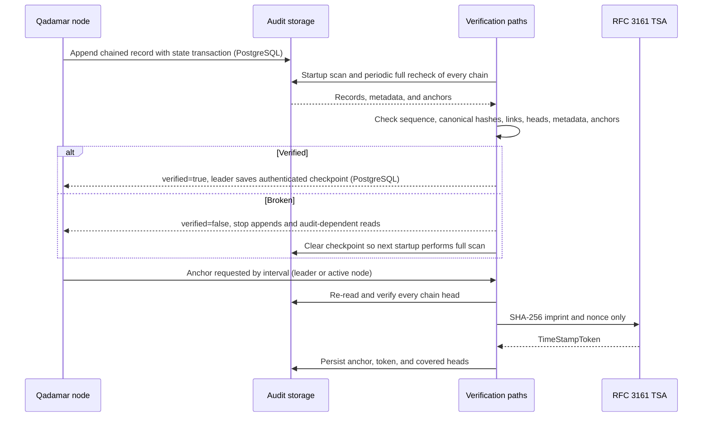

# Audit and evidence

Qadamar appends metadata-only events to SHA-256 hash chains, one per node in PostgreSQL mode, and can anchor the chain heads with an RFC 3161 timestamp authority. Verification detects unauthorized changes covered by a chain or a retained anchor. SIEM export, signed evidence packs, and encrypted backups let auditors preserve and check evidence outside Qadamar's own storage. This page describes the code at commit b09bc44 (after 0.3.0).

## On this page

- [Audit record and hash chain](#audit-record-and-hash-chain)
- [Verification lifecycle](#verification-lifecycle)
- [RFC 3161 anchoring](#rfc-3161-anchoring)
- [Tamper scenarios and detection](#tamper-scenarios-and-detection)
- [SIEM export](#siem-export)
- [Evidence export and offline verification](#evidence-export-and-offline-verification)
- [Personal data in evidence](#personal-data-in-evidence)
- [Encrypted backups as evidence custody](#encrypted-backups-as-evidence-custody)
- [Evidence limits](#evidence-limits)

## Audit record and hash chain

Each record has this logical shape (`packages/pdp-http/src/audit.ts`):

```json
{
  "node": "b",
  "seq": 42,
  "ts": "2026-11-10T12:00:00.000Z",
  "type": "decision",
  "actor": "pep",
  "action": "approve",
  "subject": "alice",
  "resource": "PAY-17",
  "effect": "deny",
  "rules": ["SOD.SELF_APPROVAL"],
  "policyVersion": "pv.<64 hex>",
  "details": {},
  "prevHash": "<previous record hash>",
  "hash": "<this record hash>"
}
```

For every record, remove `hash`, serialize the rest as canonical JSON with recursively sorted object keys, and compute:

```text
hash = SHA-256(prevHash || canonical(record without hash))
```

The first `prevHash` of each chain is 64 zero characters. Sequence numbers start at 1 and increase without reuse. Retention creates authenticated gaps: the first retained row follows the latest sealed head rather than the genesis. Optional fields stay absent when not applicable; the canonical encoding distinguishes absent fields from null (`packages/core/src/version.ts`, `packages/pdp-http/src/audit.ts`).

### Node chains

In PostgreSQL mode each node appends only to its own chain, named by `GATE_NODE_ID` (default `0`), in the same transaction as the changes of its requests (`packages/pdp-http/src/postgres.ts`, `postgres-chains.ts`):

- `node` is part of the hashed record. Records of chain `"0"` have no `node` field, so a single node, and every row written before chains were per node, keeps the earlier record format.
- `seq` is per chain. The table key is `(node, seq)`.
- Upgrading an earlier database keeps its rows untouched as chain `"0"`. A node with the default `GATE_NODE_ID` continues that chain.
- A second process started with the same `GATE_NODE_ID` waits for the first (`NODE_LOCK`), so no chain has two writers.

File mode has one chain and no `node` field.

Decision rows include a per-subject HMAC pseudonym, resource ID, action, effect, rule IDs, and policy version. The raw subject id and its independent random HMAC key are held only in `audit-subjects.json` or `gate_subject_identity`. Administrative, session, break-glass, and security rows use the same envelope. The audit does not intentionally store passwords, bearer credentials, decision tokens, session IDs, recovery codes, business-record content, or new raw subject ids. Treat pseudonyms, legacy ids, actors, reasons in change state, and details as sensitive operational metadata.

### Storage-specific integrity checks

- **File mode:** `audit.jsonl` must be newline-terminated valid NDJSON. With `SIGNING_KEY_SEAL`, `audit-checkpoint.json` authenticates the verified head after every append with the same HKDF-derived key as PostgreSQL. Startup and `/audit/verify` check every retained record, seal, anchor, and the checkpoint HMAC; a self-consistent full rewrite therefore fails too. A missing or unreadable checkpoint for a non-empty chain fails stop and is never re-minted; an older chain that never had one migrates once with `AUDIT_CHECKPOINT_MIGRATE=<reviewed head hash>` (audited `checkpoint_migrated`). A crash between the append and the checkpoint rename is completed at the next start only for exactly one trailing row that chains from the authenticated head (audited `checkpoint_completed`). Before append, Qadamar also compares the file fingerprint; truncation or replacement of the known head fails. Demo without a seal has no keyed checkpoint, so only an external anchor or copy detects a full rewrite.
- **PostgreSQL:** `gate_audit` is the source of truth. `gate_audit_meta` contains replaceable filter metadata checked against every chained row during scans and whenever a row is listed. Only pending rows, chain heads, and fixed counters stay in memory (`packages/pdp-http/src/postgres.ts`).

After detected tampering, Qadamar refuses new audit appends. PostgreSQL audit listings, scoped counts, and compliance evidence return 503, so normal operations do not proceed over an untrusted log (`packages/pdp-http/src/postgres.ts`).

## Verification lifecycle



*Figure 1. Verification precedes anchoring, and an integrity failure blocks further appends rather than hiding the problem.*

Verification runs at these times:

| Trigger | Behavior |
| --- | --- |
| Process startup or standby takeover | PostgreSQL, every profile: from a valid authenticated checkpoint (every chain in full without one), then immediately a full background recheck; `/readyz` `audit.fullChain` and `gate_audit_full_chain_verified` show it (`packages/pdp-http/src/server.ts`). |
| Periodic PostgreSQL recheck | Every five minutes by default, on every node. Three consecutive recheck failures stop the node (`packages/pdp-http/src/postgres.ts`). |
| `GET /admin/v1/audit/verify` | File mode verifies now. PostgreSQL starts at most one shared recheck per 60 seconds and returns `checkedAt` with the result. `length` counts every chain; on failure, `brokenAt` is the seq and `node` names the chain when it is not `"0"` (`packages/pdp-http/src/admin/audit.ts`, `packages/pdp-http/src/postgres.ts`). |
| `GET /readyz` | Commits pending work and requires the latest recheck plus current verify state to pass. The result is cached for five seconds; PostgreSQL recheck data can be up to 60 seconds old. In cluster mode the staleness check is read on each probe (`packages/pdp-http/src/metrics.ts`). |
| Anchoring | Verifies before sending. PostgreSQL anchors exactly the chain heads returned by a fresh recheck (`packages/pdp-http/src/server.ts`). |
| Overview and compliance | Report the last completed verification, not a newly forced full scan (`packages/pdp-http/src/admin/overview.ts`, `packages/pdp-http/src/admin/compliance.ts`). |

A recheck requires this node's chain to match the head it committed, and every other chain to extend the head it saw at the previous verification. A rewritten, removed, or truncated row in any chain is therefore caught, and `verify` names that chain.

A successful result proves internal consistency at the checked positions. It does not prove that every event was truthful, or that an attacker with total control of Qadamar and all external evidence could not rewrite history.

## RFC 3161 anchoring

When `TSA_URL` is configured, the active node (or the leader in cluster mode) anchors a moved head every `ANCHOR_INTERVAL` seconds (default 3600, minimum 60). It commits pending work, verifies, and sends only a 32-byte SHA-256 imprint in a timestamp request with a random nonce (`packages/pdp-http/src/anchor.ts`, `packages/pdp-http/src/server.ts`).

What is anchored depends on the chains present (`postgres-chains.ts`, `auditPoint`):

- **Chain `"0"` only** (file mode, or one PostgreSQL node with the default id): the anchor is `{seq, hash}` of that chain's head, as before.
- **Several chains:** the anchor covers the set of chain heads. `heads` is `{<node>: {seq, hash}}` for every chain with rows, `seq` is the sum of the head seqs, and `hash` is SHA-256 of canonical `heads`. The TSA timestamps that hash. Verification recomputes it from `heads` and rejects an anchor row whose `heads` do not hash to its `hash`.

Qadamar accepts the TSA response only when:

- the TSA status is granted;
- the reply has no trailing bytes and stays within 64 KiB;
- the token uses SHA-256 and contains the requested imprint and nonce;
- its generation time is within ten minutes of the node's wall clock;
- redirects are not followed and the request completes within 15 seconds;
- when `TSA_CA_FILE` is set, `openssl ts -verify` validates the token and certificate chain.

The anchor stores `{seq, hash, tsa, genTime, token}`, plus `heads` for a multi-chain anchor, in `anchors.jsonl` or `gate_anchor`. `token` is base64 DER. Production requires HTTPS `TSA_URL` and `TSA_CA_FILE`; without the CA file in other profiles, signature verification is left to offline checking (`packages/pdp-http/src/profile.ts`).

If the TSA is unavailable, Qadamar keeps previous anchors, records `lastError`, logs the failure, and does not anchor an unverified or unchanged head. Decisions continue when the chains remain healthy. Monitor `gate_audit_last_anchor_age_seconds` and `GET /admin/v1/audit/anchors` rather than assuming anchoring succeeded.

## Tamper scenarios and detection

| Scenario | What detects it | Expected effect |
| --- | --- | --- |
| Edit an audit record without repairing its descendants | The record's recomputed hash differs; the next `prevHash` also differs | `verified=false` with `brokenAt` (and `node`); appends stop |
| Insert, remove, or reorder a row | Contiguous sequence and previous-link checks fail | Verification identifies the first inconsistent position in that chain |
| Truncate a previously observed tail | File head fingerprint, PostgreSQL committed head of this node, last-seen head of other chains, or an anchor beyond the new tail | Verification fails; no new anchor is created |
| Delete a whole chain | Expected heads and anchored heads still name the chain | Verification fails and names the chain |
| Rewrite an anchored row or head | Stored anchor hash no longer equals the row hash at that sequence | Verification fails even if a new self-consistent chain was built |
| Rewrite an anchor's `heads` | `heads` no longer hash to the anchored `hash` | Verification fails |
| Change only `gate_audit_meta` filters | Full recheck compares metadata with chained rows; listed rows are checked too | Tamper state and 503 for audit-dependent reads |
| Lose or corrupt derived metadata before startup | Startup rebuilds metadata from valid chained rows | Repair is logged and audited as `security` / `meta_repaired` when the chains are valid (`packages/pdp-http/src/postgres.ts`) |
| Forge or alter an audit checkpoint | HMAC verification with the seal-derived key fails | Startup refuses the store; a bad checkpoint is not silently trusted |
| Change a row before a valid checkpoint | Not necessarily read during checkpointed startup; the immediate full background recheck reads it | Detection during that first recheck (every profile since 0.5.0); then audited actions are refused and `/readyz` fails |
| TSA or SIEM endpoint is impersonated | HTTPS and, for TSA, configured CA validation; SIEM uses HTTPS plus HMAC | Delivery fails closed for that export; local chain remains available |
| Database owner rewrites every chain and deletes all anchors | Qadamar has no trusted head to compare against if no external evidence survives | **Not reliably detectable by Qadamar alone**; compare external TSA tokens, SIEM copies, and encrypted backups |
| Attacker controls Qadamar process, seal key, database owner, TSA trust store, and external copies | All verification material is under attacker control | Outside the product's detection boundary; use independent evidence custody |

Do not restore or delete audit rows to make verification green. Follow [Respond to an audit tamper alert](../operations/audit-tamper-response.md).

## Sealed retention

`AUDIT_RETENTION_DAYS` is off by default. When enabled with a seal, each expired contiguous prefix gets a segment record containing its canonical-row SHA-256, last head, count, time, and HMAC under the checkpoint key; a configured TSA anchors that head before deletion. A chained `security / audit_retention` event records the operation. `audit-segments.json` or `gate_audit_segment` preserves the seal. Verification checks segment continuity and HMACs, then verifies retained rows from the latest sealed head; old anchors within the sealed prefix are covered by the seal. Sequence numbers are not renumbered. PostgreSQL retention first requires the stored authenticated checkpoint and that every live chain extends it; otherwise it refuses before sealing, re-keying, clearing, or deleting anything, so a chain rehashed by a database owner cannot be laundered into a seal.

File mode retains at start and daily. PostgreSQL uses `scripts/ops/audit-retention.ts` as the table owner with every writer stopped, in one transaction. The service role never gets audit `DELETE`. Back up first: a seal proves the prefix digest and head, but without an external copy an auditor cannot inspect or recompute the removed rows themselves.

## SIEM export

Qadamar supports pull and push export of the actual chained records.

### Pull

`GET /admin/v1/audit/export?from=<position>&limit=<1..1000>` requires a security officer or auditor session (`packages/pdp-http/src/siem.ts`). It returns `application/x-ndjson`, one record per line, `limit` default 100, and the header `X-Audit-Next-From` to pass as the next `from`.

- `from` is inclusive and defaults to 1. While only chain `"0"` exists it is a plain `seq`, as before.
- With several chains it is a per-chain list, `from=<node>:<seq>,<node>:<seq>`. A chain not listed starts at 1.
- Rows come chain by chain, each chain in `seq` order, so no row is skipped while other nodes keep appending. An empty body means nothing newer yet.
- `until` (optional, same syntax, inclusive) is the last `seq` to export of each chain; chains it does not name are left out. For an offline check, pass the signed verification manifest's heads (`GET /admin/v1/audit/verification`): `scripts/audit/verify-export.ts` certifies rows only up to those heads and fails on any row after one, since a row past a signed head can be appended with recomputed hashes by anyone.
- Other or repeated parameters, or a malformed or repeated chain, return 400.
- PostgreSQL exports committed rows only.

### Push

Set `SIEM_WEBHOOK_URL` and `SIEM_HMAC_SECRET` together. The active node (or the leader in cluster mode) sends NDJSON batches over HTTPS with:

```text
X-SIEM-Timestamp: <unix seconds>
X-SIEM-Signature: sha256=<hex HMAC-SHA256(secret, timestamp + "." + rawBody)>
Content-Type: application/x-ndjson
```

The acknowledged position (one `seq` per chain) advances only after a 2xx response and is persisted before the next batch. Delivery is therefore **at least once**: a crash after receiver acknowledgement but before the position is persisted resends the batch. Deduplicate on `(node, seq)`, verify the HMAC in constant time, and enforce a receiver-side timestamp replay window (`packages/pdp-http/src/siem.ts`).

Retries use five attempts by default, a 10-second timeout, and exponential backoff from one second to 30 seconds. A batch that still fails is retried from the same position at the next `SIEM_INTERVAL_SECONDS` tick. Redirects are refused. SIEM delivery does not roll back Qadamar decisions; monitor export lag and receiver gaps.

## Evidence export and offline verification

### Audit evidence package

1. Export all audit pages and keep `X-Audit-Next-From` until an empty page is returned.
2. Export `GET /admin/v1/audit/anchors` as an auditor or security officer.
3. Keep the NDJSON byte stream, anchors, and any SIEM copy in independent storage.
4. For each chain, recompute each record's canonical hash, sequence, and link from the genesis.
5. For each anchor, check its `heads` (if present) hash to its `hash`, that each head matches the record at that chain and seq, and verify the token's imprint.

For a DER token saved as `token.der`, with its anchored hash and CA bundle:

```bash
openssl ts -verify -digest <anchored-hash-hex> \
  -in token.der -token_in -CAfile tsa-ca.pem
```

The `OPENSSL` environment variable selects the executable Qadamar uses for online verification. Successful OpenSSL output includes `Verification: OK` (`packages/pdp-http/src/anchor.ts`).

### Evidence packs

`GET /admin/v1/compliance/evidence?framework=<id>` (security officer or auditor) returns `{pack, manifest, signature}` built from live data (`packages/pdp-http/src/admin/evidence.ts`):

- `framework` is one of `iso27001`, `iso27017`, `iso27018`, `iso27701`, `iso42001`, `iec62443-4-1`, `iec62443-4-2`, `soc2`. Other or repeated parameters return 400.
- `pack` holds sections such as configuration baseline, time, policy, audit, access reviews, approvals, break-glass, keys, security events, and CI references. `pack.framework.controls` names, per control, the sections that hold its live evidence. Audit-derived lists keep the newest 1,000 rows across every chain, with `complete: false` when older rows were left out.
- `manifest` is `{format, framework, generatedAt, packSha256, sections: {<name>: sha256(canonical(section))}, verify}`.
- `signature` is a detached EdDSA JWS over canonical `manifest`, signed by the decision-token keyring. Verify it with the `kid`-selected key from `GET /.well-known/jwks.json`.
- Each export is audited as `security` / `evidence_export` with the framework, `packSha256`, and whether it was pseudonymised.

A pack is evidence an auditor can test. It is not a certification, an attestation, or a statement of compliance.

### Signed compliance summary

`GET /admin/v1/compliance/export` (security officer or auditor) returns `{pack, signature}`. The pack maps product rule IDs to evidence counts for NIST SP 800-53 Rev. 5 and ISO/IEC 27001:2022 Annex A controls; the UAE Information Assurance entry has no mapped controls (`packages/pdp-http/src/admin/compliance-map.ts`). `signature` is an Ed25519 detached compact JWS over canonical `pack`.

Preserve the JWKS used at export: a rotated verification key leaves the live JWKS after 300 seconds (`packages/pdp-http/src/tokens.ts`).

Policy publications use the same detached-JWS mechanism over canonical bundle JSON. Their version is recomputable as `pv.` plus SHA-256 of that canonical JSON (`packages/pdp-http/src/policy-signature.ts`, `packages/core/src/version.ts`).

## Personal data in evidence

- **Pseudonymised exports.** `pseudonymise=1` on `GET /admin/v1/audit/export` and on the evidence pack replaces person IDs (subject, actor, and the `openedBy`, `makerId`, `checkerId`, `subjectIds` details) with `ps.<32 hex>`, an HMAC-SHA256 under a key derived from `SIGNING_KEY_SEAL` with HKDF label `qadamar/audit-pseudonym/hmac-sha256/v1`. Service actors (`pep`, `pep:…`, `system`, `unknown`, `scim`, `bootstrap`) stay readable. Equal IDs keep equal pseudonyms under one key, so maker/checker separation stays checkable. Without `SIGNING_KEY_SEAL` the key is random per process. Each pseudonymised row carries `pseudonymised: true` and no longer hashes to its `hash`: verify the chain on the server with `GET /admin/v1/audit/verify` (`packages/pdp-http/src/admin/privacy.ts`).
- **Subject access and erasure.** `GET /admin/v1/privacy/subjects/:id` (security officer) returns the model and newest 1,000 audit rows resolvable to one id. `POST /admin/v1/privacy/subjects/:id/erasure` proposes an `erase_subject` change; a second security officer's approval deletes the separate raw-id/per-subject-key mapping and atomically appends `security / subject_erased` carrying the pseudonym, the change id, and the approver's pseudonym. Self-erasure, open break-glass access, and pending reviews of the subject are refused. Chain hashes do not change. Raw-id filters no longer find those pseudonymous rows, but an auditor can still verify the chain, correlate equal pseudonyms, and prove that an erasure event occurred. They cannot recover the erased id from the pseudonym without another copy. New rows pseudonymise human actors and the person-id details too, so erasure covers them; technical actors (`pep`, `system`, `scim`, ...) stay readable, and the console resolves pseudonyms to names only while the mapping exists. Legacy raw-id rows, earlier exports and SIEM copies, and backups are outside this operation; new activity creates a fresh mapping. Existing `ps.` subjects pass through `pseudonymise=1` unchanged rather than being pseudonymised twice.

## Encrypted backups as evidence custody

`scripts/ops/backup.sh` dumps all eighteen `gate_*` tables and encrypts the archive with `scripts/ops/archive-crypt.ts`: AES-256-GCM, streaming, under `BACKUP_ENCRYPTION_KEY` (32 bytes as 64 hex characters or unpadded base64url). The format is `GATEBK`, a version byte, and a 12-byte random nonce (this header is the GCM additional data), then the ciphertext and a 16-byte tag. `restore.sh` refuses an archive that does not authenticate under the key, and a decrypted output file that survives is authentic (`scripts/ops/archive-crypt.ts`).

A backup holds every chain, anchor, and checkpoint at the time of the dump. Keep archives, and the key, apart from the database: a copy the database owner cannot rewrite is what makes a full rewrite detectable. See [Back up and restore](../operations/backup-restore.md).

## Evidence limits

- Hash chaining provides tamper evidence, not truth, non-repudiation of the original caller, or external certification.
- TSA tokens bind a hash to a time. They do not validate the decision or business data behind that hash.
- Anchors are periodic. Evidence between the last anchor and an incident relies on the chains and independent exports until a later anchor is obtained.
- The audit records Qadamar's decision and token-consumption events, not proof that the protected application committed its business write.
- Traces and metrics are operational telemetry, not substitutes for audit records. OTLP spans omit subject and resource IDs (`packages/pdp-http/src/tracing.ts`).
- External evidence custody is essential against a database owner who can rewrite chains and anchors. Qadamar does not copy evidence off-site beyond the configured SIEM webhook; backup archives are encrypted but storing them off-site is a deployment task.

## Related pages

- [Data and storage](data-and-storage.md)
- [Security architecture](security-architecture.md)
- [Integration](integration.md)
- [ADR 0004: Hash-chained audit with RFC 3161](decisions/0004-hash-chain-rfc3161.md)
- [ADR 0011: Cluster mode](decisions/0011-cluster-mode.md)
- [Respond to an audit tamper alert](../operations/audit-tamper-response.md)
- [Monitoring and alerts](../operations/monitoring.md)
