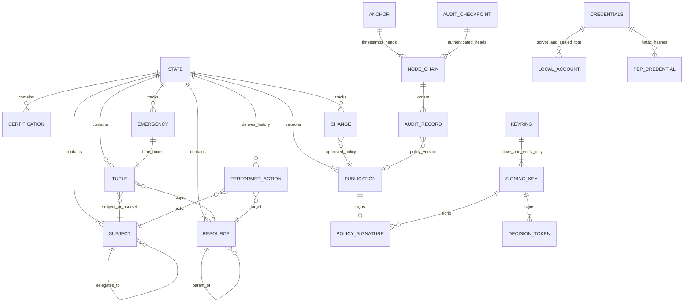
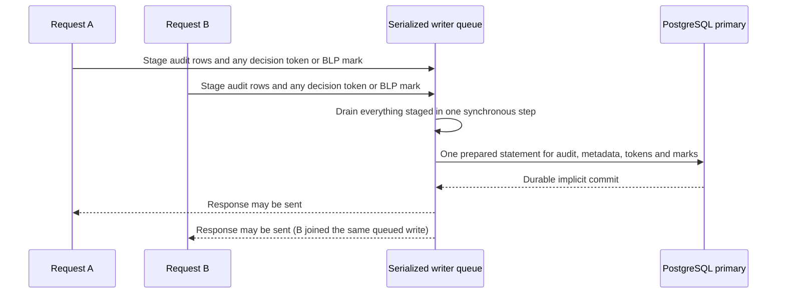

# Data and storage

Qadamar stores policy/workflow metadata, individual world records, security material, decision-token state, performed actions, and evidence. File mode writes local JSON and NDJSON for demonstrations. PostgreSQL mode stores named metadata documents, subject/resource/tuple rows and append-only tables with serialized group commits, one state writer, and one hash chain per node. Followers apply record deltas and retain the same in-memory decision structures.

## On this page

- [Conceptual data model](#conceptual-data-model)
- [Map objects to storage](#map-objects-to-storage)
- [Compare file mode and PostgreSQL](#compare-file-mode-and-postgresql)
- [PostgreSQL tables, roles, and RLS](#postgresql-tables-roles-and-rls)
- [Transactions and group commit](#transactions-and-group-commit)
- [Leader lock and checkpoint](#leader-lock-and-checkpoint)
- [Consistency guarantees](#consistency-guarantees)
- [Retention and scaling limits](#retention-and-scaling-limits)

## Conceptual data model

The diagram shows logical records, not one-table-per-entity physical storage. `STATE` is the `Disk.state` structure; most child collections are embedded in it (`packages/pdp-http/src/store.ts`).

*Figure 1. Logical state, workflow, security, and evidence entities; embedded collections are normalized only where the implementation does so.*

Important record contents are:

- **State:** bundle, subjects, resources, stored tuples, and optional append-only certifications.
- **Subject:** roles, optional time-bounded `roleAssignments` (`{ role, notBefore?, notAfter? }`, kept inside the record body), clearance, compartments, integrity, and attributes.
- **Tuple:** object, relation, subject or userset, validity bounds (`notBefore`/`notAfter`; older records may carry `validFrom`/`validTo`), break-glass marker, grantor, and reason.
- **Change:** maker, checker, reason, status, impact, broadening flag, mandatory-weakening report, and state digest. SCIM proposals also record credential origin and fingerprint.
- **Emergency:** time-bounded tuple reference, opener, review/revocation state, outcome, and expiry-notification marker.
- **Publication:** policy version, publication actors and time, reason, and optional Ed25519 signature.
- **Performed action:** certified-action subject, resource, action, time, and the people acted for.
- **Audit record:** optional `node`, per-chain sequence, timestamp, type, actor, action, optional IDs/effect/rules/policy version/details, previous hash, and hash. Records of chain `"0"` carry no `node` field.
- **Anchor:** audit sequence and hash, TSA URL, generation time, base64 DER timestamp token, and, when several chains exist, the chain heads it covers (`heads`).
- **Credentials:** local accounts with scrypt hashes (N=2^16, cost stored per hash) and PEP credentials with HMAC-SHA256 hashes; active TOTP secrets are sealed and recovery codes are hashed. A PEP credential can carry `subjectTypes` (Clark-Wilson E3 binding) and `contextScopes` (allowed context claims, value constraints and public attester keys).
- **Keyring:** Ed25519 public keys and active private keys, sealed when `SIGNING_KEY_SEAL` is configured.
- **Decision token:** claims (`jti`, `exp`, and the binding), the request context, and a used flag.

Source definitions: `packages/pdp-http/src/store.ts`, `audit.ts`, `auth.ts`, `tokens.ts`, and `postgres.ts`.

## Map objects to storage

| Logical object | File mode | PostgreSQL mode |
| --- | --- | --- |
| Policy, changes, emergencies, publications | `DATA_DIR/state.json` | `gate_doc` row `state` (metadata only) |
| Subjects, resources, tuples | In `state.json` | `gate_subject`, `gate_resource`, `gate_tuple`, one row per record; ordered for state-digest compatibility |
| Incremental record changes | Not used | `gate_state_change`, append-only rows addressed by dense `gate_sync.records` generations |
| Performed actions | In `state.json` | `gate_performed` rows; actions stored in the `state` document by an earlier version stay there |
| Issued decision tokens | `tokens.json` | `gate_token` rows. Unexpired tokens in an earlier version's `tokens` document are imported by the leader at start |
| Local accounts and PEP credentials | `credentials.json` | `gate_doc` row `credentials` |
| Open PDP sessions | `blp-sessions.json` | `gate_blp_session` rows; bearer tokens are not stored |
| PDP session revocation tombstones | `blp-revocations.json` | `gate_doc` row `blp_revocations`, also in the signed replica feed |
| BLP high-water marks | `sessions.json` | `gate_blp_mark` rows |
| Console login lockouts | `lockouts.json` | `gate_doc` row `lockouts` |
| Decision-token and policy signing keyring | `signing-keys.json`; active public PEM also written | `gate_doc` row `signing_keys`; use JWKS |
| SCIM credential | `scim-credential.json` | `gate_doc` row `scim` |
| SIEM acknowledged position | `siem-cursor.json` | `gate_doc` row `siem` |
| Approval modes and per-user snoozes | `approval-prefs.json` | `gate_doc` row `approval_prefs`; not in the replica feed (replicas forward the admin plane) |
| Audit checkpoint | Not used | `gate_doc` row `audit_checkpoint` |
| Hash-chained audit | `audit.jsonl` (one chain) | `gate_audit`, one chain per `node`, with derived `gate_audit_meta` |
| RFC 3161 anchors | `anchors.jsonl` | `gate_anchor` |
| Document version, record generation, positions, performed-action counter, leader address | Not used | `gate_sync`, one row (`id = 1`) |
| First-start clear bootstrap secrets | `INITIAL-CREDENTIALS.txt`, deleted on first sign-in or TTL | Same local file on the seeding node; not a shared database row |

On the first PostgreSQL start without a `credentials` document, Qadamar imports available credential, keyring, lockout, SCIM, and SIEM files from that node's `DATA_DIR`. After that start commits, those files are no longer read or written (`packages/pdp-http/src/server.ts`). The state itself is loaded from `WORLD_DIR` only when the backing store has no state (`packages/pdp-http/src/store.ts`).

## Compare file mode and PostgreSQL

| Property | File mode | PostgreSQL mode |
| --- | --- | --- |
| Intended use | Demonstration and development | Required for production |
| Writers | One process | Each node writes its own audit chain; one node (active node, or leader in cluster mode) writes state metadata and records |
| State write | Synchronous temporary JSON file plus atomic rename | Changed metadata documents and record rows staged, then written in a database transaction |
| Audit write | Synchronous NDJSON append, mode 0600 | Batched insert with state, tokens, and performed actions in the same transaction |
| Audit read | Parses file for listings and full verification | Separate read-only connection; database listings and in-memory counters |
| Atomicity across state and audit | No cross-file transaction | One transaction for staged documents, record rows/log, audit rows, tokens, and performed actions |
| Failure behavior | Append refuses after detected integrity failure; no standby | Write or writer-connection failure makes the node fail-stop |
| Startup verification | Full chain | From the authenticated checkpoint in every profile (full chain without one), then every chain in full in the background |
| Session state | Memory only | Memory only, per node; not shared |
| Backup | Copy files consistently while stopped | `scripts/ops/backup.sh` and `restore.sh`, AES-256-GCM encrypted archives |

File-mode `Store.save()` replaces the state document atomically, but it does not make `state.json`, `audit.jsonl`, tokens, credentials, and anchors one transaction. Do not claim equivalent durability or recovery semantics (`packages/pdp-http/src/store.ts`, `packages/pdp-http/src/audit.ts`).

## PostgreSQL tables, roles, and RLS

The owner-run `SCHEMA` creates eighteen tables (`packages/pdp-http/src/postgres-schema.ts`):

| Table | Columns and write model |
| --- | --- |
| `gate_doc` | `name` primary key, `body` (JSON as text), `updated_at`. Replaceable documents. Only the active node or leader writes them. |
| `gate_audit` | `node` (default `'0'`), `seq` (`CHECK (seq > 0)`), `record` (the complete chained record as text). Primary key `(node, seq)`. Append-only. |
| `gate_audit_meta` | `node`, `seq`, `ts`, `type`, `effect`, `subject`, `resource`, `rules text[]`. Primary key `(node, seq)`. Derived filter metadata, repairable from `gate_audit`, with indexes on subject, resource, type, and a GIN index on rules. |
| `gate_anchor` | `seq` primary key, `hash`, `tsa`, `gen_time`, `token bytea`, `heads` (JSON text, null for an anchor of chain `"0"` alone). Append-only. |
| `gate_audit_segment` | `(node, seq)` primary key, `body`: HMAC-sealed removed-prefix digest and head, with any retention anchor. Append-only to the service; the owner re-keys seals on rotation. |
| `gate_subject_identity` | `pseudonym` primary key, unique `id` (JSON-encoded), per-subject HMAC `key`, `used_at` (last use; `NULL` for a world subject's mapping or one stored before the column, never purged) with the index `gate_subject_identity_used`. Erasable mapping, kept apart from the chained rows; a non-world id used only as a PEP decision subject and unused for 90 days loses it; actors (and person-id details) are never purged (docs/API.md §3.9.1). |
| `gate_sync` | One row, `id = 1`: `version` (metadata/record writes), `records` (dense record generation), per-kind positions, migration flag, `performed`, `leader`. |
| `gate_token` | `jti` primary key, `node` (issuing node), `body`, `exp` (indexed), `used`. In cluster mode the leader deletes rows expired for more than 60 seconds, once a minute; single-active mode does not delete them. |
| `gate_performed` | `seq` primary key (`CHECK (seq > 0)`), `node`, `body`, `ref`, `kind`. Numbered under the `gate_sync` row lock so every node reads them in commit order. Reservations and their outcomes (0.4.1) are separate rows; a unique index allows one outcome per reservation. Append-only. |
| `gate_session` | Console sessions (0.5.0): key is the SHA-256 of the session id (the id itself is never stored), user, method, created and last-use times on real time. Deleted at logout, back-channel logout and expiry. |
| `gate_blp_mark` | BLP high-water marks: hashed credential/subject scope (legacy demo ids have their own scopes), highest level read, created and last-use times. Expire after 15 min idle or 8 h; close does not clear them. |
| `gate_blp_session` | Open PDP-issued BLP sessions: PDP-chosen `sid`, credential, subject, signed claims, real-clock last use and expiry. Deleted at close, administrative revocation or expiry; the bearer token itself is not stored. Revocation tombstones are the separate `blp_revocations` document. |
| `gate_retired` | Resource ids a PEP retired (after 0.5.0): type, id, version and time of the retirement, writing node; append-only, outside the state document. Registering such an id again is always a two-person proposal (docs/API.md §2.2). The leader loads it when it starts or takes the lead. |
| `gate_subject` | `(type, id)` primary key, ordered position, state version and JSON body (role assignments included). One row per subject. |
| `gate_resource` | `(type, id)` primary key, ordered position, state version and JSON body. One row per resource. |
| `gate_tuple` | `id` primary key, ordered position, state version and JSON body; object and subject lookup indexes; derived text columns `not_before` (`notBefore ?? validFrom`) and `not_after` (`notAfter ?? validTo`) with the index `gate_tuple_not_after`. |
| `gate_state_change` | `(seq, kind, type, id)` primary key, document version, put/delete, position, optional body and `move` (a reorder: followers reload the position-ordered snapshot instead of replaying it). Append-only incremental synchronization log. |
| `gate_rate_limit` | SHA-256-hashed key, remaining tokens, database-clock timestamp and last lease. Mutable, disposable shared token buckets; rows idle for an hour are swept on later leases. |

Rows are JSON text, not `jsonb`, because `jsonb` refuses `\u0000` and lone surrogates that callers can send (`postgres-schema.ts`).

**Upgrade from an earlier schema.** `SCHEMA` adds the `node` column to `gate_audit` and `gate_audit_meta` with default `'0'`, so existing rows become chain `"0"` without rewriting a record. It changes their primary keys to `(node, seq)` and creates the newer tables. The newest marker is the index `gate_subject_identity_used` (created last, so a database at 0.11.0 or earlier is migrated); `SCHEMA` adds the `not_before` and `not_after` columns of `gate_tuple` and backfills them for existing rows, and adds `gate_subject_identity.used_at` as `NULL` for existing mappings (they are never purged). If older tables belong to another role, the owner runs `SCHEMA` and grants first. The first target start then imports a 0.6.0 whole-document state under `MIGRATE_LOCK`: records move to ordered rows and the `state` document keeps only metadata. The import is transactional, idempotent and preserves pending state digests (`postgres-records.ts`).

### Row-level security

All eighteen tables enable and force row-level security. The policies are:

| Table | Policies |
| --- | --- |
| `gate_doc` | `gate_doc_rw`: FOR ALL |
| `gate_audit` | `gate_audit_read`: FOR SELECT, `gate_audit_append`: FOR INSERT, `gate_audit_retention`: FOR DELETE (only table ownership grants that privilege, to the offline owner operation) |
| `gate_audit_meta` | `gate_audit_meta_rw`: FOR ALL |
| `gate_anchor` | `gate_anchor_read`: FOR SELECT, `gate_anchor_append`: FOR INSERT |
| `gate_audit_segment` | `gate_audit_segment_read`: FOR SELECT, `gate_audit_segment_append`: FOR INSERT, `gate_audit_segment_rekey`: FOR UPDATE (owner re-keying; read-only to the service) |
| `gate_subject_identity` | `gate_subject_identity_rw`: FOR ALL (read/write to the service because erasure is its purpose) |
| `gate_sync` | `gate_sync_rw`: FOR ALL |
| `gate_token` | `gate_token_rw`: FOR ALL |
| `gate_performed` | `gate_performed_read`: FOR SELECT, `gate_performed_append`: FOR INSERT |
| `gate_session`, `gate_blp_mark`, `gate_blp_session` | `<table>_rw`: FOR ALL |
| `gate_retired` | `gate_retired_read`: FOR SELECT, `gate_retired_append`: FOR INSERT |
| `gate_subject`, `gate_resource`, `gate_tuple` | `<table>_rw`: FOR ALL |
| `gate_state_change` | `gate_state_change_read`: FOR SELECT, `gate_state_change_append`: FOR INSERT |
| `gate_rate_limit` | `gate_rate_limit_rw`: FOR ALL (shared lease updates and stale-row sweeps) |

Every policy is `TO PUBLIC USING (true)` (or `WITH CHECK (true)`). They restrict operations, not rows: they are not tenant predicates. Effective isolation comes from role privileges and one deployment per customer. `SCHEMA` also revokes `UPDATE, DELETE, TRUNCATE` on `gate_audit`, `gate_anchor`, `gate_performed`, `gate_retired`, `gate_audit_segment` and `gate_state_change`, and `DELETE, TRUNCATE` on `gate_audit_meta`, from the role that runs it; the owner maintenance script grants `DELETE` only back to the owner, never through `serviceGrants`.

### Transport and roles

`DATABASE_TLS=verify-full` is the production default and is required for non-local hosts. Node verifies the certificate chain and the `DATABASE_URL` hostname, using `DATABASE_TLS_CA_FILE` or the system CA store and an optional client certificate/key pair. Every runtime and owner-operation client uses the same setting; backup and restore translate it to libpq. `require` does not authenticate the server; `disable` is confined to non-production or local targets. URL TLS parameters are rejected (`packages/pdp-http/src/postgres-tls.ts`).

For production, use separate roles:

1. An **owner role** runs `SCHEMA` and `audit-retention.ts`. It is used for migration and maintenance, not normal service traffic.
2. A **service role** receives `serviceGrants(role)` (`postgres-schema.ts`):
   - `SELECT, INSERT, UPDATE` on `gate_doc` and `gate_audit_meta`;
   - `SELECT, INSERT` on `gate_audit`, `gate_anchor`, `gate_performed`, `gate_retired`, and `gate_state_change`;
   - `SELECT` on `gate_audit_segment`;
   - `SELECT, UPDATE` on `gate_sync`;
   - `SELECT, INSERT, UPDATE, DELETE` on `gate_subject_identity`, `gate_token`, `gate_session`, `gate_blp_mark`, `gate_blp_session`, `gate_subject`, `gate_resource`, `gate_tuple`, and `gate_rate_limit`.
3. A **backup role** receives `backupGrants(role)`: `SELECT` on all eighteen tables (`BACKUP_TABLES`). `pg_dump` also needs `BYPASSRLS` on that role because RLS is forced.

`GATE_PROFILE=production` checks, before any migration, that the service role is not (and is not a member of) a superuser, has no `BYPASSRLS` or `CREATEROLE`, does not own or belong to the owner of any of the eighteen tables (`GATE_TABLES`), and cannot `UPDATE`, `DELETE`, or `TRUNCATE` append-only evidence (`gate_audit`, `gate_anchor`, `gate_audit_segment`, `gate_performed`, `gate_retired`, `gate_state_change`). It also requires all eighteen tables to exist in schema `public` (`packages/pdp-http/src/profile.ts`).

A service role can update derived metadata and can therefore cause an integrity failure and denial of service if compromised. It cannot forge valid chained records by changing metadata. A database owner or superuser remains outside this protection boundary.

### Advisory locks

| Constant (`postgres.ts`) | Value | Kind | Held by | Purpose |
| --- | --- | --- | --- | --- |
| `LEADER_LOCK` | `0x47415445` | Session lock, one key | The active node or leader, for the life of its writer connection | One writer of the state documents. Without cluster mode a node waits for it (`pg_advisory_lock`). In cluster mode a node tries it (`pg_try_advisory_lock`) at start and at each sync tick. |
| `NODE_LOCK` | `0x47415446` | Session lock, two keys (`NODE_LOCK`, `hashtext(GATE_NODE_ID)`) | The process writing that node's chain | One writer per chain. A second process with the same id waits for it like a standby. Two ids with the same hash also wait. |
| `MIGRATE_LOCK` | `0x4741544d` | Transaction lock | The node running `SCHEMA` | Nodes starting together do not race on `CREATE` or `ALTER`. |
| `BLP_LOCK` | `0x47415442` | Transaction lock, two keys (`BLP_LOCK`, `hashtext(session)`) | A mark-relevant decision or token consumption | The mark is reloaded on the locked writer connection and the lock is held through commit. This makes decisions linearizable within each session; hash collisions only serialize additional sessions. |

## Transactions and group commit

The PostgreSQL ledger has one writer connection and a promise queue per node. Each request stages document changes, audit rows, decision tokens, and performed actions in memory; `commit()` writes everything staged in one transaction (`packages/pdp-http/src/postgres.ts`). A request whose `commit()` finds a write already queued and not yet started joins it instead of queueing its own: that write drains everything staged before it starts, so concurrent requests share one transaction and one fsync, and each still answers only after the commit that holds its rows. Decision-only groups use one prepared statement for their chained rows, derived metadata and any decision tokens and BLP marks; PostgreSQL commits that statement implicitly and durably before returning it. Other groups retain explicit `BEGIN` and `COMMIT`. No delay is added to enlarge a group.

A mark-relevant session decision instead has its own transaction around refresh, decision and commit: `BLP_LOCK` must be held before the mark is read and cannot be released until the raise is durable. Multiple sessions in a batch are locked in sorted order. No-session requests and L0 reads retain the ordinary group-commit path without a session lock.

*Figure 2. Group commit shares one writer transaction while preserving the response rule: no successful answer before durability.*

The implementation drains the staged sets synchronously so the document snapshot and audit rows correspond. A follower stages no documents: what a request would change in one (a PEP credential's last use) stays in its memory until the next reload. A failed write marks the ledger failed and causes the main process to exit; the node must not continue answering from potentially ahead-of-database memory (`packages/pdp-http/src/postgres.ts`, `packages/pdp-http/src/main.ts`).

Decision-token consumption runs in its own transaction: it locks the `gate_token` row with `SELECT ... FOR UPDATE`, checks it, and on acceptance marks it used and writes everything staged in the same transaction. A second node consuming the same token waits for the first transaction and then sees the token used.

The reader connection is separate, read-only, and uses a 15-second statement timeout. It handles audit listings, scoped counts, and rechecks so they do not occupy the writer queue. Reader reconnection uses exponential backoff from 100 ms up to 2 seconds; three consecutive failed periodic rechecks stop the node (`packages/pdp-http/src/postgres.ts`).

## Leader lock and checkpoint

Every node first takes `NODE_LOCK` for its `GATE_NODE_ID` (default `0`). Then:

- **Single-active (default):** the node waits for `LEADER_LOCK` before migration and startup verification. A standby blocks in `listen()` and opens no HTTP port. Closing the writer session releases both locks; the next node reloads all documents, performed actions, audit chains, and anchors before serving (`packages/pdp-http/src/postgres.ts`, `packages/pdp-http/src/server.ts`).
- **Cluster mode:** the node tries `LEADER_LOCK`. If another node leads, it waits only until the `state` and `credentials` documents exist (or takes the lead itself if it can), then serves decisions. See [ADR 0011](decisions/0011-cluster-mode.md).

After a successful full recheck, the active node or leader writes `audit_checkpoint`. With only chain `"0"` it keeps the earlier shape `{seq, hash, verifiedAt, counters, mac}`; with several chains it is `{heads: {<node>: {seq, hash}}, verifiedAt, counters, mac}`. `counters` (since 0.5.0) are each chain's audit counters at its head, under the MAC. The MAC is HMAC-SHA256 under an HKDF-SHA256 key derived from `SIGNING_KEY_SEAL` with label `qadamar/audit-checkpoint/hmac-sha256/v1` (`packages/pdp-http/src/tokens.ts`, `postgres-chains.ts`).

- **Any profile with a valid checkpoint** (production included since 0.5.0): for each chain the checkpoint names, startup checks that rows 1 to the checkpoint seq all exist, that the row at that seq and every anchored row hash to the recorded values, then follows the chain from the checkpoint. A full background recheck begins immediately.
- **Invalid checkpoint or MAC:** startup treats it as tampering and refuses to serve.
- **No usable seal key, or a checkpoint without a MAC:** startup reads every chain in full.
- **Detected integrity failure:** the checkpoint is cleared so the next start performs a full scan.

Checkpointed startup does not instantly prove every earlier row unchanged. That detection window ends with the first full background recheck, shown by `/readyz` `audit.fullChain` and `gate_audit_full_chain_verified`; a detection then refuses every audited action (`packages/pdp-http/src/postgres.ts`, docs/API.md §3.9.1).

## Consistency guarantees

Qadamar provides the following bounded guarantees:

- **Current state, single-active:** decisions use the active node's in-memory copy of state loaded from the store. Changes are applied through the same process.
- **Current state, cluster mode:** a follower decides on the metadata and record generations of the last synchronisation it applied. Record deltas patch the same lookup and tuple-graph indexes used by decisions; a missing generation causes a full ordered snapshot fallback. A node refuses decisions with `503 unavailable` when its last confirmed synchronisation is older than `GATE_MAX_STALENESS_MS` (default 2000 ms). A change approved on the leader is therefore decided on by every deciding node within that bound, or the node refuses. A reloaded bundle whose signature does not verify against the keyring is not decided on.
- **Durable before success:** in PostgreSQL mode, decision and administration responses wait for their staged commit. A refused operation's audit row is also committed before the error response (`packages/pdp-http/src/router.ts`).
- **No stale standby serving:** a single-active standby has no port until it has acquired the lock and reloaded.
- **Single-use tokens across nodes:** a decision token is consumed once, whichever node issued or consumes it (`SELECT ... FOR UPDATE` on `gate_token`).
- **Performed-action order:** `gate_performed` numbers are assigned under the `gate_sync` row lock, so a node that reads number *n* also sees every number below it.
- **Stale proposal refusal:** approval compares the stored state digest and recomputed impact with the proposal. Changes after proposal make approval fail with `409 stale` (`packages/pdp-http/src/admin/changes.ts`).
- **Decision-token freshness:** consumption checks the token's single-use ID, expiry, signature, action, resource, resource version, and current policy version, then re-decides (`packages/pdp-http/src/tokens.ts`, `packages/pdp-http/src/pdp.ts`).
- **Audit read consistency:** rechecks use a repeatable-read, read-only transaction. They require this node's chain to match its committed head and every other chain to extend the head last verified.

Qadamar does **not** provide a distributed transaction with the protected application's database. It does not provide a snapshot token for external relation stores: all relations used in a decision are Qadamar's stored tuples.

## Retention and scaling limits

- File audit listings and verification read and parse the log. Memory and latency therefore grow with the chain.
- PostgreSQL mode retains only pending audit rows, chain heads, anchors, and fixed counters in memory. It streams verification in batches of 10,000 rows per chain (`packages/pdp-http/src/postgres.ts`).
- Every node loads the full subjects, resources, tuples, workflow state, certifications, and performed actions of each served tenant into memory. `GATE_TENANTS_FILE` and `GATE_SERVE_TENANTS` exclude unassigned tenant runtimes entirely, using separate databases/directories and keys. Per-record PostgreSQL storage removes whole-document writes and ordinary follower reloads, not this decision-memory requirement.
- Registration patches arrays and indexes in place and validates only changed resources and their direct children. One laptop measured 2,423.898 single registrations/s at 100k and 1,962.376/s at 1M (32 clients, group commit); 20-write follower catch-up was 33.067 ms and 27.676 ms. These are single runs, not capacity targets (docs/PERFORMANCE.md).
- A source comment notes that the performed-action history grows without bound and may need a per-resource index past roughly 100,000 actions; this is guidance in code, not a tested capacity limit (`packages/pdp-http/src/pdp.ts`).
- Production startup time grows with audit length because it verifies every chain in full.
- **Retention:** `AUDIT_RETENTION_DAYS` seals and deletes expired prefixes (file at start/daily; PostgreSQL owner-only `audit-retention.ts` with writers stopped). Verification resumes at the sealed head. Record-change-log retention, partitioning and archival tiering are not provided. Backups include all eighteen tables.

Use the measured workloads and their conditions in [Capacity and performance](../operations/capacity.md) when estimating latency or throughput.

## Related pages

- [Architecture overview](overview.md)
- [Audit and evidence](audit-and-evidence.md)
- [ADR 0003: PostgreSQL single active node](decisions/0003-postgresql-single-active-node.md)
- [ADR 0011: Cluster mode](decisions/0011-cluster-mode.md)
- [Back up and restore](../operations/backup-restore.md)
- [Fail over the active node](../operations/failover.md)
- [Configuration reference](../operations/configuration.md)
