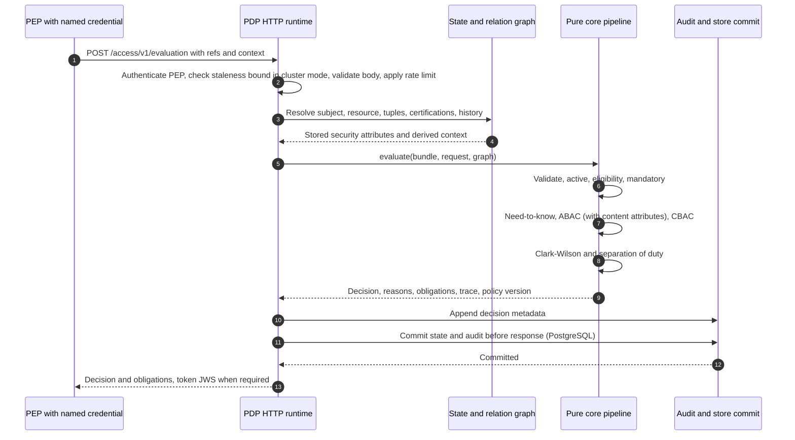
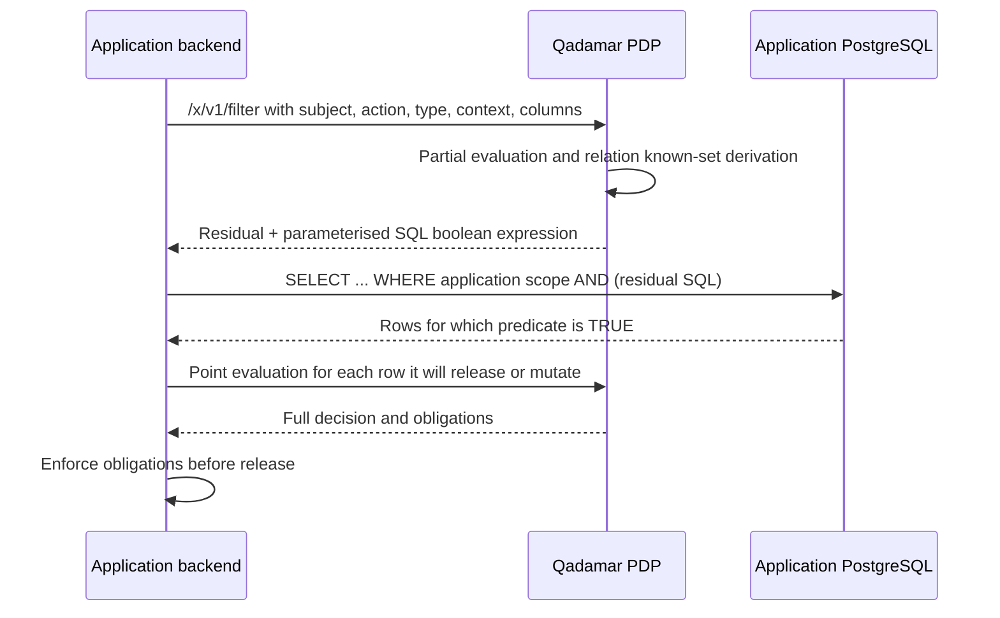

# Decision engine

The engine is a pure function of a policy bundle, a resolved request, and a relation graph, with no I/O inside `packages/core`. Its fixed pipeline evaluates every principal in a delegation chain, accumulates denials and obligations, and returns a policy-versioned decision that denies on malformed input or rule failure. This page describes the code at commit b09bc44 (after 0.3.0).

## On this page

- [Inputs and determinism](#inputs-and-determinism)
- [Follow the fixed pipeline](#follow-the-fixed-pipeline)
- [Deny-overrides and fail-closed semantics](#deny-overrides-and-fail-closed-semantics)
- [Trace one decision](#trace-one-decision)
- [Evaluate relations and delegation](#evaluate-relations-and-delegation)
- [Build list filters with partial evaluation](#build-list-filters-with-partial-evaluation)
- [Compile residuals to SQL](#compile-residuals-to-sql)
- [Limits of the decision](#limits-of-the-decision)

## Inputs and determinism

`evaluate(bundle, request, graph)` returns the same `Decision` for the same three inputs. The caller supplies `context.now`; the core does not read the clock, network, filesystem, or environment (`packages/core/src/evaluate.ts`, `packages/core/src/types.ts`). Canonical JSON sorting produces `pv.` plus the SHA-256 of the bundle, and that version is returned with the decision (`packages/core/src/version.ts`).

Before evaluation, the HTTP runtime resolves the subject and resource from stored state. It also derives:

- the delegation chain from `subject.attrs.delegatedBy`;
- certification records from state;
- performed actions on the target resource for the subject and delegation chain;
- the server-known maker from the first recorded certified action;
- caller context, with `network` defaulting to `untrusted` and time supplied by the server.

These steps are in `packages/pdp-http/src/runtime.ts`. Unknown subject or resource references produce `CORE.UNKNOWN_ID`, not a request for the caller to supply attributes.

## Follow the fixed pipeline

The order below is implemented in `pipeline()` in `packages/core/src/evaluate.ts`. Stages do not short-circuit on the first denial, except malformed requests, undeclared actions, and inactive principals, which return immediately. Consequently, a response can contain several independent denial reasons.

| Order | Stage | Exact behavior |
| ---: | --- | --- |
| 1 | Request and schema validation | Missing or invalid subject/resource fields, an invalid instant or network, an over-deep delegation chain, or missing content-scan results deny with `ENGINE.MALFORMED_REQUEST`. An action not declared for the resource type denies with `SCHEMA.UNKNOWN_ACTION` (`packages/core/src/request.ts`). |
| 2 | Active principals | Every principal in the subject’s delegation chain must be active. The subject gets `CORE.INACTIVE`; a delegator gets `DELEGATION.INACTIVE`. |
| 3 | Eligibility: RBAC or ABAC permit | Each principal needs either an inherited RBAC grant for the action and resource type, or an applicable ABAC `permit` whose condition is exactly TRUE. Otherwise `RBAC.NOT_ELIGIBLE` denies (`packages/core/src/evaluate.ts`). |
| 4 | Mandatory controls | Bell–LaPadula, compartments, network restrictions, and Biba run for every principal. They cannot be replaced by tenant rules (`packages/core/src/mandatory.ts`). |
| 5 | Need-to-know: ReBAC | For protected types at or above `minLevel`, a declared live relation must give each principal a reason to know. `off` skips it, `dry_run` records `wouldDeny`, and `enforce` denies without it. Unknown modes deny (`packages/core/src/evaluate.ts`). |
| 6 | ABAC forbid and obligation rules | An applicable `forbid` denies on TRUE or UNKNOWN. An `obligation` rule fires on TRUE or UNKNOWN and merges its obligations (`packages/core/src/evaluate.ts`, `packages/core/src/conditions.ts`). |
| 7 | ABAC on content attributes | Content rules (`abacContent`) apply when the resource carries the declared content class and action, inside the `abac` trace stage (steps with `kind: "content"` and `policyRule` = the rule id). `deny` denies with `ABAC.CONTENT_DENY`; `mask` and `redact` add obligations (`ABAC.CONTENT_MASK`, `ABAC.CONTENT_REDACT`). An `unless` exemption must be exactly TRUE (`packages/core/src/evaluate.ts`, `packages/core/src/content.ts`). |
| 8 | CBAC (context-based, Zero Trust) | Request-wide rules select actions/kinds, types, minimum resource levels or content classes. Every network, country/IP, local-time, device, authentication/MFA/method and risk requirement is re-evaluated. Failure denies with `CBAC.*`; a missing required signal denies with `CBAC.SIGNAL_MISSING`; a known-expired session denies with `CBAC.SESSION_EXPIRED`. Role assignments and relation tuples outside their `notBefore`/`notAfter` window do not exist for the request and are traced as `skip` steps (`CBAC.GRANT_EXPIRED`, `CBAC.GRANT_NOT_YET`). Trace entries (stage `cbac`) include the policy rule, requirement and observed value (`packages/core/src/context.ts`). |
| 9 | Clark–Wilson | Constrained resource types accept only certified write actions (`CW.UNCERTIFIED_TP`). Certified actions run integrity verification predicates (`CW.IVP.<id>`) and, where configured, require a server-held certification record (`CW.NOT_CERTIFIED`). They also check declared input validators (`CW.INPUT_REQUIRED`, `CW.INPUT.<validatorId>`, C5), the PEP credential's subject-type binding (`CW.SUBJECT_NOT_AUTHENTICATED`, E3), and that no certifier runs what it certified (`CW.CERTIFIER_EXECUTES`, E4). An allowed certified action adds a decision-token obligation (`packages/core/src/evaluate.ts`, `packages/core/src/integrity.ts`, `packages/core/src/procedures.ts`). |
| 10 | Separation of duty | A two-person action rejects an unknown maker, self-approval, or a maker claim that contradicts server history. Conflict rules reject prior conflicting actions on the same resource (`packages/core/src/evaluate.ts`). |

Every action kind except `read` counts as a write for mandatory and Clark–Wilson controls: `write`, `delete`, `approve`, and `execute` included (`packages/core/src/mandatory.ts`).

### Bell–LaPadula, compartments, network, and Biba

- **No read up:** effective session level is the lower of clearance and optional session level. It must be at least the resource’s L0–L3 level.
- **Compartments:** the subject must hold every compartment on the resource.
- **Untrusted network:** the resource must not exceed `untrustedNetworkMaxLevel`. Compartmented resources also require a trusted network unless the bundle explicitly sets `compartmentsRequireTrustedNetwork` to false.
- **No write down:** writes require resource level at least session level, except for a declared trusted role.
- **Biba no write up:** writer integrity must be at least resource integrity, ranked `derived < extracted < system < verified`.
- **Biba no read down:** covered actions require resource integrity at least subject integrity. `bibaNoReadDownScope` is `actions` by default (only names in `bibaNoReadDownActions`), `reads` for every read-kind action, or `all` for every action.

The engine sees one resource at a time. The store enforces that a child is never below its parent’s classification, so the resource’s stored `level` is already its effective level (`packages/core/src/mandatory.ts`, `packages/pdp-http/src/store.ts`).

### Obligation combination

Field allowlists intersect; redacted fields, mask classes, and notification recipients union. A certified-action decision token is carried as an obligation. A denied decision returns empty obligations, so a PEP has no permit-associated content instructions to act on (`packages/core/src/evaluate.ts`).

Obligations are not business effects performed by the core. The SDK or gateway must enforce them and refuse a release it cannot transform safely (`packages/sdk/src/enforce.ts`, `packages/gateway/src/gateway.ts`).

## Deny-overrides and fail-closed semantics

The final boolean is `run.denies.length === 0`. No later permit, role, relation, exemption, or break-glass tuple removes a denial. On allow, `rules` contains the eligibility and need-to-know basis; on deny, it contains unique denying rule IDs (`packages/core/src/evaluate.ts`).

| Input or failure | Result |
| --- | --- |
| Any denying stage | Deny, even when another stage passes. |
| Rule throws or returns an unsupported effect | Deny with `ENGINE.RULE_ERROR`; evaluation continues far enough to return a decision (`packages/core/src/evaluate.ts`). |
| Missing or null value in a comparison | UNKNOWN under three-valued Kleene logic (`packages/core/src/conditions.ts`). |
| Operands of the wrong type (`lt`/`le`/`gt`/`ge` other than two numbers or two strings, `in` without an array on the right, `contains` on a non-array non-string or a string with a non-string needle, `subset` of non-arrays) | UNKNOWN, as a missing value: a forbid on `amount ge 10000` fires for `"50000"` or `[50000]`. `eq`/`ne` stay defined across types (`"1" eq 1` is FALSE). |
| ABAC permit or content-attribute exemption evaluates UNKNOWN | Does not permit or exempt. |
| ABAC forbid or obligation evaluates UNKNOWN | Fires, which fails closed for a forbid and applies conservative obligations. |
| Integrity predicate evaluates UNKNOWN or throws | Fails the integrity check and denies the certified action. |
| Unparseable relation validity bound or decision time | Tuple is not live. |
| Need-to-know mode outside `off`, `dry_run`, `enforce` | Denies a protected request. |
| Missing maker for a two-person action | `SOD.MAKER_UNKNOWN`. |
| Missing content-class list on a resource | Malformed request; an unscanned resource is not treated as clean (`packages/core/src/request.ts`). |

### Three-valued truth table

| Expression | Result when an operand is missing or null |
| --- | --- |
| comparison (`eq`, `lt`, `in`, and others) | UNKNOWN |
| ordering, `in`, `contains` or `subset` over operands of the wrong type (both present) | UNKNOWN |
| `eq` / `ne` across types (both present) | FALSE / TRUE |
| `NOT UNKNOWN` | UNKNOWN |
| `FALSE AND UNKNOWN` | FALSE |
| `TRUE AND UNKNOWN` | UNKNOWN |
| `TRUE OR UNKNOWN` | TRUE |
| `FALSE OR UNKNOWN` | UNKNOWN |
| SQL-style filter predicate | Keep a row only when the complete predicate is TRUE |

## Trace one decision

*Figure 1. The HTTP runtime resolves facts and commits audit evidence around one pure core evaluation.*

A PEP must treat transport errors, malformed responses, and denials as no access. The SDK validates every response field and exposes typed errors rather than accepting an incomplete decision (`packages/sdk/src/client.ts`, `packages/sdk/src/validation.ts`).

## Evaluate relations and delegation

Relations provide need-to-know only. They never increase clearance, add a compartment, relax network policy, or change Biba integrity (`packages/core/src/relations.ts`).

Supported rewrites are:

- `this`: a direct tuple or a userset tuple;
- `computed`: another relation on the same object;
- `fromParent`: follow a live tuple to a parent-like object, then evaluate another relation;
- `viaReports`: traverse a manager relation through a bounded reporting line, then evaluate another relation.

Point checks stop after 32 hops; reporting traversal is capped by the declared `maxDepth` and by 50. Cycles and previously failed nodes do not create access. Validity uses instants, includes both endpoints, and rejects invalid bounds. A break-glass tuple additionally needs finite positive duration no greater than the bundle cap (`packages/core/src/relations.ts`).

An agent must have a delegator. The chain is limited to four delegation edges, and each principal repeats eligibility, mandatory, need-to-know, and ABAC checks, content attributes included. Obligations therefore survive unless every principal qualifies for an exemption (`packages/core/src/request.ts`, `packages/core/src/evaluate.ts`).

### Break-glass is an ordinary bounded relation

The admin break-glass route creates a `granted` tuple with `breakGlass: true`, capped at four hours and at the bundle’s smaller cap if configured. Admission evaluates the prospective read and refuses if mandatory controls, inactivity, eligibility, or another stage would still deny. It does not bypass the pipeline (`packages/pdp-http/src/admin/break-glass.ts`).

Opening applies immediately and adds notification obligations when the relation is used. Review or revocation is performed by a security officer other than the opener or subject. Expiry makes the tuple non-live; a minute sweep audits and notifies expiry.

## Build list filters with partial evaluation

`buildFilter()` substitutes subject, action, and context while leaving `resource.*` paths symbolic. It returns a residual expression over resource fields only (`packages/core/src/filter.ts`).

The residual mirrors the point pipeline for each principal:

1. Unknown action, inactive or malformed principal, invalid time/network, an expired session (`context.sessionExpired`), uncertified constrained write, or missing required certification becomes FALSE.
2. RBAC eligibility becomes TRUE when granted; otherwise applicable ABAC permits are partially evaluated and ORed.
3. Mandatory checks become resource predicates.
4. Enforced need-to-know becomes membership in a sorted known-object ID set, or a level-below-`minLevel` alternative.
5. For each forbid, the residual requires its partially evaluated condition to be certainly FALSE.
6. Content-attribute denials require either a certain exemption or absence of the content class.
7. Applicable integrity predicates are partially evaluated and ANDed.

`knownObjects()` uses reverse graph reachability to find candidates, then reruns the exact point check for each candidate before sorting IDs. This preserves hop and cycle semantics (`packages/core/src/relations.ts`).

AuthZEN resource search evaluates that residual through `ResourceCandidates`: cached resource paths map distinct values to original array positions, and boolean operators combine separate TRUE and FALSE sets so UNKNOWN remains non-matching, including under NOT. Subject search uses `knownSubjects()` for one conservative forward traversal, followed by the candidate's own mandatory and eligibility checks. Both only prune; the normal point pipeline still decides every survivor, and cursor tokens retain their original-array positions. In-place record patches invalidate the cached resource index (`packages/core/src/candidates.ts`, `packages/pdp-http/src/pdp.ts`).

**Obligations, two-person checks, and SoD conflict history are not represented by the residual.** `filterDecides()` says whether those history-dependent checks are absent; it does not mean that obligations were applied. A PEP must make a point decision before releasing or changing a row when it needs those semantics (`packages/core/src/filter.ts`).

## Compile residuals to SQL

`POST /x/v1/filter` returns both the residual and `{ sql: { text, params } }` for dialect `postgres`. The application must add `sql.text` to its own query’s `WHERE` clause and pass `params` in order (`packages/pdp-http/src/pdp.ts`).

The compiler:

- quotes only validated column identifiers;
- binds literals as parameters rather than interpolating them;
- requires every referenced path to have an explicit column mapping;
- supports `text`, `number`, `boolean`, `text[]` and `jsonb` mappings; a `jsonb` column may hold a different JSON type per row, and each operator tests `jsonb_typeof` so a mistyped value is SQL NULL, as in a point decision;
- uses SQL NULL for UNKNOWN and preserves three-valued `AND`, `OR`, and `NOT`;
- rejects unmapped paths, invalid arrays, unsupported types, excessive expression depth, and incorrect built-in types (`packages/sql/src/index.ts`, `packages/pdp-http/src/pdp.ts`).

*Figure 2. SQL filtering narrows candidate rows; point decisions and obligation enforcement remain the release boundary.*

The compiler targets predicates, not generated row-level-security policies for business tables. Such a database backstop is **Not available**. The gateway's list route also does not use this SQL path. It asks `/x/v1/assertions/list` (which uses the residual only to decide whether any item can be released), fetches a JSON list, makes batch point decisions, removes denied items, and applies each allowed item's obligations (`packages/gateway/src/gateway.ts`).

## Limits of the decision

- **Clark–Wilson coverage is Partial.** Integrity checks on current and proposed state (C1, C2), declared SoD (C3), authorization-event logging (C4), declared input validators (C5), PEP subject-type binding (E3), and the certifier exclusion (E4) are implemented. Within a bound population the PDP still believes which user the PEP names (E3). Input a backend takes outside the body the PEP sees is not validated (C5). A backend that does not verify decision assertions, or a direct database write, is not stopped (E1) (`packages/core/src/integrity.ts`, `packages/core/src/procedures.ts`, `packages/pdp-http/src/admin/changes.ts`, `packages/gateway/src/gateway.ts`).
- A PDP decision covers Qadamar’s stored view of the resource. The PEP must keep subject, resource, version, content classes, and business state synchronized.
- The PDP trusts the subject reference asserted by the authenticated PEP. End-user proof is outside the evaluation API.
- `SOD_HISTORY=server`, the default in every profile, ignores caller history for constrained actions. Explicit `SOD_HISTORY=caller` is a warned demo/test opt-in that trusts it when the server has none (`packages/pdp-http/src/profile.ts`).
- Token consumption re-evaluates current Qadamar state and checks resource version, policy version, expiry, signature, single use, and proposed post-state. It cannot make the application’s subsequent database write atomic with Qadamar’s store (`packages/pdp-http/src/pdp.ts`).
- Successful token consumption appends performed-action history before the gateway forwards the business command. An upstream failure can therefore leave history for an action that did not commit (`packages/gateway/src/gateway.ts`).
- No decision cache is implemented. Every decision uses the node's in-memory state. In cluster mode that is the state of the last synchronisation, and a node past `GATE_MAX_STALENESS_MS` refuses to decide (`packages/pdp-http/src/router.ts`).

## Related pages

- [Architecture overview](overview.md)
- [Data and storage](data-and-storage.md)
- [Integration](integration.md)
- [Capacity and performance](../operations/capacity.md)
- [ADR: Fixed evaluation pipeline](decisions/0001-fixed-evaluation-pipeline.md)
- [ADR: Server-derived separation of duty](decisions/0005-server-derived-sod.md)
