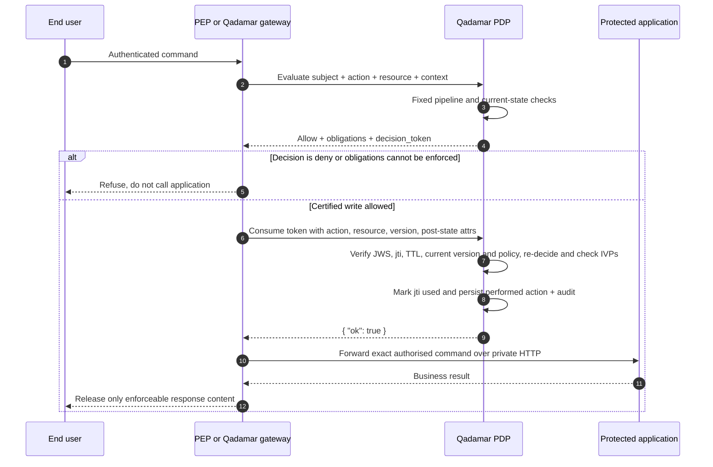
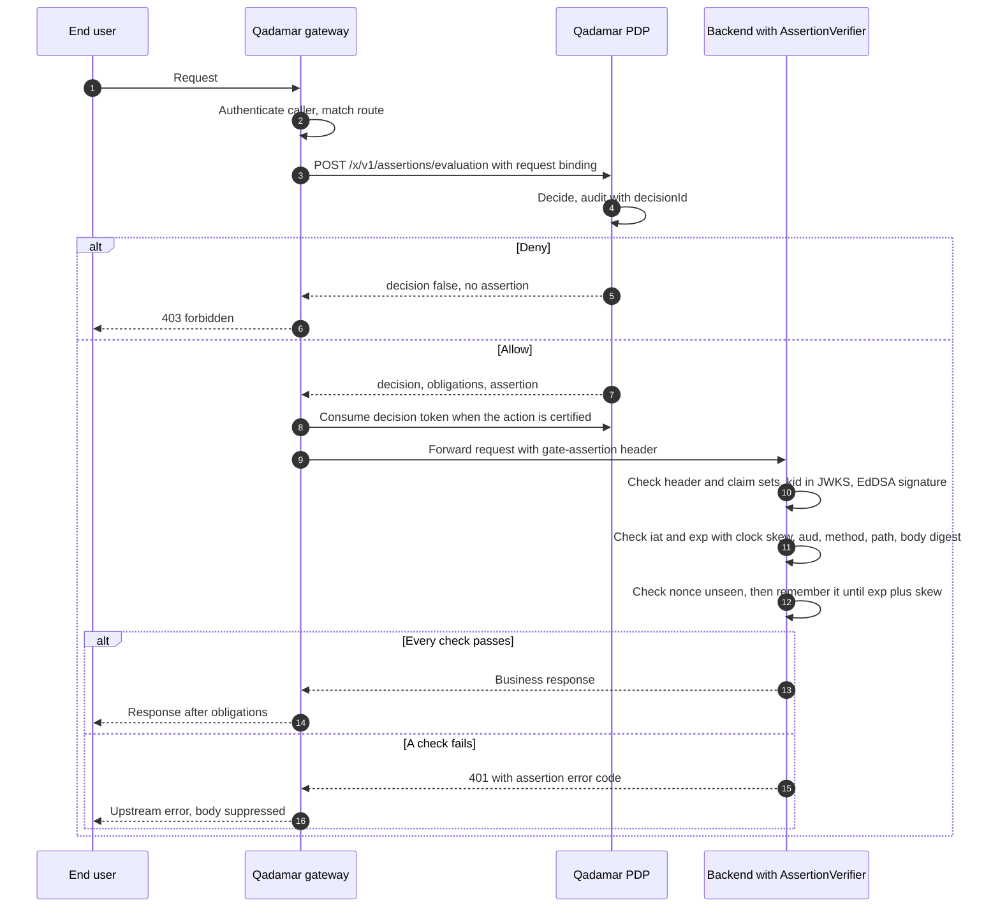
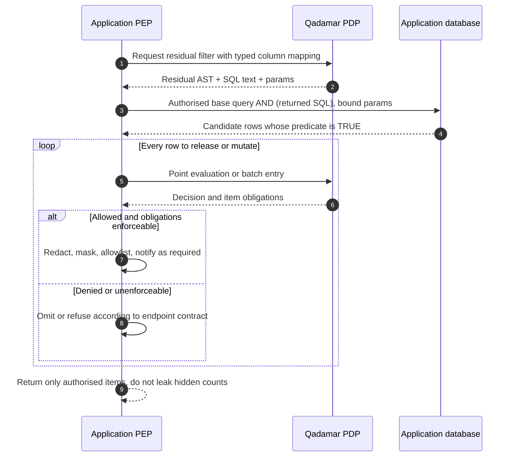

# Integration

PEPs integrate through AuthZEN Authorization API 1.0 endpoints, Qadamar extensions, or the XACML 3.0 JSON mapping, while identity and operations teams use OIDC, SCIM, SIEM, and OTLP adapters. Every integration must enforce denials and obligations locally, protect its own credential, and treat network or response failures as no access. This page describes the code at commit b09bc44 (after 0.3.0).

## On this page

- [Choose an integration surface](#choose-an-integration-surface)
- [AuthZEN evaluation and search](#authzen-evaluation-and-search)
- [Integrate a certified write](#integrate-a-certified-write)
- [Verify decision assertions at the backend](#verify-decision-assertions-at-the-backend)
- [Filter lists and collections](#filter-lists-and-collections)
- [XACML](#xacml)
- [OIDC and SCIM](#oidc-and-scim)
- [SIEM and OTLP](#siem-and-otlp)
- [TypeScript SDK](#typescript-sdk)
- [Enforcing HTTP gateway](#enforcing-http-gateway)
- [Integrate with a cluster](#integrate-with-a-cluster)
- [Integration checklist](#integration-checklist)

## Choose an integration surface

| Surface | Use it for | Status and limits |
| --- | --- | --- |
| `/access/v1/*` | Single and batch decisions, resource/subject/action search, discovery | AuthZEN 1.0 shape. Official Todo vector replay passes 163/163; this is not OpenID certification (`docs/AUTHZEN-CONFORMANCE.md`). |
| `/x/v1/explain` | Decision trace, reasons, obligations, relation path | Qadamar extension. Sensitive hidden reads return 404. |
| `/x/v1/filter` | Residual JSON AST and parameterised PostgreSQL predicate | Qadamar extension. Does not return obligations or replace point checks for release/mutation. |
| `/x/v1/tokens/consume` | Single-use certified-action consumption | Qadamar extension. Re-decides current state and verifies post-state when required. |
| `/x/v1/assertions/evaluation`, `/x/v1/assertions/list` | Decision plus a signed `gate-assertion` for the backend | Qadamar extension. 30-second Ed25519 JWS bound to the forwarded request; issued on allow only. |
| `/xacml/v3/authorize` | XACML 3.0 JSON Profile clients | **Partial.** Translation to the same evaluation. XML, XPath, combined decisions, and XACML policy administration are **Not available** (`packages/pdp-http/src/xacml.ts`). |
| `/scim/v2/Users`, `/scim/v2/Groups` | Identity provisioning | **Partial.** Supported SCIM subset; writes are two-person proposals by default. |
| `/x/v1/resources`, `/retire`, `/sync`, `/list` | The owning application registers, updates and retires its records | Qadamar extension. Credential bound to resource types; declassification and changes of integrity, owner or parent are two-person proposals; batches of 1,000, atomic (docs/API.md §2.2). |
| OIDC and SAML admin routes | Console SSO and logout | OIDC code + PKCE/back-channel logout; SAML signed or encrypted assertions and signed POST/Redirect SLO; MFA required. |
| SIEM webhook and audit pull | Evidence export | Signed NDJSON push with at-least-once delivery, or authenticated NDJSON pull. |
| OTLP/HTTP JSON | Operational traces | No exporter authentication headers, protobuf, gRPC, OTLP metrics, or OTLP logs. |
| `packages/sdk` | TypeScript PEP client, JSON obligation enforcement, and backend `AssertionVerifier` | No third-party runtime dependency; Node.js 22.18 or later. |
| `packages/gateway` | Declared JSON HTTP routes | Optional reverse-proxy PEP; no GraphQL or HTTPS upstream. |

All PDP decision, assertion, XACML, filter, and token endpoints require a PEP bearer credential. SCIM uses a different credential. Browser console cookies never authorise these endpoints (`packages/pdp-http/src/router.ts`).

## AuthZEN evaluation and search

### Discover the PDP

`GET /.well-known/authzen-configuration` is public and returns the base PDP and the evaluation, batch, and three search endpoint URLs. The base is `PUBLIC_ORIGIN` when configured, otherwise the listening URL (`packages/pdp-http/src/router.ts`).

### Evaluate once

```http
POST /access/v1/evaluation
Authorization: Bearer pep.<id>.<secret>
Content-Type: application/json
```

```json
{
  "subject": { "type": "user", "id": "alice" },
  "action": { "name": "read" },
  "resource": { "type": "case", "id": "CASE-14" },
  "context": { "network": "trusted", "sessionLevel": 2 }
}
```

A response has `decision` and a `context` object with `rules`, `reasons`, `obligations`, `policy_version`, `would_deny`, and optional `decision_token` (`packages/pdp-http/src/pdp.ts`). If `context.network` is absent, it is `untrusted`. The server supplies `context.now`, security attributes, certifications, and performed-action history; the caller cannot replace them with arbitrary attributes.

Do not release data merely because HTTP returned 200. Require `decision === true`, validate the response shape, enforce every obligation, and fail closed on any unknown field or obligation. The SDK performs this validation for its supported contract (`packages/sdk/src/validation.ts`).

### Evaluate a batch

`POST /access/v1/evaluations` accepts shared partial request fields and up to 1,000 entries. `options.evaluations_semantic` is one of:

- `execute_all` (default): decide every entry;
- `deny_on_first_deny`: stop after the first denial;
- `permit_on_first_permit`: stop after the first allow.

The response contains only evaluations actually executed, in input order. Rate limiting charges one token per entry, not one per HTTP request (`packages/pdp-http/src/pdp.ts`, `packages/pdp-http/src/router.ts`).

### Search

- `POST /access/v1/search/resource`: resources of a type the subject may act on.
- `POST /access/v1/search/subject`: subjects of a type that may act on the resource.
- `POST /access/v1/search/action`: declared actions the subject may perform on the resource.

Resource and subject searches accept `page.limit` from 1 to 1,000 and an opaque `page.token`. Return `page.next_token` to the same endpoint unchanged. Candidates retain stored order. The server decides only enough candidates for the page and one lookahead; the lookahead is decided again without an audit row until that page is requested (`packages/pdp-http/src/pdp.ts`).

Resource search uses a residual prefilter only when two-person and SoD rules do not require point evaluation. Every returned item still has a full point decision. Searches reveal IDs, not business content.

## Integrate a certified write

A certified action on a constrained type returns both a `decisionToken` obligation and a compact Ed25519 JWS in `context.decision_token`. The token is bound to subject, action, resource, resource version, policy version, unique ID, issue time, and expiry (`packages/pdp-http/src/tokens.ts`).



*Figure 1. Certified execution consumes the token before the upstream command and records the authorised action before its business outcome is known.*

For a constrained type with integrity verification predicates, include `attrs`: the JSON object of resource attributes as the command will commit them. Qadamar merges these over stored attributes and checks the same predicates. Missing or invalid post-state returns 409 without consuming the token, so the PEP may correct and retry within its lifetime (`packages/pdp-http/src/pdp.ts`).

Consumption returns 409 for an expired, reused, altered, mismatched, stale-version, stale-policy, or newly denied token. The PEP must not call the application after any consumption failure. The JWS signature alone is insufficient: single-use state and current-state re-evaluation live at the PDP.

The maximum token TTL is 300 seconds; the bundle can choose a shorter positive TTL. Signing-key rotation preserves the previous verification key for 300 seconds (`packages/core/src/validate.ts`, `packages/pdp-http/src/tokens.ts`). In PostgreSQL mode tokens are rows of `gate_token`, so a token issued by one node can be consumed on another, and only once.

Clark-Wilson checks on the caller and the input also apply to certified commands (`packages/core/src/procedures.ts`):

- **Input validators (C5).** If the bundle declares `clarkWilson.inputValidators` for the action, send the command's input as `context.input` (a JSON object). Missing input denies with `CW.INPUT_REQUIRED`; a failing validator denies with `CW.INPUT.<validatorId>`. At consumption the post-state `attrs` is checked the same way. The gateway sends the request body as both on `postState: 'body'` routes.
- **PEP binding (E3).** If the resource type is listed in `clarkWilson.requirePepBinding`, the PEP credential must be bound, at creation, to the subject's type (`subjectTypes`). Otherwise the decision denies with `CW.SUBJECT_NOT_AUTHENTICATED`. An unbound credential cannot run these commands.
- **Certifier (E4).** A subject named as certifier or checker of the action's certification record is denied with `CW.CERTIFIER_EXECUTES`.

## Verify decision assertions at the backend

The gateway, or any PEP, can obtain a **decision assertion** for the exact request it will forward and send it to the backend in the `gate-assertion` header. The PDP signs it, so the PEP never holds a private key, and a deny gets no assertion (`packages/pdp-http/src/pdp.ts`, `packages/pdp-http/src/tokens.ts`).

- `POST /x/v1/assertions/evaluation` takes an evaluation request plus `request: {audience, method, path, bodySha256}`: the backend origin, the method (`A-Z`), the path with the forwarded query, and the base64url SHA-256 of the forwarded body. It returns the `/access/v1/evaluation` answer plus `assertion` on allow. The audit row carries `details.decisionId`. A malformed `request` returns 400.
- `POST /x/v1/assertions/list` takes `{subject, action, resource: {type}, context?, request}` and returns `{decision, policy_version, assertion?}`. `decision` is true when the list residual is not FALSE: the subject may act on some item of the type. The PEP still decides every item. It is audited with rule `GATE.LIST_ASSERTION` or `GATE.LIST_NONE`.
- The assertion is a compact JWS with header `{alg: "EdDSA", typ: "gate-assertion+jwt", kid}`, signed by the decision-token keyring. Claims: `sub {type, id}`, `act`, `res {type, id?}`, `did` (decision id), `pv`, `aud`, `htm`, `htp`, `bsh`, `iat`, `exp = iat + 30`, and `nonce` (128 random bits). The `typ` keeps an assertion from passing as a decision token, and the reverse.

On the backend, verify with the SDK (`packages/sdk/src/assertion.ts`, example `packages/sdk/src/example-backend.ts`):

```ts
import { createServer } from 'node:http';
import { AssertionVerifier, withGateAssertion } from './packages/sdk/src/assertion.ts';

const verifier = new AssertionVerifier({
  jwksUrl: 'https://gate.internal.example/.well-known/jwks.json',
  audience: 'http://10.0.0.5:8080', // this backend's origin, as the gateway's upstream names it
});
const server = createServer(withGateAssertion(verifier, (req, res, { claims, body }) => {
  // claims.sub, claims.act, claims.res are what the PDP allowed for exactly this request
}));
```



*Figure 2. The backend accepts only requests that came through a credentialed PEP with an allow for exactly that request.*

Verifier behaviour (`AssertionVerifier`):

| Check | Behaviour |
| --- | --- |
| Keys | Ed25519 keys from the PDP's JWKS, cached `jwksCacheSeconds` (default 300, range 10 to 86400). An unknown `kid` refetches at most every 10 seconds. The cache is replaced, not merged, so a key the PDP retired stops verifying at the next refresh. |
| JWKS unavailable when needed | `jwks_unavailable`; `withGateAssertion` answers 503. Stale keys are never used. |
| Clock skew | `clockSkewSeconds`, default 5, range 0 to 60: `iat` must not be later than now + skew, `exp` must be later than now − skew. |
| Binding | `aud` must equal the configured `audience`; `htm`, `htp` (the raw request target), and `bsh` must equal this request. |
| Replay | Each nonce is accepted once and remembered until `exp` + skew. |
| Errors | 401 with `assertion_missing`, `assertion_invalid`, `assertion_expired`, `assertion_mismatch`, `assertion_replayed`, or `assertion_key_unknown`. The handler never runs. |
| Body | `withGateAssertion` reads at most `maxBodyBytes` (default 1 MiB), else 413. |

**Limits.** The nonce cache is per backend process: behind several backend replicas, route a client's requests to one replica or share the cache (not provided). The PDP signs the method, path, and body digest the PEP reports, so the assertion proves the decision and that the request came through a credentialed PEP, not that a compromised PEP forwarded the body it described.

## Filter lists and collections

Use `/x/v1/filter` when the application database can apply a PostgreSQL predicate. Supply a mapping for every residual path, with accurate types:

```json
{
  "subject": { "type": "user", "id": "alice" },
  "action": { "name": "read" },
  "resource": { "type": "case" },
  "context": { "network": "trusted" },
  "dialect": "postgres",
  "columns": {
    "resource.id": "id",
    "resource.level": { "column": "level", "type": "number" },
    "resource.compartments": { "column": "compartments", "kind": "text[]" },
    "resource.integrity": "integrity",
    "resource.contentClasses": { "column": "content_classes", "kind": "text[]" }
  }
}
```



*Figure 3. Push down the resource predicate, then re-check and enforce each result before release.*

SQL UNKNOWN never keeps a row, matching `WHERE`. Built-in fields have fixed expected types; a wrong mapping receives 400 because it could otherwise change semantics (`packages/pdp-http/src/pdp.ts`). The compiler emits no complete query, joins, RLS policy, pagination, or obligation transformation (`packages/sql/src/index.ts`).

The SQL residual does not carry SoD history or obligations. For a list endpoint that cannot query with SQL, use resource search or per-item/batch evaluation. The bundled gateway takes the latter approach and refuses lists over 1,000 items (`packages/gateway/src/gateway.ts`).

## XACML

`POST /xacml/v3/authorize` accepts `application/xacml+json` or `application/json` and returns `application/xacml+json`. It maps standard subject/resource/action IDs plus Qadamar URNs for subject type, resource type, network, session level, maker, and prior actions to one AuthZEN evaluation (`packages/pdp-http/src/xacml.ts`).

- Allow maps to `Permit`; denials map to `Deny`; an undeclared action maps to `NotApplicable`.
- Missing or malformed attributes produce `Indeterminate` with an XACML status and an audited deny.
- `MultiRequests.RequestReference` supports up to 1,000 individual decisions.
- Qadamar obligations map to `urn:qadamar:1.0:obligation:*`; explanation data is associated advice.
- A permit with an obligation the mapper cannot express becomes `Indeterminate`, is audited as a deny, and issues no token.

Configure XACML PEPs as **deny-biased**. Qadamar’s fail-closed guarantee does not constrain a nonconforming integration that permits on `Indeterminate` or `NotApplicable`.

The implementation is repository-tested but has not run OASIS conformance tests or third-party XACML interoperability tests and is not certified. XML, XPath, `CombinedDecision`, `IncludeInResult`, XACML discovery, and XACML policy administration are **Not available**.

## OIDC and SCIM

### Console OIDC

Register these URLs at the IdP:

```text
Redirect:  ${PUBLIC_ORIGIN}/admin/v1/oidc/callback
Logout:    ${PUBLIC_ORIGIN}/admin/v1/oidc/backchannel-logout
```

Set `OIDC_ISSUER`, `OIDC_CLIENT_ID`, and `OIDC_ID_CLAIM`. Optionally set `OIDC_CLIENT_SECRET`, `OIDC_ROLE_CLAIM`, and `OIDC_ACR`. `PUBLIC_ORIGIN` is required because it defines the redirect and external origin (`packages/pdp-http/src/main.ts`, `packages/pdp-http/src/oidc.ts`).

The PDP discovers the IdP, starts code + PKCE, verifies the signed ID token and MFA evidence, filters console roles, then issues its own session cookie. The IdP does not directly authorise PDP application requests. Back-channel logout uses a separate signed logout token and ends the matching sessions: with PostgreSQL, rows of `gate_session`, so on every node; in file mode, in the receiving node's memory.

### SCIM provisioning

Use `SCIM_BEARER_TOKEN`, or have an access administrator mint a credential through `POST /admin/v1/scim/credential`. Map groups to policy roles explicitly with `SCIM_GROUP_ROLES`; each role can come from only one group (`packages/pdp-http/src/scim.ts`).

The implementation supports:

- User and Group create, read, replace, patch, list, and deactivate-on-DELETE;
- User `userName`, `externalId`, `displayName`, `active`, and `groups`;
- Group `externalId`, `displayName`, `active`, and `members`;
- equality filters on supported names/IDs and pagination up to 200 items;
- `PatchOp` on `active`, `groups`, or `members`, including one-member value filters.

Unsupported attributes and schema extensions return 400 rather than being silently discarded. New users receive a random ID, clearance 0, and no compartments. SCIM cannot change clearance, compartments, integrity, subject type, or unmodelled attributes (`packages/pdp-http/src/scim.ts`, `packages/pdp-http/src/admin/changes.ts`).

By default every write returns 202 and creates a `scim_subjects` proposal. An independent approver or security officer must approve it; the credential minter and beneficiaries cannot. `SCIM_DIRECT=true` applies immediately and requires `SCIM_BEARER_TOKEN`. Direct mode removes the second-person provisioning review and should be a deliberate risk decision.

Full SCIM schema discovery, bulk operations, arbitrary filters, and SCIM extensions are **Not available**.

## SIEM and OTLP

### SIEM

Configure `SIEM_WEBHOOK_URL` and `SIEM_HMAC_SECRET`. The receiver must:

1. require HTTPS at the deployment edge and reject unexpected content type;
2. read the raw NDJSON body without reserialising it;
3. recompute `HMAC-SHA256(secret, X-SIEM-Timestamp + "." + rawBody)` and compare in constant time;
4. reject stale timestamps and redirect attempts;
5. deduplicate by audit `(node, seq)` because delivery is at least once;
6. respond 2xx only after durably accepting the batch.

Qadamar persists its acknowledged position, one `seq` per chain. Failures stay on the same position and retry with bounded backoff and at each configured interval (`packages/pdp-http/src/siem.ts`).

For pull collection, authenticate as a security officer or auditor and page through `GET /admin/v1/audit/export` using `X-Audit-Next-From`. With several node chains the position is `<node>:<seq>,...`; pass it back unchanged. Preserve the exported rows and external anchors for independent verification.

### OTLP

Set `OTEL_EXPORTER_OTLP_ENDPOINT` to the collector base URL and optionally `OTEL_SERVICE_NAME`. Qadamar posts JSON to `<endpoint>/v1/traces` (`packages/pdp-http/src/tracing.ts`).

Each request has one SERVER span. Decisions and PostgreSQL commits create INTERNAL child spans, capped at 100 children per request. Attributes are route family, HTTP status, decision effect, and rule IDs; no subject, resource, raw path, IP, header, or credential is exported. Incoming W3C `traceparent` controls parentage and sampled=0 suppresses the request trace; there is no outbound trace propagation from the PDP.

The in-memory queue holds 2,048 spans and exports batches up to 512 every five seconds or when full. Export never delays or fails a request. A full queue drops new spans, non-retryable responses drop batches, and retryable failures back off. The dropped count is not a Prometheus metric.

Use a local or sidecar collector if the upstream collector needs credentials: `OTEL_EXPORTER_OTLP_HEADERS` and `OTEL_EXPORTER_OTLP_TRACES_ENDPOINT` are **Not available**.

## TypeScript SDK

```ts
import { createPepClient, enforce } from './packages/sdk/src/index.ts';

const pdp = createPepClient({
  baseUrl: 'https://gate.internal.example',
  apiKey: process.env.PEP_API_KEY!,
  timeoutMs: 10_000,
});
const record = {
  id: 'CASE-14',
  content: [{ class: 'public', text: 'Summary' }],
};

try {
  const decision = await pdp.evaluate({
    subject: { type: 'user', id: 'alice' },
    action: { name: 'read' },
    resource: { type: 'case', id: 'CASE-14' },
    context: { network: 'trusted' },
  });
  const releasable = enforce(decision, record);
  return releasable;
} catch {
  // Deny or refuse the operation. Do not fall back to local allow.
}
```

`enforce()` throws when the decision is false, so no separate boolean branch is required. Alternatively, `pdp.enforce(request, record)` evaluates and transforms in one call. The client supports evaluation, batch, all three searches, filter, token consumption, `evaluateAsserted()`, and `assertList()`. The client has one `baseUrl` and does not retry; an HTTP error surfaces as `PdpHttpError` with `status` and `retryAfter`. It uses bearer authentication, a default 10-second timeout, optional abort signals, and strict response validation (`packages/sdk/src/client.ts`).

`enforce()` deep-clones plain JSON, applies field allowlist, null redaction, and `[MASKED]` text replacement for declared `content: [{class, text}]` fragments. It throws on deny, `notify` obligations, unknown response keys, malformed records, unsafe paths, or missing required mask classes. Notification requires a capable PEP such as the gateway’s configured hook (`packages/sdk/src/enforce.ts`).

## Enforcing HTTP gateway

Create the gateway with an `upstream` plain-HTTP origin, a configured `PepClient`, an explicit route table, an `authenticate` hook, `trustedNetworks` (client CIDRs evaluated as the trusted network), `trustedProxies` behind a load balancer (X-Forwarded-For read only from those addresses), and an optional `notify` hook (`packages/gateway/src/gateway.ts`).

The gateway:

1. matches method and path against declared routes;
2. refuses method overrides and unsafe IDs;
3. authenticates the caller through the supplied hook and derives network from the socket address, never forwarded-for headers;
4. asks `/x/v1/assertions/evaluation` before a single-resource upstream call and answers 403 on deny;
5. consumes a certified token, then performs notification, before forwarding (a list notifies once every allowed item is released), so nobody is notified of a refused request; on `postState: 'body'` routes it refuses (400) a body whose objects repeat a key;
6. forwards only allowlisted headers and query parameters, plus the `gate-assertion` header (a client-sent `gate-assertion` is dropped);
7. suppresses upstream error bodies and applies response obligations only to supported JSON;
8. refuses any exchange whose decision or obligations it cannot enforce.

List routes must be GET. The gateway first asks `/x/v1/assertions/list`. If the subject may act on no item of the type, it returns an empty list without calling the upstream. Otherwise it fetches the upstream list with the assertion, batch-evaluates up to 1,000 IDs, omits denials, enforces each allowed item, and returns only the item array. Sibling totals and cursors are dropped because they can reveal hidden counts (`packages/gateway/src/gateway.ts`).

The upstream must be a private HTTP origin without a path or credentials. HTTPS upstreams, GraphQL, and arbitrary proxying are **Not available**.

A PDP failure (transport error or a non-2xx answer such as `503 unavailable`) makes the gateway answer `503 pdp_unavailable`; a malformed PDP answer gives `502 unenforceable_decision`; a `409` at token consumption gives `409 conflict`.

## Integrate with a cluster

In cluster mode every node serves the PDP API and one leader serves the admin plane (`packages/pdp-http/src/router.ts`, docs/API.md §3.9.1). Configure PEPs and load balancers as follows:

- **Decision traffic.** Send `/access/v1/*`, `/x/v1/*`, and `/xacml/v3/authorize` to every node. Use `GET /readyz` as the health check: it answers 503 on a node whose shared state is older than `GATE_MAX_STALENESS_MS`.
- **Stale node.** A node past its staleness bound refuses decisions with `503 unavailable`. Neither the SDK nor the gateway retries another node: the SDK throws `PdpHttpError` (status 503) and the gateway answers `503 pdp_unavailable`. Point `baseUrl` at a load balancer that removes unready nodes, and treat a 503 as no access.
- **Admin and SCIM traffic.** Send `/admin/` and `/scim/` (console, OIDC callbacks, back-channel logout, SCIM provisioning) only to the node that answers 200 on `GET /leaderz`. A follower answers `409 {"error":"not_leader","leader":<GATE_ADVERTISE_URL or null>}` without an audit row and never proxies.
- **Resource registration.** `/x/v1/resources*` writes the changed resource and any parent-tuple rows: the leader answers it, and a follower forwards it over the signed hop (or answers `409 not_leader`). Followers apply those rows from the change log and decide on the registered record after their next synchronisation, within `GATE_MAX_STALENESS_MS`.
- **Decision tokens.** A token issued by one node can be consumed on any node, once.
- **Decision assertions.** Every node signs with the shared keyring. After a key rotation on the leader, a follower signs with the new key once it has synchronised; the backend picks it up through the unknown-`kid` refetch.
- **Shared rate limits, local console sessions.** General and PEP budgets lease small batches from `gate_rate_limit` and never overspend cluster-wide; unused leases can only under-admit, bounded by N(B−1) tokens per key for N nodes and lease size B. Console sessions remain shared in PostgreSQL, as described above.


## Integration checklist

- Create one named PEP credential per service; do not share the bootstrap credential.
- Authenticate the actual end user before naming its subject to Qadamar.
- Keep Qadamar state, resource versions, content classes, and the application’s records synchronized.
- Treat absent network context as untrusted and production `SOD_HISTORY=server` as mandatory.
- Deny on PDP timeout, transport failure, invalid response, or any unknown obligation.
- Consume a certified token immediately before the exact authorised command and send the actual post-state.
- Verify `gate-assertion` on the backend with `AssertionVerifier` so requests that bypass the PEP are refused.
- In cluster mode, health-check decision nodes with `/readyz` and route admin and SCIM traffic by `/leaderz`.
- Apply field allowlists, redaction, masking, and notification before releasing data.
- Do not expose direct application routes that bypass the PEP; Qadamar does not supply a business-database backstop.
- Preserve SIEM batches, TSA anchors, policy bundles, evidence packs, and the JWKS needed to verify them later.
- Load-test the real route mix with your own data sizes. Do not turn the single-laptop benchmark into a service-level objective.

## Related pages

- [Decision engine](decision-engine.md)
- [Audit and evidence](audit-and-evidence.md)
- [Security architecture](security-architecture.md)
- [ADR: AuthZEN as the primary API](decisions/0006-authzen-primary-api.md)
- [ADR 0011: Cluster mode](decisions/0011-cluster-mode.md)
- [Capacity and performance](../operations/capacity.md)
- [Rotate keys and credentials](../operations/rotate-credentials.md)

Shared assertion replay protection and point-wise enforcement after SQL filtering have
[tested reference implementations](../guides/integration-safety.md).
