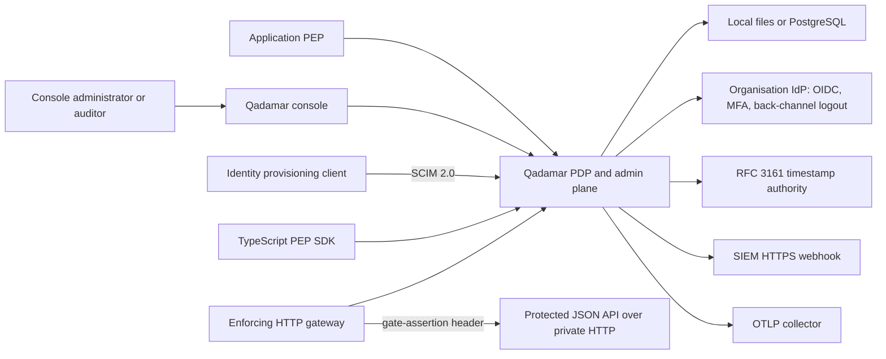
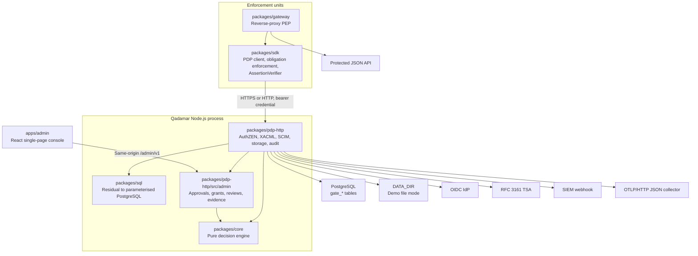
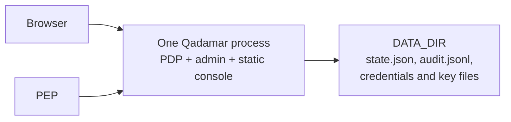
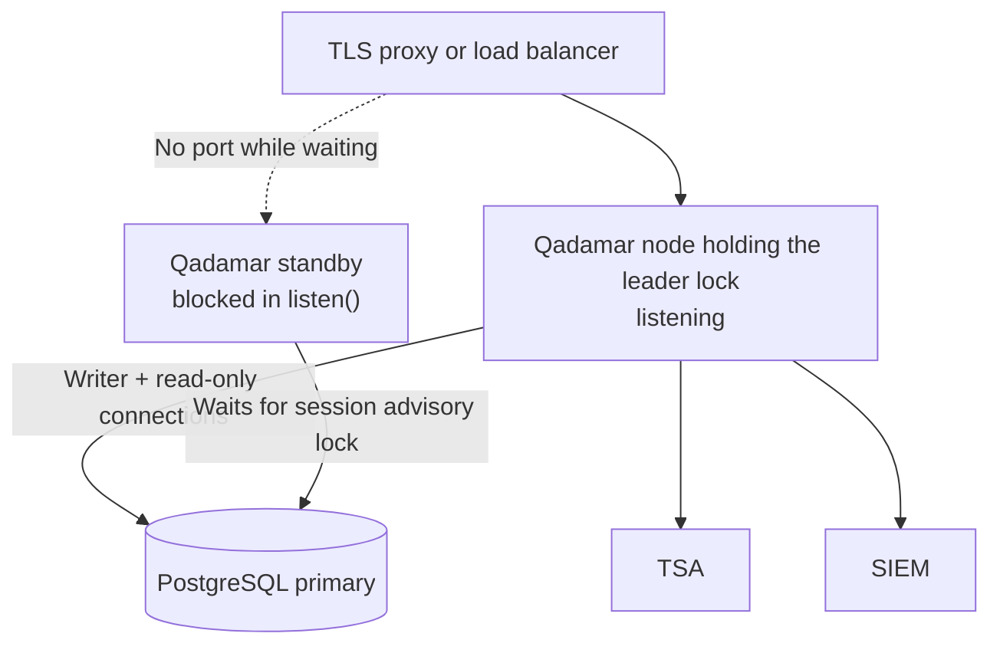
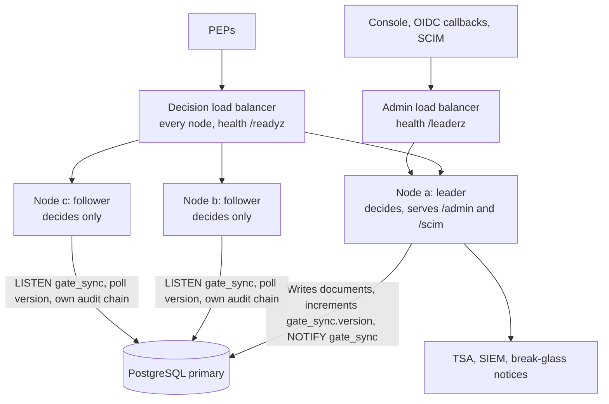
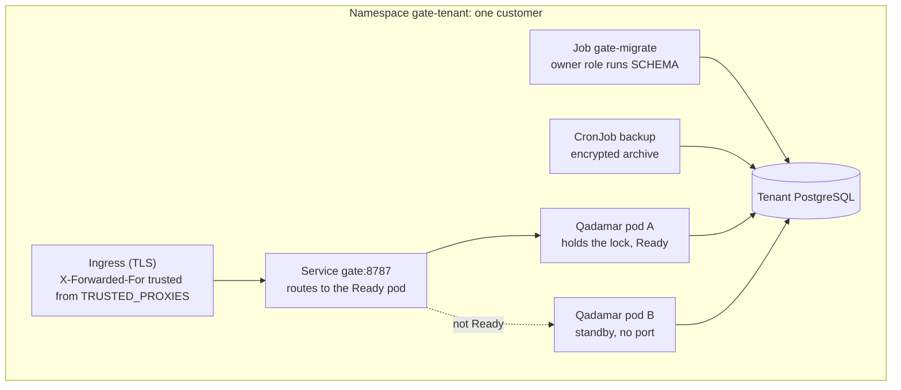

# Architecture overview

Qadamar is a self-hosted access-control decision point with an embedded administration plane, a browser console, and enforcement libraries. This page describes the code at commit b09bc44 (after 0.3.0). One Node.js process makes decisions and commits their state and audit records. With PostgreSQL, you run either one active node with waiting standbys (the default) or, in cluster mode, several deciding nodes of which one leader serves the admin plane.

## On this page

- [System context](#system-context-c4-level-1)
- [Containers](#containers-c4-level-2)
- [Decision and administration paths](#decision-and-administration-paths)
- [Deployment views](#deployment-views)
- [Current boundaries](#current-boundaries)

## System context (C4 level 1)

The product sits between policy enforcement points (PEPs) and the policy, identity, and evidence systems they use. It does not replace the protected application, its business database, or its end-user authentication.

*Figure 1. Qadamar decides for PEPs, serves the console, and connects to storage and optional evidence or identity services.*

A PEP supplies only subject, resource, and action references plus a limited context. The PDP resolves the subject and resource from its own store; caller-supplied security attributes do not replace that state (`packages/pdp-http/src/runtime.ts`). The PEP remains responsible for authenticating the end user and for enforcing the returned decision and obligations.

## Containers (C4 level 2)

"Container" here means a deployable or separately consumable unit, not necessarily an operating-system container. The PDP HTTP server and admin plane are modules in the same Node.js process, not independent services.

*Figure 2. The core and SQL compiler are libraries inside the PDP process; the SDK and gateway are separate enforcement units.*

| Unit | Responsibility | Implementation |
| --- | --- | --- |
| Engine core | Fixed pipeline, three-valued conditions, relation traversal, partial evaluation, validation, impact simulation, policy versions | `packages/core/src` |
| SQL compiler | Compiles a residual expression into a PostgreSQL boolean expression with positional parameters and typed column mappings | `packages/sql/src/index.ts` |
| PDP HTTP server | AuthZEN and extensions, decision assertions, XACML mapping, SCIM, authentication, sessions, tokens, persistence, audit, metrics, tracing, static hosting | `packages/pdp-http/src` |
| Admin plane | Policy and attribute changes, two-person review, break-glass, access reviews, integrity verification, compliance evidence, evidence packs, subject access reports | `packages/pdp-http/src/admin` |
| Console | Browser UI for administrators and auditors; calls only same-origin admin APIs | `apps/admin/src` |
| Gateway | Optional reverse-proxy PEP for declared JSON API routes; decides, consumes tokens, forwards a decision assertion, applies obligations, and refuses unenforceable exchanges | `packages/gateway/src` |
| SDK | TypeScript HTTP client, response validation, local JSON obligation enforcement, and backend-side decision-assertion verification | `packages/sdk/src` |
| PostgreSQL | Shared documents, per-node chained audit rows, derived audit metadata, anchors, decision tokens, performed actions, the sync row, and the advisory locks | `packages/pdp-http/src/postgres.ts`, `postgres-schema.ts` |
| IdP | OIDC console authentication, MFA evidence, signing keys, and back-channel logout | `packages/pdp-http/src/oidc.ts` |
| TSA | External RFC 3161 timestamps for audit heads | `packages/pdp-http/src/anchor.ts` |
| SIEM | Receives signed NDJSON audit batches; the receiver is external to this repository | `packages/pdp-http/src/siem.ts` |
| OTLP collector | Receives request, decision, and commit spans as OTLP/HTTP JSON | `packages/pdp-http/src/tracing.ts` |

The core, SQL compiler, SDK, and gateway have no third-party runtime package dependency. The PDP has one direct runtime dependency, `pg` 8.23.1; the console uses React and is built with Vite (`packages/pdp-http/package.json`, `apps/admin/package.json`). Node.js 22.18 or later executes the TypeScript sources directly (`package.json`).

## Decision and administration paths

### Application decision

1. The PEP authenticates to the PDP with a named bearer credential.
2. In cluster mode, the node refuses the decision with `503 unavailable` if it has not confirmed the shared state within its staleness bound (`packages/pdp-http/src/router.ts`).
3. The PDP resolves stored state, derives delegation, maker, certification, and performed-action context, and invokes the pure core.
4. The PDP appends the decision to the audit chain. In PostgreSQL mode it commits state and audit together before answering.
5. The PEP denies or releases only what it can enforce. Certified actions also require decision-token consumption before the business command runs. The gateway forwards each allowed request with a signed decision assertion that the backend can verify.

The decision path and its failure semantics are detailed in [Decision engine](decision-engine.md).

### Administrative change

1. A signed-in user proposes a change with a reason.
2. The server computes a bounded affected-set impact preview against current state, certifications and performed-action history; differential tests compare its deltas with the full grid.
3. A different authorised person approves or rejects it. Approval repeats the state-digest and impact checks and rejects stale proposals.
4. The server applies the change and appends an audit record. A policy publication also receives an Ed25519 detached JWS (`packages/pdp-http/src/admin/changes.ts`, `packages/pdp-http/src/policy-signature.ts`).

In cluster mode only the leader accepts `/admin/` and `/scim/` requests; see [Cluster mode](#postgresql-cluster-mode).

With PostgreSQL, console sessions are shared rows of `gate_session` (the hash of the session id, never the id): a standby or follower that takes over accepts them. The pending OIDC sign-in state is process-local (`packages/pdp-http/src/auth.ts`, `packages/pdp-http/src/oidc.ts`).

## Deployment views

| Mode | Set with | Deciding nodes | Admin plane | Use |
| --- | --- | --- | --- | --- |
| File mode | No `DATABASE_URL` | One | Same process | Demonstration and development |
| PostgreSQL single-active (default) | `DATABASE_URL` | One active node; standbys wait without a port | Active node | Production |
| PostgreSQL cluster mode | `DATABASE_URL` and `GATE_CLUSTER=true`, a unique `GATE_NODE_ID` per node | Every node | Leader only | Production, when one node's decision throughput is not enough |

All variables are listed in the [Configuration reference](../operations/configuration.md), which follows the generated [CONFIGURATION.md](../../CONFIGURATION.md).

### File mode: demonstration only

*Figure 3. File mode is one process with synchronous local persistence and no standby.*

Without `DATABASE_URL`, the server uses `DATA_DIR` (default `data/runtime`) and seeds from `WORLD_DIR` (default `examples/toy-domain`) when no state exists. State replacement uses a temporary file and atomic rename; audit records append synchronously (`packages/pdp-http/src/store.ts`, `packages/pdp-http/src/audit.ts`). This mode has no leader election, shared sessions, or database transactions, and `GATE_PROFILE=production` refuses to start without `DATABASE_URL` (`packages/pdp-http/src/profile.ts`).

### PostgreSQL single-active node (default)

*Figure 4. One node holds the database session lock and serves; the other starts serving only after acquiring it.*

The active node holds `pg_advisory_lock(0x47415445)` (`LEADER_LOCK`) for the lifetime of its writer connection. A standby waits for that lock before opening its HTTP port, then reloads shared documents (including credentials and the keyring), performed actions, audit chains, and anchors (`packages/pdp-http/src/postgres.ts`, `packages/pdp-http/src/server.ts`). A write failure stops the active node so it cannot answer from memory that may be ahead of the database. A health check on the port is enough for the load balancer.

This is application-level active/standby, not database high availability. Connect directly to the primary; a lagging replica or a transaction-mode pooler can produce false tamper results (docs/API.md §3.9.1). Database replication and failover, and storage encryption, are deployment responsibilities. Backup archives are encrypted by `scripts/ops/backup.sh`; see [Back up and restore](../operations/backup-restore.md).

### PostgreSQL cluster mode

*Figure 5. In cluster mode every node decides on its own audit chain; one leader writes the state documents and serves the admin plane.*

With `GATE_CLUSTER=true` (`packages/pdp-http/src/postgres.ts`, `packages/pdp-http/src/router.ts`, docs/API.md §3.9.1):

- **Every node decides.** Each node serves `/access/v1/*`, `/x/v1/*`, and `/xacml/v3/authorize` and appends to its own audit chain, named by `GATE_NODE_ID`. A second process started with the same id waits for the first.
- **One leader administers.** The node that obtains `LEADER_LOCK` with `pg_try_advisory_lock` is the leader. It alone writes metadata documents and subject/resource/tuple rows (policy, model, changes, emergencies, credentials, keyring, lockouts, SCIM credential, SIEM cursor, audit checkpoint). It also anchors, pushes to the SIEM, sends break-glass expiry notices, and deletes expired decision tokens once a minute.
- **Followers refuse the admin plane.** A follower answers every `/admin/` and `/scim/` request, read or write, with `409 {"error":"not_leader","leader":<GATE_ADVERTISE_URL or null>}` and writes no audit row. It never proxies. `GET /leaderz` returns 200 on the leader (and on any node outside cluster mode) and 503 on a follower. Route the console, OIDC callbacks, and SCIM to the node that answers 200 on `/leaderz`.
- **Followers stay current.** Each metadata or record write increments `gate_sync.version`; a record write also increments `gate_sync.records` and appends `gate_state_change`. Nodes listen and poll every `max(20, min(500, GATE_MAX_STALENESS_MS / 4))` ms. A follower reloads metadata and applies only new record deltas, patching its decision indexes; a missing generation triggers a full ordered snapshot. Every reload checks the policy-bundle signature against the keyring.
- **Staleness bound.** A node records when each synchronisation read was sent. If that time is older than `GATE_MAX_STALENESS_MS` (default 2000, range 100 to 60000), the node refuses decisions with `503 unavailable` and `/readyz` answers 503 until it catches up.
- **Leader failover.** Followers keep deciding when the leader stops, because they need the database, not the leader. Each tick a follower tries the lock; the first to get it reloads the documents and anchors, publishes its `GATE_ADVERTISE_URL` in `gate_sync.leader`, and serves the admin plane.
- **Shared sessions and rate budgets:** console sessions are rows. General and PEP limits lease small batches from `gate_rate_limit` without a database call per request; leases cannot overspend, and idle leases can only under-admit by N(B−1) tokens per key. The decision counter remains per node.

Measured scaling on one laptop is in [Capacity and performance](../operations/capacity.md) and docs/PERFORMANCE.md, with its conditions. The design decision is [ADR 0011](decisions/0011-cluster-mode.md).

### Managed offer on Kubernetes: one dedicated instance per customer

The repository ships Kubernetes manifests for one dedicated Qadamar deployment per customer (`deploy/k8s`, `scripts/managed`, [MANAGED-OFFER.md](../../MANAGED-OFFER.md)). Each tenant is its own namespace, PostgreSQL database, roles, sealed signing keyring, and backup volume; tenants share no Qadamar table.

*Figure 6. The base manifests run one tenant in the production profile with two pods in single-active mode.*

What the base manifests set (`deploy/k8s/base`):

- A Deployment of two Qadamar pods in single-active mode. `GATE_CLUSTER` is not set, so one pod holds the lock and is Ready, and the other waits without a port. Readiness is `GET /readyz`.
- `GATE_PROFILE=production` and `TRUSTED_PROXIES` in the base ConfigMap.
- A schema migration Job run by the owner role, and a backup CronJob that receives `BACKUP_ENCRYPTION_KEY` from a Secret.
- NetworkPolicies, Pod Security `restricted`, and a PodDisruptionBudget.

**Partial.** The offer is proven end to end only on a local Kubernetes cluster with test stand-ins for the IdP, TSA, break-glass receiver, certificates, and database (`deploy/k8s/overlays/local`). No cloud overlay ships. The manifests do not use cluster mode. See [MANAGED-OFFER.md](../../MANAGED-OFFER.md) section 11 for what is not covered.

Do not infer multi-tenant tables or tenant-aware request routing from the forced row-level security. The RLS policies are `USING (true)` policies on a single deployment's tables; they do not partition rows by customer (`packages/pdp-http/src/postgres-schema.ts`).

## Current boundaries

- The PDP is stateful through its store. Without cluster mode, only one PostgreSQL-mode node answers at a time. In cluster mode every node decides, but the admin plane has one writer, the leader.
- The protected application's business transaction is separate from Qadamar's transaction. Token consumption records an authorised action before the gateway forwards it; it does not confirm that the upstream commit succeeded (`packages/pdp-http/src/pdp.ts`, `packages/gateway/src/gateway.ts`).
- The PDP trusts the end-user reference asserted by an authenticated PEP. The gateway delegates that authentication to its `authenticate` hook (`packages/gateway/src/gateway.ts`). A PEP credential can be bound to subject types, and a bundle can require that binding for certified commands (Clark-Wilson E3).
- File mode is for demonstrations. Production requires PostgreSQL, an HTTPS public origin, OIDC or SAML with MFA evidence, sealed keys, server-derived separation of duty, a protected metrics endpoint, TSA anchoring, and break-glass notices (`packages/pdp-http/src/profile.ts`).
- **Not available:** generated database RLS as a backstop for protected business tables, distributed signed-bundle deployment, a decision cache, non-TypeScript SDKs, Cedar, GraphQL gateway support, and HTTPS gateway upstreams.
- The shipped Compose file is a starting point, not a production profile: its database role owns the database objects, and production startup rejects that arrangement (`docker-compose.yml`, `packages/pdp-http/src/profile.ts`).

## Related pages

- [Decision engine](decision-engine.md)
- [Data and storage](data-and-storage.md)
- [Security architecture](security-architecture.md)
- [ADR 0011: Cluster mode](decisions/0011-cluster-mode.md)
- [Deploy Qadamar](../operations/deploy.md)
- [Fail over the active node](../operations/failover.md)
