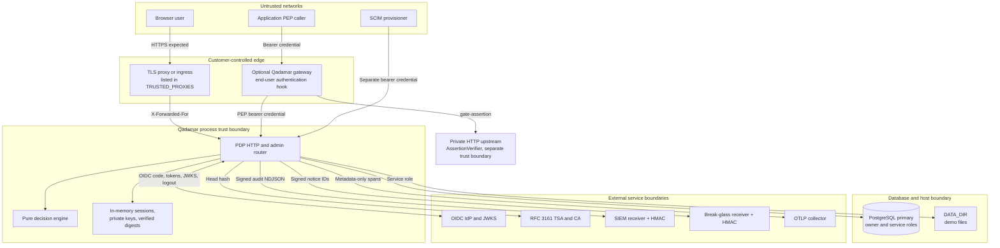

# Security architecture

Qadamar separates untrusted callers, the PDP process, its database, and external identity or evidence services with explicit authentication and fail-closed checks. Its strongest controls assume a correctly configured production profile and a protected deployment boundary; they do not protect against a fully compromised host or database owner with control of all external evidence. This page describes the code at commit b09bc44 (after 0.3.0).

## On this page

- [Trust boundaries](#trust-boundaries)
- [Authenticate each principal](#authenticate-each-principal)
- [Client address behind a proxy](#client-address-behind-a-proxy)
- [Sessions, CSRF, and browser protections](#sessions-csrf-and-browser-protections)
- [Decision assertions and Clark-Wilson at the boundary](#decision-assertions-and-clark-wilson-at-the-boundary)
- [Keys, sealing, and rotation](#keys-sealing-and-rotation)
- [Production profile](#production-profile)
- [STRIDE threat model](#stride-threat-model)
- [Known security limits](#known-security-limits)

## Trust boundaries

*Figure 1. Authentication, storage privileges, and restricted payloads protect each crossing; the application upstream remains outside Qadamar’s transaction and identity proof.*

The production profile does not authenticate arbitrary end users to the PDP. A PEP authenticates itself and asserts the end-user `type` and `id`; Qadamar resolves the security attributes for that identity. Put only trusted PEPs at this boundary (`packages/pdp-http/src/auth.ts`, `packages/pdp-http/src/runtime.ts`).

## Authenticate each principal

| Principal | Mechanism and checks | Source |
| --- | --- | --- |
| Console user through IdP | OIDC authorization code with S256 PKCE, state, nonce, signed ID token, exact issuer and audience, time validation, and MFA evidence. `OIDC_ACR` requires an exact `acr`; otherwise `amr` must include `mfa` or `mca`. At least one recognised console role is required. | `packages/pdp-http/src/oidc.ts` |
| Local console user | scrypt-hashed password (N=2^16, r=8, p=2; older hashes rehashed at the next sign-in), generic failure responses, per-IP/account throttling and progressive lockout. With active TOTP, a six-digit code in the current or adjacent 30-second step, or an unused recovery code, is required; replayed steps and used recovery codes fail. Users enrol on the **Two-step sign-in** screen (`GET /admin/v1/session/totp`, `POST /admin/v1/session/totp/enrol` with the password, `POST /admin/v1/session/totp/activate` with a first code, which returns ten recovery codes once). | `packages/pdp-http/src/auth.ts`, `packages/pdp-http/src/totp.ts`, `packages/pdp-http/src/router.ts` |
| PEP service | `Authorization: Bearer pep.<credential-id>.<random>` or legacy bootstrap key. Secrets are stored as salted HMAC-SHA256 (random 192-bit secrets need no stretching); a SHA-256 digest is cached only after verification. Named credentials can rotate with overlap or revoke immediately. A credential can be bound at creation to the subject types its PEP authenticates (`subjectTypes`, Clark-Wilson E3). | `packages/pdp-http/src/auth.ts` |
| SCIM provisioner | Separate bearer credential, not a PEP key or console cookie. Environment token is compared by SHA-256 digest in constant time; console-minted token is stored as a salted HMAC-SHA256. | `packages/pdp-http/src/scim.ts` |
| IdP back-channel caller | Signed logout token from the configured issuer’s JWKS, with issuer, audience, event, `jti`, `iat`, optional `exp`/`nbf`, `sub` or `sid`, and no `nonce`. No browser session or CSRF token is expected on this server-to-server route. | `packages/pdp-http/src/oidc.ts`, `packages/pdp-http/src/router.ts` |
| Metrics scraper | None by default. `METRICS_TOKEN` requires a bearer token compared in constant time; production requires at least 32 characters. | `packages/pdp-http/src/metrics.ts`, `packages/pdp-http/src/profile.ts` |
| SIEM receiver | HTTPS transport and per-batch HMAC-SHA256 with timestamp. Receiver must verify authenticity and replay window. | `packages/pdp-http/src/siem.ts` |
| Break-glass receiver | HTTPS transport and per-notice HMAC-SHA256 with timestamp. Payload contains IDs and event time, not the emergency reason. | `packages/pdp-http/src/notify.ts` |
| Database service connection | `DATABASE_URL` credentials and PostgreSQL role privileges. Production checks role membership and append-only-table privileges. `DATABASE_TLS=verify-full` authenticates the certificate chain and hostname for non-local production hosts; optional private-CA and client-key files apply to runtime and operations clients. | `packages/pdp-http/src/profile.ts`, `packages/pdp-http/src/postgres-tls.ts` |
| Qadamar PDP, as seen by a backend | Decision assertion in the `gate-assertion` header: Ed25519 JWS from the PDP keyring, verified against the JWKS by the SDK's `AssertionVerifier`. | `packages/sdk/src/assertion.ts` |

### OIDC identity and role mapping

`OIDC_ID_CLAIM` is required when SSO is enabled. Its value becomes the console identity exactly as supplied and must match the subject ID used by applications; `email` is accepted only when `email_verified` is true. `OIDC_ROLE_CLAIM` defaults to `roles`, and only the six known console roles survive filtering (`packages/pdp-http/src/oidc.ts`).

Discovery metadata and JWKS are fetched over HTTPS except loopback test configurations. ID-token algorithms are limited to RS256, PS256, and ES256; RSA keys below 2048 bits are ignored. An unknown key ID triggers at most one JWKS refresh per minute (`packages/pdp-http/src/oidc.ts`).

### Administrative authorisation

Console roles authorise routes independently of the PDP’s RBAC policy bundle. Every administrative change also enforces maker/checker restrictions, role-specific proposal permissions, beneficiary restrictions, and current-state impact checks (`packages/pdp-http/src/admin/changes.ts`). Hiding a button in React is not the security boundary; the server repeats these checks.

A user whose only role is `resource_owner` is restricted to resources owned by that authenticated ID or IDs configured in `RESOURCE_OWNERS`. Out-of-scope object lookups return 404 (`packages/pdp-http/src/runtime.ts`).

## Client address behind a proxy

Qadamar uses the client address for the per-IP rate limit, the login lockout, sign-in audit rows, and request spans. By default it is the connecting socket address, and `X-Forwarded-For` is ignored (`packages/pdp-http/src/proxy.ts`).

Set `TRUSTED_PROXIES` to a comma-separated list of addresses or CIDR ranges (IPv4 or IPv6) of the reverse proxies in front of the node. Then:

- `X-Forwarded-For` is read only when the connecting address is in the list.
- The client is the **rightmost entry that is not itself a trusted proxy**. Entries a client wrote on the left of the header are never believed.
- A malformed entry stops the walk; the last address a trusted proxy vouched for is used.
- An invalid list entry refuses startup.

Without `TRUSTED_PROXIES` behind an ingress, every client shares the ingress address, so one client can exhaust the per-IP limit for everyone. List only proxy ranges you control. The gateway does not use this setting: it derives its trusted network from the socket address and its own `trustedNetworks` option.

## Sessions, CSRF, and browser protections

- Console sessions live only in process memory. They expire after 15 minutes idle or eight hours absolute, whichever comes first (`packages/pdp-http/src/auth.ts`).
- The `sid` cookie is `HttpOnly`, `SameSite=Strict`, `Path=/admin`, and `Max-Age=28800`. It is `Secure` with direct TLS or an HTTPS `PUBLIC_ORIGIN`; `X-Forwarded-Proto` is not trusted (`packages/pdp-http/src/admin/session.ts`, `packages/pdp-http/src/http.ts`).
- Every non-GET admin route requires the per-session `X-CSRF-Token` in addition to the cookie. The token is held in browser memory, not local storage (`packages/pdp-http/src/auth.ts`, `apps/admin/src/api/client.ts`).
- OIDC pending state is sealed with AES-256-GCM under a random per-process key in a ten-minute `HttpOnly; SameSite=Lax` cookie. State is single use. A process restart cancels pending sign-ins (`packages/pdp-http/src/oidc.ts`, `packages/pdp-http/src/router.ts`).
- OIDC back-channel logout ends matching sessions on every node (PostgreSQL `gate_session`; file mode: the receiving node). Logout-token replay IDs are process-local and retained for 24 hours, up to 10,000 entries; when full, new tokens are refused (`packages/pdp-http/src/oidc.ts`).
- API responses use `Cache-Control: no-store`, a self-only/frame-denying content security policy, `nosniff`, and no-referrer. HTTPS public origin or direct TLS adds one-year HSTS with subdomains (`packages/pdp-http/src/http.ts`).
- Request bodies are limited to 1 MiB. The default IP and principal token buckets allow 120 requests per minute, with batch evaluations charged per item; login has tighter controls (`packages/pdp-http/src/http.ts`, `packages/pdp-http/src/router.ts`, `packages/pdp-http/src/ratelimit.ts`).

A takeover does not migrate console sessions, pending OIDC flows, or logout replay memory. Require a fresh sign-in after failover. In cluster mode sessions exist only on the leader, because followers refuse every `/admin/` request with `409 not_leader`; a new leader starts with no sessions. Replaying a valid old logout token after restart can only end matching sessions again; it cannot create one (`packages/pdp-http/src/auth.ts`).

## Decision assertions and Clark-Wilson at the boundary

### Decision assertions

A backend behind a PEP cannot otherwise tell whether a request was decided. With decision assertions (`packages/pdp-http/src/pdp.ts`, `packages/sdk/src/assertion.ts`):

- The PDP signs a 30-second Ed25519 JWS (`typ: gate-assertion+jwt`) on allow only, bound to subject, action, resource, decision id, policy version, the backend origin (`aud`), method, path with query, and body SHA-256. The PEP never holds a private key.
- The backend verifies signature, header and claim sets, time with a bounded clock skew (default 5 s, at most 60 s), the binding to this exact request, and a single-use nonce. Failures answer 401 and the handler never runs.
- The distinct `typ` stops an assertion from being accepted as a decision token, and the reverse.

Limits: the nonce cache is per backend process; the assertion proves the request came through a credentialed PEP with an allow, not that a compromised PEP forwarded the body it described. A backend that does not verify assertions, or a direct database write, is not stopped. See [Integration](integration.md#verify-decision-assertions-at-the-backend).

### Clark-Wilson enforcement rules E3, E4, and C5

For certified commands on constrained types, the engine adds three checks that depend on the caller and the input, never on the item (`packages/core/src/procedures.ts`):

| Rule | Control | Denial |
| --- | --- | --- |
| E3, users who run procedures are authenticated | For types in `clarkWilson.requirePepBinding`, the subject's type must be in the asking PEP credential's `subjectTypes`, read from the server's credential store, never from the request. An unbound or bootstrap credential cannot run these commands. | `CW.SUBJECT_NOT_AUTHENTICATED` |
| E4, a certifier may not run what it certified | The certifier and checker named in the certification record are denied that procedure, for every link of a delegation chain and in the list filter. | `CW.CERTIFIER_EXECUTES` |
| C5, unconstrained input is validated | Declared `clarkWilson.inputValidators` (closed field schemas: type, required, enum, min, max, maxLength) check `context.input` at decision and the post-state `attrs` at token consumption. | `CW.INPUT_REQUIRED`, `CW.INPUT.<validatorId>` |

Remaining trust: within a bound population, the PDP still believes which user the PEP names; it does not verify the end user's own token. Removing a type from `requirePepBinding` or a validator is flagged as a mandatory weakening (`packages/core/src/weakening.ts`).

## Keys, sealing, and rotation

### Key inventory

| Key or secret | Purpose | Storage and rotation |
| --- | --- | --- |
| Ed25519 decision-token signing keyring | Signs decision tokens, decision assertions, current policy publications, evidence-pack manifests, and the compliance export | Private keys are in `signing-keys.json` or `signing_keys`; security-officer rotation discards the previous private key and retains its public key for 300 seconds (`packages/pdp-http/src/tokens.ts`). In cluster mode every node signs with the shared keyring. |
| `SIGNING_KEY_SEAL` | AES-256-GCM sealing root for private signing keys and TOTP secrets; HKDF root for the audit-checkpoint HMAC key and the pseudonym key | Deployment secret, never written by Qadamar. Required with PostgreSQL unless explicitly running with clear keys; required in production. Online root-seal rotation is **Not available**. |
| PEP secrets | Authenticate enforcement callers | HMAC-SHA256 hashes only. Rotation keeps the prior hash for `PEP_ROTATION_GRACE_SECONDS` (default 300); revocation clears cached verified digests. |
| SCIM credential | Authenticate provisioning | Environment token or console-minted HMAC-SHA256 hash. A new console-minted credential replaces the old one. |
| Local password and TOTP material | Local console sign-in | Passwords use scrypt (N=2^16, r=8, p=2, parameters stored per hash). TOTP secrets are AES-256-GCM sealed with account ID as additional data; ten recovery codes are stored only as SHA-256 digests. |
| SIEM and break-glass HMAC secrets | Authenticate outbound webhooks | Deployment secrets, at least 32 characters. Rotation requires coordinated receiver configuration and process restart; there is no overlap mechanism. |
| OIDC client secret | Optional confidential-client token exchange | Deployment secret. PKCE is always used; the client secret is optional for public clients. |
| OIDC pending-state sealing key | Protects state, nonce, and PKCE verifier in the login cookie | Random per-process key; not persisted and not shared. |
| `BACKUP_ENCRYPTION_KEY` | AES-256-GCM key of backup archives (`scripts/ops/archive-crypt.ts`) | 32 bytes as 64 hex characters or unpadded base64url. Used only by `backup.sh` and `restore.sh`, never by the server. Keep it apart from the archives and the database. |

Sealed private-key format `v2.` binds the key ID as AES-GCM additional authenticated data. TOTP sealing similarly binds `totp:<account-id>`. Older `v1.` signing-key entries are read and resealed as `v2.` at the next write; plaintext legacy PEM keys are removed in file mode after a sealed keyring is written (`packages/pdp-http/src/tokens.ts`, `packages/pdp-http/src/auth.ts`).

The checkpoint HMAC and the export pseudonyms do not use the root seal directly. Each uses HKDF-SHA256 with an empty salt and a purpose label: `qadamar/audit-checkpoint/hmac-sha256/v1` and `qadamar/audit-pseudonym/hmac-sha256/v1` (`packages/pdp-http/src/tokens.ts`, `packages/pdp-http/src/admin/privacy.ts`).

### Decision-token rotation behavior

`POST /admin/v1/signing-keys/rotate` generates a new active key, sets the old key’s `verifyUntil` to 300 seconds, removes its private component, re-signs the current policy publication, and audits both key IDs. Existing tokens remain consumable only within their original shorter TTL and all other current-state checks. Archive an old JWKS with evidence that must be verified later, such as evidence packs (`packages/pdp-http/src/admin/security.ts`, `packages/pdp-http/src/tokens.ts`).

Policy signatures are checked at startup, at takeover, and, in cluster mode, at every document reload on a follower; a follower does not decide on a bundle whose signature does not verify. `POLICY_SIGNATURE_ADOPT=1` is an explicit one-time recovery control for an unsigned bundle or one whose signer is absent; production refuses to run with this flag enabled (`packages/pdp-http/src/policy-signature.ts`).

## Production profile

`GATE_PROFILE=production` refuses startup before taking the database lock or migrating when any required condition fails (`packages/pdp-http/src/profile.ts`). The enforced baseline is:

- HTTPS `PUBLIC_ORIGIN`;
- OIDC configured, with MFA proof always required;
- local password login disabled or every local account has active TOTP;
- `DATABASE_URL` with all eighteen `gate_*` tables existing in `public` and a least-privilege, non-owner service role;
- `SIGNING_KEY_SEAL`, with clear signing keys and policy-signature adoption disabled;
- `SOD_HISTORY=server`;
- `METRICS_TOKEN` of at least 32 characters;
- HTTPS `TSA_URL` plus `TSA_CA_FILE`;
- no fixed `CLOCK`;
- HTTPS break-glass webhook and secret;
- HTTPS OTLP endpoint when tracing is enabled, except loopback HTTP;
- full audit-chain verification on every startup.

Production credential creation requires `contextScopes`, and request authentication maps an older unscoped credential to the empty scope. Demo alone permits those legacy claims for one compatibility version with deprecation warnings. The profile does not verify the IdP's actual MFA policy, external attester operation, database TLS settings, host encryption, backup encryption or storage, SIEM configuration, network segmentation, `TRUSTED_PROXIES`, cluster settings, TSA availability, or external evidence retention. These remain deployment controls. The configuration baseline in evidence packs records `TRUSTED_PROXIES`, cluster mode, node id, and staleness bound, and lists every production deviation (`packages/pdp-http/src/profile.ts`, `configurationBaseline`).

## STRIDE threat model

STRIDE covers spoofing, tampering, repudiation, information disclosure, denial of service, and elevation of privilege. The full model, with assets and residual risks, is [docs/security/THREAT-MODEL.md](../../security/THREAT-MODEL.md). The table identifies the principal risks at each boundary and the code that mitigates them; it is not a claim that every threat is eliminated.

| Boundary | STRIDE threats | Mitigation and implementation |
| --- | --- | --- |
| PEP → PDP | **S:** stolen or shared PEP identity. **T:** caller changes IDs, context, or token. **R:** caller denies a request. **I:** decision details or credentials exposed. **D:** expensive batches and floods. **E:** caller supplies roles or history to gain access. | Named HMAC-hashed credentials and revocation (`packages/pdp-http/src/auth.ts`); per-credential context claim scopes, value constraints and optional Ed25519/ES256 attester verification (`packages/pdp-http/src/context-trust.ts`); PDP-resolved attributes (`packages/pdp-http/src/runtime.ts`); server-derived SoD in production (`packages/pdp-http/src/runtime.ts`, `packages/pdp-http/src/profile.ts`); single-use signed tokens and PEP/subject-bound, immediately revocable PDP sessions (`packages/pdp-http/src/tokens.ts`, `packages/pdp-http/src/pep-sessions.ts`); metadata-only audit (`packages/pdp-http/src/audit.ts`); 1 MiB body, per-IP/principal limits and batch cost (`packages/pdp-http/src/http.ts`, `packages/pdp-http/src/router.ts`). PEP binding (E3) limits a credential to the subject types it authenticates for certified commands. A compromised PEP can still assert any end user within its population and any claims in its scope, so it is trusted by design. |
| Reverse proxy → PDP | **S:** client forges `X-Forwarded-For` to evade the per-IP limit or lockout, or to pollute sign-in audit rows. **D:** all clients share one bucket behind a proxy. | `X-Forwarded-For` read only from peers in `TRUSTED_PROXIES`, rightmost untrusted entry wins, invalid configuration refuses startup (`packages/pdp-http/src/proxy.ts`). A wrongly broad `TRUSTED_PROXIES` lets any peer choose its address. |
| Browser → console/admin | **S:** password, session, or SSO theft. **T:** CSRF and OIDC callback manipulation. **R:** admin disowns change. **I:** caching or out-of-scope IDs. **D:** login brute force. **E:** self-approval or role abuse. | OIDC PKCE/state/nonce/MFA (`packages/pdp-http/src/oidc.ts`); local TOTP with the Two-step sign-in screen, and lockout (`packages/pdp-http/src/auth.ts`); Strict HttpOnly session cookie and CSRF header (`packages/pdp-http/src/admin/session.ts`, `packages/pdp-http/src/auth.ts`); server-side roles and owner scope (`packages/pdp-http/src/admin`, `packages/pdp-http/src/runtime.ts`); maker/checker and audit (`packages/pdp-http/src/admin/changes.ts`); no-store/security headers (`packages/pdp-http/src/http.ts`). |
| IdP → PDP callback and back-channel | **S:** forged discovery, JWKS, ID, or logout token. **T:** token substitution or replay. **I:** identity attributes sent to the wrong endpoint. **D:** JWKS churn or replay-table filling. **E:** token without MFA or recognised role accepted. | Exact issuer and endpoint validation, restricted algorithms/key sizes, nonce/audience/time checks (`packages/pdp-http/src/oidc.ts`); state single use; required MFA and role; logout event and `jti` checks with bounded replay memory. Replay memory is process-local, a documented limit; sessions are shared through `gate_session` with PostgreSQL. |
| SCIM client → PDP | **S:** PEP key reused as SCIM identity. **T:** unsupported attributes or role mappings changed. **R:** automated writes disowned. **D:** large memberships or PATCH. **E:** provisioner grants arbitrary clearance or approves its own work. | Separate credential (`packages/pdp-http/src/scim.ts`); strict schemas/attributes and bounded references; explicit one-group-per-role mapping; new users start at L0 with no compartments; two-person proposals by default and minter/beneficiary approval blocks (`packages/pdp-http/src/scim.ts`, `packages/pdp-http/src/admin/changes.ts`). `SCIM_DIRECT=true` deliberately removes the review gate and requires an environment token. |
| PDP → PostgreSQL | **S:** wrong role or endpoint. **T:** state, chain, metadata, or checkpoint rewritten. **R:** database actor disowns edits. **I:** keys or records read. **D:** writer/reader failure or long queries. **E:** service role gains owner or audit rewrite privileges. | Production role-membership and privilege checks (`packages/pdp-http/src/profile.ts`); forced RLS and least-privilege grants (`packages/pdp-http/src/postgres.ts`); chained records, metadata comparison, HMAC checkpoint; sealed private keys; separate read-only connection, 15-second timeout, and fail-stop writer. Per-node chains with one writer each (`NODE_LOCK`); a recheck requires every other chain to extend its last-seen head. In cluster mode a follower refuses decisions past `GATE_MAX_STALENESS_MS` and does not decide on a bundle whose signature fails. Database owner/superuser remains trusted. |
| PDP → TSA | **S:** fake authority. **T:** response for another hash/nonce or wrong time. **I:** audit contents disclosed. **D:** slow or unavailable TSA. **E:** malicious token accepted as evidence. | Only head hash sent; HTTPS, no redirects, 15-second timeout, 64 KiB response limit, granted status, SHA-256 imprint, nonce and ten-minute time check (`packages/pdp-http/src/anchor.ts`); CA verification required in production. Availability is not guaranteed by the profile. |
| PDP → SIEM and break-glass receivers | **S:** forged sender/receiver. **T:** batch or notice altered/replayed. **R:** receiver disputes delivery. **I:** secrets in URL or business content leaked. **D:** endpoint stalls export. **E:** redirects reach another service. | HTTPS without credentials/query/redirects; timestamped HMAC signatures (`packages/pdp-http/src/siem.ts`, `packages/pdp-http/src/notify.ts`); bounded attempts/backoff; IDs and metadata only; at-least-once SIEM cursor with sequence deduplication. Break-glass notices are background and best-effort after final failure, with failure audited. |
| PDP → OTLP collector | **S/T:** spoofed collector or altered telemetry. **I:** identities, URLs, headers, or secrets leaked in spans. **D:** collector blocks requests or queue grows. **E:** untrusted trace context injects attributes. | Configured endpoint, HTTPS required remotely in production, no redirects; fixed route families and rule/effect/status attributes only (`packages/pdp-http/src/tracing.ts`); strict `traceparent` parser; asynchronous bounded queue of 2048 and batches of 512 with drop/backoff. Collector authentication headers are not supported. |
| Gateway → protected upstream | **S:** client spoofed identity headers, or a caller reaching the upstream directly. **T:** method override, smuggling, response validators for transformed content. **R/I:** denied bodies or upstream errors released. **D:** oversized/slow responses. **E:** undeclared route bypass. | Deployment-supplied authentication hook; explicit route table (`packages/gateway/src/routes.ts`); allowlisted headers/query and no forwarded identity (`packages/gateway/src/headers.ts`); method-override refusal; body/response bounds and whole-exchange deadline; deny and obligation failure before release; upstream error bodies suppressed (`packages/gateway/src/gateway.ts`). A client-sent `gate-assertion` is dropped; the gateway forwards the PDP-signed assertion, which a backend verifies for signature, binding, time, and replay (`packages/sdk/src/assertion.ts`). Upstream is plain HTTP and must be on a protected private link; a backend that does not verify assertions is not protected from direct calls. |
| Host/files → demo PDP | **S/T:** local file replacement or audit edit. **R/I:** local secrets and records disclosed. **D/E:** unsafe paths or file permissions abused. | Mode 0700 runtime directory, mode 0600 files, atomic state rename, audit fingerprint and chain checks (`packages/pdp-http/src/store.ts`, `packages/pdp-http/src/audit.ts`); static path and realpath containment (`packages/pdp-http/src/static.ts`); sealed keys when configured. A compromised host remains outside the boundary; file mode is not for production. |
| Backup archives → storage | **T:** archive altered or swapped. **I:** dump of state, keys (sealed), and audit read. **R:** history rewritten in the database and in the backups. | AES-256-GCM with the header as additional data; restore refuses an archive that does not authenticate; output created with mode 600 and removed on failure (`scripts/ops/archive-crypt.ts`). Key custody, off-site copies, and retention are deployment controls. |
| Evidence pack → auditor | **T:** pack edited after export. **R:** exporter disowns it. **I:** person IDs disclosed. | Manifest of per-section SHA-256 hashes signed by the keyring; export audited as `evidence_export`; `pseudonymise=1` replaces person IDs with keyed pseudonyms (`packages/pdp-http/src/admin/evidence.ts`, `admin/privacy.ts`). Preserve the JWKS of the time. |

## Known security limits

- Qadamar has not been independently penetration tested, formally model-checked, or certified. Do not infer a certification from control mappings or vector replay.
- The end-user identity assertion is trusted from the PEP. The gateway’s `authenticate` callback is integration code that the deployer must implement correctly.
- The database owner, host administrator, and holders of deployment secrets are trusted. RLS does not defend against a superuser or table owner.
- The root `SIGNING_KEY_SEAL` has no built-in rotation or recovery mechanism. Losing it makes sealed signing and TOTP material unusable and prevents valid checkpoint authentication.
- Production startup checks configuration, not the ongoing correctness of external MFA, TLS proxy, database transport, backup encryption, SIEM retention, or TSA operations.
- SSO and local sessions are memory-resident and per node. Failover signs users out; back-channel logout must reach the node holding the session (the leader in cluster mode).
- Users enrol TOTP on the Two-step sign-in screen. A self-service or administrator TOTP reset is **Not available**; recovery requires a controlled operator edit of the credentials document after identity verification.
- Without `METRICS_TOKEN` the metrics endpoint answers only on a loopback listen address (403 on any other); production requires the token. Health and readiness are intentionally public and expose only status.
- OTLP exporter authentication headers, gRPC, protobuf, and configurable sampling are **Not available**. Use a local trusted collector when authentication is required.
- The gateway supports only JSON and identity-encoded responses, plain-HTTP upstream origins, and at most 1,000 items in a list response. It is not a general-purpose proxy (`packages/gateway/src/gateway.ts`).
- Qadamar cannot prevent direct writes to the protected application that bypass every PEP. A backend that verifies decision assertions refuses HTTP requests that did not come through a PEP; generated business-database RLS is **Not available**.
- Token consumption records an authorised performed action before the upstream request. It does not prove business-data commit or prevent a compromised upstream from changing data differently.
- The 300-second public-key retention is sized for decision tokens and assertions, not long-term evidence verification. Preserve historical JWKS documents independently.
- Cluster rate limits lease shared capacity and cannot overspend, but up to N(B−1) unused leased tokens per key can temporarily under-admit. Login lockouts and the decision counter remain per node; console sessions are shared in PostgreSQL.

## Related pages

- [Architecture overview](overview.md)
- [Audit and evidence](audit-and-evidence.md)
- [Integration](integration.md)
- [Rotate keys and credentials](../operations/rotate-credentials.md)
- [Deploy Qadamar](../operations/deploy.md)
- [Configuration reference](../operations/configuration.md)
