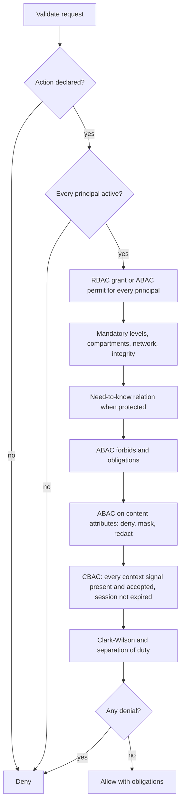

# Follow a decision through the core

A Qadamar decision combines a stored subject, a stored resource, a declared action, caller context, and a versioned policy bundle. The engine evaluates those inputs in a fixed order and returns an explainable allow or deny; no individual role, relation, or permit rule can override another stage's denial.

## On this page

- [Identify subjects and resources](#identify-subjects-and-resources)
- [Declare actions and context](#declare-actions-and-context)
- [Assemble a policy bundle](#assemble-a-policy-bundle)
- [Read the fixed evaluation pipeline](#read-the-fixed-evaluation-pipeline)
- [Interpret the decision object](#interpret-the-decision-object)

## Identify subjects and resources

In plain terms, a **subject** is who or what asks, and a **resource** is the item being accessed. A reference names each by `type` and `id`; the HTTP runtime resolves those references against its own store. Unknown references deny with `CORE.UNKNOWN_ID`.

A stored subject carries:

- `active`: inactive subjects and inactive delegators deny.
- `roles`: policy RBAC role names, not console roles.
- `roleAssignments` (optional): time-bounded roles `[{ role, notBefore?, notAfter? }]` added to `roles` only while `context.now` is inside the window (CBAC grant duration, both bounds inclusive).
- `clearance`: an integer level from L0 through L3.
- `compartments`: every compartment the subject holds.
- `integrity`: `derived`, `extracted`, `system`, or `verified`.
- `attrs`: domain attributes for conditions, including `delegatedBy` for a delegated agent.

A stored resource carries its `level`, `compartments`, and `integrity`, plus optional `owner`, `parent`, `version`, domain `attrs`, and `contentClasses`. The core requires `contentClasses` to be an array at evaluation time: use `[]` only after a scan found no covered content. An unscanned item is not equivalent to a clean item.

Subject and resource ids must be non-empty strings of at most 256 characters. All classification, compartment, integrity, role, owner, and relation facts come from the PDP snapshot, not from arbitrary request attributes. Sources: `packages/core/src/request.ts`, `packages/core/src/types.ts`, `packages/pdp-http/src/runtime.ts`.

## Declare actions and context

An action has a domain-specific name such as `read`, `update`, `approve`, or `can_update_todo`. Each resource type declares its own action names and one of five kinds: `read`, `write`, `delete`, `approve`, or `execute`. An undeclared action denies with `SCHEMA.UNKNOWN_ACTION`.

Every kind except `read` changes state for Bell-LaPadula, Biba, and Clark-Wilson. An `approve` or `execute` therefore receives write-side checks as well as its own governance rules. Action definitions can also set `certified` and `requiresSecondPerson`. Sources: `packages/core/src/types.ts`, `packages/core/src/mandatory.ts`, `packages/core/src/evaluate.ts`.

The context supplies facts that are not intrinsic to the subject or resource:

| Field | Meaning |
|---|---|
| `network` | `trusted` or `untrusted`; HTTP requests default to `untrusted`. |
| `now` | Decision instant; the core receives it from the caller, while the PDP supplies server time. |
| `sessionLevel` | Optional working level, capped at the subject's clearance. |
| `makerId` | Caller claim about the maker for a two-person action. |
| `serverMakerId` | Server-derived maker, which takes precedence over a contradictory claim. |
| `priorActions` | Earlier actions used by conflict rules; the runtime adds recorded history. |
| `certified` | Server-supplied procedure-certification records, with their certifier and approver, never accepted from a PEP request. |
| `pepSubjectTypes` | Server-supplied subject types the calling PEP credential is bound to, used by `clarkWilson.requirePepBinding`. |
| `input` | The certified command's input as a JSON object, checked by `clarkWilson.inputValidators`. |
| `attrs` | Additional JSON values available to conditions in the core. |

The HTTP context parser accepts network, session level, maker id, prior actions, and input. It derives time, certification records, performed-action history, and the PEP binding on the server. Sources: `packages/core/src/types.ts`, `packages/pdp-http/src/runtime.ts`, `packages/pdp-http/src/pdp.ts`.

## Assemble a policy bundle

A policy bundle is the complete, versioned description of how a domain authorizes actions. It contains JSON only; the condition language is a JSON abstract syntax tree, not Cedar, Rego, or a general-purpose programming language.

| Section | What it declares |
|---|---|
| `name` | Human-readable bundle name. |
| `schema` | Resource types, actions, relations, subject-side relations, and compartment names. |
| `rbac` | Policy roles, inheritance, and action grants. |
| `mandatory` | Trusted roles, untrusted-network ceiling, compartment network rule, and Biba no-read-down action list plus optional `actions` / `reads` / `all` scope. |
| `needToKnow` | Mode, protected resource types and relations, break-glass cap, and notification targets. |
| `abac` | Permit, forbid, and obligation rules over subject, resource, action, and context. |
| `abacContent` | ABAC on content attributes: deny, mask, and redact rules matched by resource content classes. A legacy bundle may still name this field `cbac` for one version (read as `abacContent`, warning `DEPRECATED_CBAC_FIELD`). |
| `context` | CBAC (context-based, Zero Trust) rules re-verifying network, country, IP, time, device, authentication and risk signals. Optional. |
| `sod` | Sets of conflicting actions on the same resource. |
| `clarkWilson` | Decision-token lifetime, optional IVPs, types requiring certification records, input validators, and types requiring a PEP binding. |

The validator checks structure, action kinds, relation references, role grants, scopes, rule ids, conditions, and Clark-Wilson declarations before publication. The engine still fails closed if it receives an invalid request or rule at runtime. Sources: `packages/core/src/types.ts`, `packages/core/src/validate.ts`.

## Read the fixed evaluation pipeline

*Figure: All applicable stages contribute to the result, and any denial wins over eligibility and obligations.*

Validation and undeclared-action failures stop the pipeline immediately. An inactive subject or delegator also stops it. Later stages can accumulate several denials so that the response explains more than the first problem; an earlier eligibility denial does not erase later findings.

For a delegation chain, eligibility, mandatory controls, need-to-know, and ABAC (content attributes included) run for every principal. Clark-Wilson and separation of duty then evaluate the action with the whole chain available for maker, history, and certifier checks. Sources: `packages/core/src/evaluate.ts`, `packages/core/src/request.ts`.

## Interpret the decision object

The core `Decision` contains:

- `decision`: `true` only when no denial was recorded.
- `rules`: on allow, the eligibility and reason-to-know basis; on deny, the denying rule ids.
- `reasons`: denial explanations; an allow has an empty reasons array.
- `obligations`: field allowlist, redactions, masks, notifications, and possibly a decision-token requirement. A deny always has empty obligations because nothing may be released.
- `trace`: per-stage pass, deny, would-deny, skip, or obligation entries, including relation paths. A role or relation grant outside its `notBefore`/`notAfter` window appears as a `cbac` `skip` entry (`CBAC.GRANT_EXPIRED`, `CBAC.GRANT_NOT_YET`).
- `wouldDeny`: need-to-know rules that would deny after a move from `dry_run` to `enforce`.
- `policyVersion`: the canonical bundle's version fingerprint.

The PEP evaluation endpoint wraps these values under `decision` and `context`, using `policy_version`, `would_deny`, and an optional signed `decision_token`. The admin **Explain decision** drawer exposes the full trace. The PEP `/x/v1/explain` endpoint instead returns 404 for an unknown id or a denied read, preserving “hidden means absent.”

Sources: `packages/core/src/types.ts`, `packages/core/src/evaluate.ts`, `packages/pdp-http/src/pdp.ts`, `apps/admin/src/components/ExplainDrawer.tsx`.

## Related pages

- [Understand mandatory controls](mandatory-controls.md)
- [Author policy bundles and conditions](policy-and-content.md)
- [Look up decision rule ids](../reference/decision-reasons.md)
- [Integrate a PEP](../guides/integrator.md)
