# Govern policy change and audit evidence

Qadamar routes administrative changes through preview, written justification, independent approval, and a hash-chained metadata log. Policy fingerprints and signatures connect a decision to its bundle, while access reviews, impact analysis, and evidence exports help operators examine whether access still matches intent.

## On this page

- [Follow the change lifecycle](#follow-the-change-lifecycle)
- [Version and sign policy bundles](#version-and-sign-policy-bundles)
- [Read an impact preview](#read-an-impact-preview)
- [Recertify access](#recertify-access)
- [Verify and export audit evidence](#verify-and-export-audit-evidence)
- [Export compliance evidence](#export-compliance-evidence)
- [Answer a subject access request](#answer-a-subject-access-request)

## Follow the change lifecycle

```mermaid
stateDiagram-v2
  [*] --> Pending: maker submits validated candidate, reason, impact, and state digest
  Pending --> Applied: independent approver accepts after current-state checks
  Pending --> Rejected: independent approver rejects with a note
  Pending --> Pending: stale state or impact; maker must create a new proposal
  Applied --> [*]
  Rejected --> [*]
```

*Figure: Every administrative proposal is decided by a second person, and stale proposals are not applied.*

A proposal carries its kind and payload, the maker, a written reason of at least 20 characters, a state digest, and the computed impact. The console requires the current candidate to be previewed before submission and invalidates that preview after an edit. The API computes impact again when it receives the proposal.

An approver or security officer can approve or reject, but never their own proposal. Additional checks prevent beneficiary approval, self-certification of access reviews, and certification by someone who can execute the procedure. Approval recomputes the state digest and exact impact; a mismatch returns 409 `stale`. Expired grants also become stale. A narrowing or neutral change still needs approval.

Break-glass is the exception: emergency access applies immediately, then enters independent post-incident review. SCIM writes normally create `scim_subjects` proposals; the person who minted the credential that proposed them cannot approve them. `SCIM_DIRECT=true` is an explicit alternative that requires an environment-provided SCIM token.

Sources: `packages/pdp-http/src/admin/changes.ts`, `packages/pdp-http/src/admin/reviews.ts`, `packages/pdp-http/src/scim.ts`, `apps/admin/src/utils/useChangePreview.ts`.

## Version and sign policy bundles

The current policy version is `pv.` followed by 64 hexadecimal characters of SHA-256 over canonical bundle JSON. Canonicalization recursively sorts object keys, preserves array order, and removes insignificant whitespace. Older `pv.` plus 16-hex FNV-1a identifiers remain readable in history and audit rows, but they are fingerprints rather than security hashes.

Approving a `publish_policy` change signs the canonical bundle with the active Ed25519 decision-token key. The publication stores a detached JWS and its `kid`. Startup verifies that the stored bundle matches the latest publication and that its signature verifies against the keyring. `POLICY_SIGNATURE_ADOPT=1` provides an audited, deliberate way to sign an unsigned or orphaned bundle after inspection; production refuses that flag.

Rotating a signing key re-signs the bundle in force. The previous public key remains usable for decision-token verification for 300 seconds, then leaves the JWKS. Keep the JWKS of the day with exported evidence if it must be verified later. Signed bundle distribution to independent PDPs and maximum bundle age are **Not available**.

Sources: `packages/core/src/version.ts`, `packages/pdp-http/src/policy-signature.ts`, `packages/pdp-http/src/tokens.ts`.

## Read an impact preview

Impact compares the current world with a candidate world using the same decision engine. Each changed cell identifies the subject, resource, action, and the rules on the denying side:

- **Gained access** was denied before and allows after; its rules explain the previous denial.
- **Lost access** was allowed before and denies after; its rules explain the new denial.

The admin analysis evaluates both trusted and untrusted networks. Actions affected by a second-person maker, SoD history, or a condition that reads `context.makerId`, `context.serverMakerId` or `context.priorActions` also run across independent and known-maker variants. Server-derived certification and performed-action history feed the same cells. The network switch near an impact preview changes the context used when opening an explanation; it does not remove either network from the computed impact.

The analyzer selects only cells whose decision or obligations can change: changed subjects and resources, the scope of changed rules and definitions, and subjects and objects reachable through changed relation tuples. It reports that unique set as `analysis.affectedCells` and why it was selected as `analysis.reasons`. Mandatory-model, broad-rule and relation-rewrite changes can legitimately select a large set.

The default bound is 100,000 reported cell evaluations across those variants, configurable by `IMPACT_MAX_EVALUATIONS`. A larger affected analysis is rejected before evaluation and must be split into smaller proposals. Each reported cell is decided in both worlds, so engine work can be up to twice the reported count. Differential tests establish the same gained, lost and obligation deltas as the former full grid. Impact uses the PDP's stored snapshot; it does not predict changes in an external application database that are not represented in that snapshot.

Sources: `packages/core/src/simulate.ts`, `packages/pdp-http/src/admin/changes.ts`, `apps/admin/src/screens/SimulatorImpactPane.tsx`.

## Recertify access

The **Access reviews** queue includes live, non-break-glass tuples that meet either criterion:

- A `granted` or `allocated` tuple expires within 30 days.
- A `granted` tuple began at least 90 days ago, including one without an expiry.

`Certify` creates a replacement grant through the normal two-person workflow. It must extend an existing expiry when one exists and must satisfy the 90-day grant limit. `Revoke` proposes removal through the same workflow. Neither action applies directly from the review screen.

A reviewer cannot certify a tuple they granted or a tuple for which they are the subject. Resource owners see only their own ownership scope; security officers see the unscoped queue. Sources: `packages/pdp-http/src/admin/reviews.ts`, `packages/pdp-http/src/admin/changes.ts`.

## Verify and export audit evidence

Each audit record contains a sequence number, timestamp, event type, actor, action, optional subject and resource, effect, rule ids, policy version, details, previous hash, and its own hash. The hash is SHA-256 over the previous hash plus the canonical record without its hash. The first previous hash is 64 zeroes.

In cluster mode each node writes its own chain, named by `GATE_NODE_ID`, and its rows carry a `node` field. Chain `0` is the single chain of a non-cluster node and of rows written by earlier versions. Verification checks every chain. An anchor over several chains timestamps the hash of all chain heads together. The audit list cursor is `seq` on chain `0` and `node:seq` on any other chain. The NDJSON export's `from` takes a sequence number on chain `0` or a comma-separated list of `node:seq` positions, both inclusive; the `X-Audit-Next-From` response header gives the next value.

The **Audit** screen filters by type, outcome, exact rule id, subject, and resource. **Verify chain** checks monotonic sequences, previous hashes, record hashes, authenticated retention seals, checkpoints, and any stored anchors. A sealed retention gap is expected; an unsealed one is tampering. File mode uses `audit-checkpoint.json`, HMAC-authenticated from `SIGNING_KEY_SEAL`, so a fully recomputed JSONL chain also fails. The console's overview and compliance views show the latest completed verification result rather than promising a fresh scan on every render.

PEP decisions append decision metadata. Console simulations do not append decision rows. Change, session, break-glass, and security events have their own event types. Audit records do not contain passwords, bearer tokens, session ids, or business record bodies.

Auditors and security officers can export the chained rows as NDJSON through `GET /admin/v1/audit/export`, paginated by sequence. Add `pseudonymise=1` to replace the actor, the subject, and person ids in the details with keyed pseudonyms (`ps.` plus 32 hexadecimal characters, HMAC-SHA-256 under a key derived from `SIGNING_KEY_SEAL`). Equal ids keep equal pseudonyms, so maker and checker separation stays checkable. Service actors such as `pep` stay readable. A pseudonymised row no longer matches its hash and is marked `pseudonymised: true`; verify the chain on the server. Without `SIGNING_KEY_SEAL`, pseudonyms are stable only for the life of the process.

Optional RFC 3161 anchoring timestamps a chain head. Keep timestamp tokens and exported records outside the Qadamar host: an attacker who can rewrite both the log and its locally stored anchors is detected only by a copy held elsewhere. Sources: `packages/pdp-http/src/audit.ts`, `packages/pdp-http/src/postgres-chains.ts`, `packages/pdp-http/src/admin/audit.ts`, `packages/pdp-http/src/siem.ts`, `packages/pdp-http/src/admin/privacy.ts`.

## Export compliance evidence

The **Compliance** screen maps selected controls to rule ids and live evidence counts, then exports a metadata pack with a detached Ed25519 signature. UAE IA controls are deliberately unmapped.

An evidence pack is a per-framework export built from live data: `GET /admin/v1/compliance/evidence?framework=<id>`, available to security officers and auditors and from the **Compliance** screen. The frameworks are `iso27001`, `iso27017`, `iso27018`, `iso27701`, `iso42001`, `iec62443-4-1`, `iec62443-4-2`, and `soc2`. The pack has sections for configuration baseline, time and anchors, policy publications and certifications, audit verification and chain heads, access reviews, approvals, break-glass, signing keys and PEP credentials, security events, and CI references. A manifest lists the SHA-256 of each section and of the pack and carries a detached EdDSA JWS that verifies against `/.well-known/jwks.json`. Add `pseudonymise=1` to pseudonymise the people in the pack. Each export is itself audited as `evidence_export`.

These mappings and packs are product evidence for an auditor to test. They are not a certification, attestation, or statement of compliance. Sources: `packages/pdp-http/src/admin/compliance.ts`, `packages/pdp-http/src/admin/compliance-map.ts`, `packages/pdp-http/src/admin/evidence.ts`, `apps/admin/src/screens/EvidencePackCard.tsx`.

## Answer a subject access request

A subject access report lists everything the control plane holds about one subject id: `GET /admin/v1/privacy/subjects/<id>`, available to security officers only. It is not available in the console. The report contains the stored subject records, tuples, emergencies, changes, and up to the newest 1,000 audit rows resolvable through the current per-subject pseudonym. Each report is itself audited as `subject_access_report`.

For erasure, pause new activity for the subject and call `POST /admin/v1/privacy/subjects/<id>/erasure` as a security officer; a second security officer approves the resulting change (neither may be the subject; open break-glass access or pending reviews of the subject block it). On approval Qadamar deletes the raw-id/per-subject-key mapping in `audit-subjects.json` or `gate_subject_identity` and atomically appends `subject_erased`; no chained row is edited. Raw-id searches stop resolving the old pseudonym, while chain verification and pseudonym correlation still work. New rows also pseudonymise human actors and person-id details, which the console resolves to names only while the mapping exists. Legacy raw-subject rows, earlier exports and SIEM copies, and backups need their own handling. Later activity creates a fresh mapping. Sealed retention can separately remove expired row prefixes without hiding removal.

Source: `packages/pdp-http/src/admin/privacy.ts`.

## Related pages

- [Propose a change and read its impact](../guides/access-administrator.md)
- [Review and approve changes](../guides/approver.md)
- [Search and export audit evidence](../guides/auditor.md)
- [Verify decision and error identifiers](../reference/decision-reasons.md)
