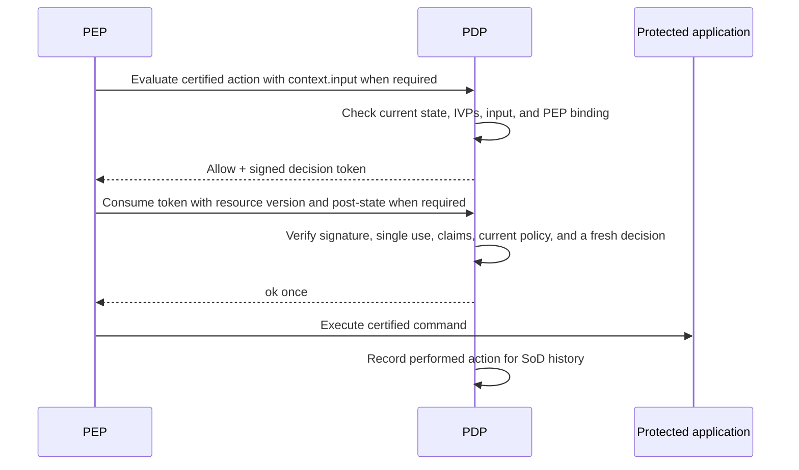

# Understand integrity and separation of duty

Qadamar constrains sensitive state changes through certified commands, integrity verification procedures (IVPs), input validators, PEP binding, decision tokens, and action-history rules. These controls make the PEP prove that the PDP authorized the exact command on the current item, and they prevent a person or delegation chain from approving their own work or running a procedure they certified.

## On this page

- [Constrain items and certify commands](#constrain-items-and-certify-commands)
- [Check integrity with IVPs](#check-integrity-with-ivps)
- [Validate command input](#validate-command-input)
- [Bind certified commands to a PEP](#bind-certified-commands-to-a-pep)
- [Keep certifiers out of execution](#keep-certifiers-out-of-execution)
- [Consume a decision token once](#consume-a-decision-token-once)
- [Separate makers, checkers, and conflicting actions](#separate-makers-checkers-and-conflicting-actions)
- [Read the Clark-Wilson coverage](#read-the-clark-wilson-coverage)

## Constrain items and certify commands

Mark a resource type `constrained: true` to make it a constrained data item. Every non-read action on that type must then be marked `certified: true`; an uncertified state-changing action denies with `CW.UNCERTIFIED_TP`. Read actions do not need certification.

A certified action emits a `CW.DECISION_TOKEN` obligation. The HTTP evaluation response includes the corresponding signed token only when the whole decision allows. A certified action on an unconstrained type also emits the obligation and runs any input validators that cover it. The IVP, certification-record, PEP-binding, and certifier checks concern constrained types only.

The toy `payment` type is constrained. Its `edit` action deliberately demonstrates `CW.UNCERTIFIED_TP`, while `create`, `approve`, and `release` are certified. Sources: `packages/core/src/evaluate.ts`, `examples/toy-domain/bundle.json`.

A bundle can additionally list constrained types in `clarkWilson.requireCertification`. For those types, a certified action also needs a server-side certification record for the same resource type and action, or it denies with `CW.NOT_CERTIFIED`. If the list is absent or empty, certification records are evidence only and do not change decisions.

Only a security officer can propose a `certify_tp` record, through the normal two-person workflow. Sources: `packages/core/src/evaluate.ts`, `packages/pdp-http/src/admin/changes.ts`, `packages/pdp-http/src/admin/integrity.ts`.

## Check integrity with IVPs

An IVP is a named predicate over the current resource, declared in `clarkWilson.ivps`. It applies only to declared constrained types and may read `resource.*` paths only. Every IVP for the type must evaluate to TRUE; a missing value, null, false result, or thrown check fails with `CW.IVP.<ivp-id>`.

For a certified action on a constrained type, Qadamar checks IVPs:

1. On the stored resource before allowing and issuing a token.
2. Again on the stored resource when the token is consumed.
3. On the proposed post-state when the type has IVPs.

The token consumption request supplies `attrs`, a JSON object merged over the item's current attributes. The IVPs check that merged state as the command will commit it. Missing post-state on a type with IVPs refuses consumption and records `CW.POST_STATE_REQUIRED`; a failing post-state records the relevant `CW.IVP.<id>`. Both cases return HTTP 409 `conflict`, record a deny, and leave the token unconsumed so the PEP can correct the request within the token's lifetime.

The list filter includes resource-only IVP predicates. Map every attribute they read in the filter's `columns` object. A security officer or auditor can also run all IVPs over the stored world with `POST /admin/v1/integrity/verify`.

Sources: `packages/core/src/integrity.ts`, `packages/core/src/filter.ts`, `packages/pdp-http/src/pdp.ts`, `packages/pdp-http/src/admin/integrity.ts`.

## Validate command input

An input validator (Clark-Wilson C5) declares what a certified command accepts as unconstrained input. Declare it in `clarkWilson.inputValidators` with an `id`, a `description`, the `resourceTypes` and `actions` it covers (certified commands of declared types), and `fields`. Each field rule sets a `type` (`string`, `number`, `integer`, or `boolean`) and may set `required`, `enum`, `min`, `max`, and `maxLength`. The schema is closed: an undeclared field fails the validator. Regular expressions are not supported.

The PEP passes the input as `context.input`, a JSON object. When validators cover the action:

- No `context.input` denies with `CW.INPUT_REQUIRED`.
- Input that fails a validator denies with `CW.INPUT.<validator-id>`, one entry per failing validator.

At token consumption, the post-state `attrs` is checked as the command's input. Missing `attrs` therefore denies with `CW.INPUT_REQUIRED`, and the token stays unconsumed. The list filter applies the same checks. On routes declared with `postState: 'body'`, the gateway sends the request body as both `context.input` and the post-state.

Validator ids share the bundle's rule-id namespace. Sources: `packages/core/src/procedures.ts`, `packages/core/src/validate.ts`, `packages/pdp-http/src/pdp.ts`, `packages/gateway/src/gateway.ts`.

## Bind certified commands to a PEP

A PEP binding (Clark-Wilson E3) restricts which PEP credentials may run certified commands for which subjects. A security officer can bind a PEP credential at creation to 1–16 subject types (`subjectTypes`) whose users that PEP authenticates.

For constrained types listed in `clarkWilson.requirePepBinding`, a certified command is decided, and its token consumed, only when the subject's type is in the calling credential's binding. Otherwise it denies with `CW.SUBJECT_NOT_AUTHENTICATED`. The binding comes from the server's credential store, never from the request. An unbound credential, including the bootstrap credential, cannot run these commands. The console simulator and access matrix answer as a PEP bound to the subject's type would.

**Partial:** within its bound subject types, the PDP still trusts which user the PEP names; it does not verify the end user's own token. Sources: `packages/core/src/procedures.ts`, `packages/pdp-http/src/auth.ts`, `packages/pdp-http/src/runtime.ts`, `packages/pdp-http/src/admin/security.ts`.

## Keep certifiers out of execution

A certifier (Clark-Wilson E4) is the security officer who proposed a `certify_tp` record or the person who approved it. Both must be PDP subjects with the same id as their console user. At proposal and at approval, Qadamar refuses with 403 `forbidden` when that person could run the procedure: a granting role, or an allow on any item of the type. A denial caused only by the item's state, input, or history does not clear the person. A missing PDP subject is also refused.

At run time, the certifier and the approver of each certification record are denied that procedure with `CW.CERTIFIER_EXECUTES`. The check covers every link of a delegation chain and the list filter. A role granted to a certifier later therefore changes nothing. Decertification is a policy publication. Matching is by id: a person with two ids counts as two people.

Sources: `packages/core/src/procedures.ts`, `packages/pdp-http/src/runtime.ts`, `packages/pdp-http/src/admin/changes.ts`.

## Consume a decision token once

*Figure: Token consumption revalidates the command before the application executes it and creates authoritative action history.*

The token is an Ed25519 JWS with `sub`, `act`, `res`, `ver`, `pv`, `jti`, `iat`, and `exp` claims. It binds the subject, action, resource, resource version, and policy version. The bundle sets its lifetime from greater than zero through 300 seconds. Public verification keys are available at `/.well-known/jwks.json`, but consumption also requires the PDP's server-side record of the issued, unused token.

Consumption rejects reuse, expiry, tampering, a different action or resource, a stale resource version, a different policy version, or a new denial with HTTP 409 `conflict`. The new decision uses the consuming PEP's binding. When consumption succeeds, the PDP appends the action to performed-action history for subsequent separation-of-duty checks. The application must not treat offline signature verification alone as permission to execute: single-use and current-state enforcement happen at the PDP.

A decision token is distinct from a decision assertion. The assertion is a 30-second JWS that the gateway forwards to the backend in the `gate-assertion` header for each allowed request; it proves the request was decided, not that a certified command may run.

Sources: `packages/pdp-http/src/tokens.ts`, `packages/pdp-http/src/pdp.ts`, `packages/pdp-http/src/runtime.ts`.

## Separate makers, checkers, and conflicting actions

There are two related but distinct controls.

**Administrative two-person change control** applies to every console change proposal. The maker cannot approve or reject their own proposal, and a beneficiary cannot approve a proposal that benefits them. A publication that weakens mandatory controls requires a security officer as the independent checker.

**Action-level two-person rules** apply when an action definition sets `requiresSecondPerson: true`. The maker cannot perform that action, including through any delegation link. If the maker is unknown, the decision fails closed with `SOD.MAKER_UNKNOWN`. A server-derived maker overrides an omitted caller claim, and a contradictory caller claim denies with `SOD.MAKER_MISMATCH`.

A bundle's `sod` rules instead define conflicting action sets on one resource. If the subject or its delegation chain already performed another action in the set, the current action denies with `SOD.<rule-id>`. Repeating the same action does not by itself create a conflict; a different prior action in the set is required.

Successful certified-token consumption creates server-side performed-action history. The runtime adds this history to caller history and derives the maker from the first recorded action. `SOD_HISTORY=server` is the default in every profile: caller-supplied maker and prior actions are ignored for all SoD-constrained actions, so a resource without history cannot satisfy `requiresSecondPerson`. Its first certified action must therefore be one that does not require a second person. Explicit `SOD_HISTORY=caller` is a warned compatibility opt-in for demos/tests that trusts caller claims when no server history exists.

Sources: `packages/core/src/evaluate.ts`, `packages/pdp-http/src/runtime.ts`, `packages/pdp-http/src/admin/changes.ts`, `packages/pdp-http/src/profile.ts`.

## Read the Clark-Wilson coverage

| Rule | Status | How Qadamar covers it |
|---|---|---|
| C1, item validity | Enforced | Declared IVPs at decision, filter, token consumption, and administrative verification. |
| C2, certified transformation | Enforced where declared | `certified` actions, certification records for types in `requireCertification`, and post-state checks. Qadamar cannot prove that the application's procedure code is correct. |
| C3, separated users | Enforced for declared rules | Two-person and conflicting-action rules with server-derived history. |
| C4, authorization log | Enforced for the authorization event | Decisions, consumptions, and refusals are in the hash-chained audit; performed actions are persisted. The application's own data log remains outside Qadamar. |
| C5, unconstrained input | Enforced where declared | Input validators at decision, filter, and token consumption. Not covered: input the backend takes outside the body the PEP sees, and validation richer than the field schema. |
| E1, only certified commands change items | **Partial** | Enforced at the PDP and the gateway, and verifiable by a backend that checks the decision assertion. A backend that does not verify it, or a direct database write, is not stopped; the database backstop is Not available. |
| E2, users run only listed procedures | Enforced | RBAC, ABAC, need-to-know, and mandatory checks for every link of a delegation chain. |
| E3, authenticated users | **Partial** | Enforced where declared through PEP binding. Within a bound subject type, the PDP trusts the user the PEP names. |
| E4, independent certifiers | Enforced | Certifiers cannot be able to run the procedure when certifying and are denied it afterwards with `CW.CERTIFIER_EXECUTES`. |

Source: `docs/ARCHITECTURE.md` §16; implementation in `packages/core/src/evaluate.ts`, `packages/core/src/procedures.ts`, `packages/pdp-http/src/pdp.ts`, `packages/pdp-http/src/admin/changes.ts`, and `packages/gateway/src/gateway.ts`.

## Related pages

- [Integrate decision-token consumption](../guides/integrator.md)
- [Manage certifications and signing keys](../guides/security-officer.md)
- [Author IVPs and SoD rules](../guides/policy-authoring.md)
- [Look up Clark-Wilson and SoD rule ids](../reference/decision-reasons.md)
