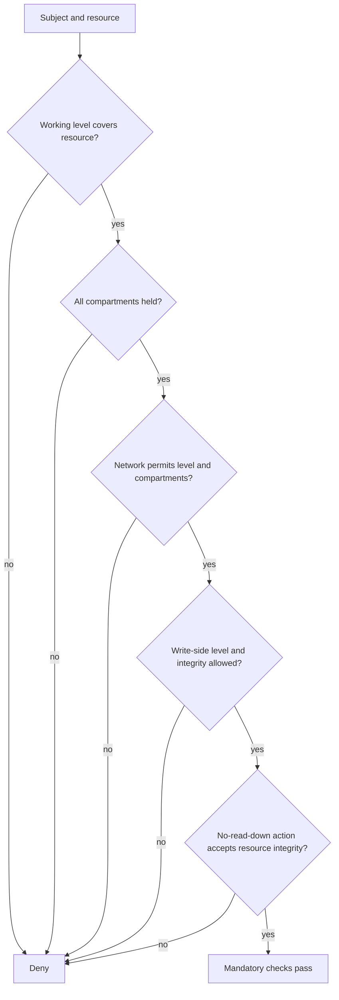

# Understand mandatory controls

Mandatory controls apply after eligibility and before relationships or tenant content rules. They enforce classification, compartments, network restrictions, and integrity for every principal in a delegation chain, so a role grant or relation can never by itself make an otherwise prohibited access safe.

## On this page

- [Work at a classification level](#work-at-a-classification-level)
- [Require every compartment](#require-every-compartment)
- [Restrict access by network](#restrict-access-by-network)
- [Protect integrity with Biba](#protect-integrity-with-biba)
- [Keep parent levels consistent](#keep-parent-levels-consistent)
- [Recognize fail-closed behavior](#recognize-fail-closed-behavior)

## Work at a classification level

Qadamar uses four confidentiality levels:

| Level | Console label |
|---|---|
| L0 | Public |
| L1 | Internal |
| L2 | Confidential |
| L3 | Secret |

A subject has a clearance, and a resource has a level. The working level is the requested `sessionLevel`, or the clearance when no session level is supplied, capped at the clearance. A higher requested session level therefore does not raise the subject's effective level.

The **no-read-up** check denies when the resource level exceeds the working level. This check runs for every action kind, not only for an action named `read`. The **no-write-down** check applies to every non-read action and denies writing to a resource below the working level. A subject with a role named in `mandatory.trustedRoles` can bypass only no-write-down; the role must be directly present on the subject, and the exception does not lift no-read-up, compartments, network, Biba, need-to-know, or any other control.

Sources: `packages/core/src/mandatory.ts`, `apps/admin/src/i18n/common.ts`.

## Require every compartment

A compartment restricts a resource to subjects who hold that named compartment. The subject must hold **every** compartment on the resource; holding only some of them denies with `MAC.COMPARTMENT`. A resource with no compartments adds no compartment requirement.

Compartment names are declared in `schema.compartments`. Administrative subject and resource updates reject unknown names, and a policy publication cannot remove a compartment still used by a stored subject or resource. A relation tuple with a matching subject and object still cannot replace a missing compartment.

Sources: `packages/core/src/mandatory.ts`, `packages/pdp-http/src/admin/changes.ts`.

## Restrict access by network

The request network is either `trusted` or `untrusted`. On an untrusted network:

- A resource above `mandatory.untrustedNetworkMaxLevel` denies with `NET.UNTRUSTED_LEVEL`.
- A compartmented resource denies with `NET.UNTRUSTED_COMPARTMENT` unless `mandatory.compartmentsRequireTrustedNetwork` is set to `false`. Absent means `true`.
- A trusted-network declaration does not relax clearance or integrity checks.

The HTTP runtime defaults an omitted network to `untrusted`. The gateway resolves trust only from the client socket address and its configured CIDR list; it ignores forwarded-for headers. The PDP's `TRUSTED_PROXIES` setting changes only the client address used for rate limiting, login lockout, sign-in audit rows, and request spans; it never makes a request network trusted. Break-glass admission defaults to a trusted-network evaluation unless the opener specifies otherwise, but every later access still evaluates the actual request network.

Sources: `packages/core/src/mandatory.ts`, `packages/pdp-http/src/runtime.ts`, `packages/gateway/src/gateway.ts`, `packages/pdp-http/src/admin/break-glass.ts`.

## Protect integrity with Biba

Integrity describes how much trust the decision places in the data or writer. From low to high, Qadamar uses `derived`, `extracted`, `system`, and `verified`.

- **No write up:** for every non-read action, the subject's integrity must be at least the resource's integrity. A `derived` writer cannot change `verified` data.
- **No read down:** the resource's integrity must be at least the subject's integrity for every covered action. `mandatory.bibaNoReadDownScope` selects that coverage: absent or `actions` uses only `mandatory.bibaNoReadDownActions` (the compatible default, useful for sensitive decisions such as approvals), `reads` covers every action declared with kind `read`, and `all` covers every action. In the latter two modes the list is not an additional filter. Narrowing effective coverage is a mandatory weakening and requires security-officer approval.

These checks are independent of confidentiality. A high-clearance AI agent with `derived` integrity can still fail a write to higher-integrity data, and every delegator must pass the same integrity checks.

Source: `packages/core/src/mandatory.ts`.

*Figure: Mandatory findings are evaluated together; a relation cannot bypass any of these checks.*

## Keep parent levels consistent

The engine evaluates one resource at a time, so the stored resource `level` must already be the effective level for its hierarchy. Qadamar enforces this by requiring every child to be at least as classified as its parent.

Startup rejects an unknown parent or a child below its parent. An administrative resource update rejects the same conditions, whether it lowers a child or raises a parent above a child. Raise children before raising their parent. This invariant lets point decisions and SQL row filters use the same stored level without traversing ancestors.

Sources: `packages/core/src/mandatory.ts`, `packages/pdp-http/src/store.ts`, `packages/pdp-http/src/admin/changes.ts`.

## Recognize fail-closed behavior

Mandatory checks are built into the core rather than implemented as tenant rules. A policy publication can change their parameters, but detected loosenings are listed as mandatory weakenings and require approval by an independent security officer. The console's candidate editor keeps `mandatory` read-only; the API still validates and analyzes every complete candidate bundle.

The following inputs do not silently skip a check:

| Input or failure | Result |
|---|---|
| Invalid level, integrity, boolean, id, timestamp, or context | `ENGINE.MALFORMED_REQUEST` |
| Missing `contentClasses` array | `ENGINE.MALFORMED_REQUEST` |
| Undeclared action on the resource type | `SCHEMA.UNKNOWN_ACTION` |
| A rule or guarded pipeline step throws | `ENGINE.RULE_ERROR` |
| Inactive subject or delegator | `CORE.INACTIVE` or `DELEGATION.INACTIVE` |
| Missing or null value used by a permit or exemption | Condition is not TRUE, so it does not grant or exempt |

Sources: `packages/core/src/request.ts`, `packages/core/src/evaluate.ts`, `packages/core/src/conditions.ts`, `packages/core/src/weakening.ts`, `apps/admin/src/screens/PolicyEditorPane.tsx`.

## Related pages

- [Follow a decision through the core](decision-model.md)
- [Use relations and delegation safely](relations-and-delegation.md)
- [Look up mandatory rule ids](../reference/decision-reasons.md)
- [Propose and review changes](../guides/access-administrator.md)
