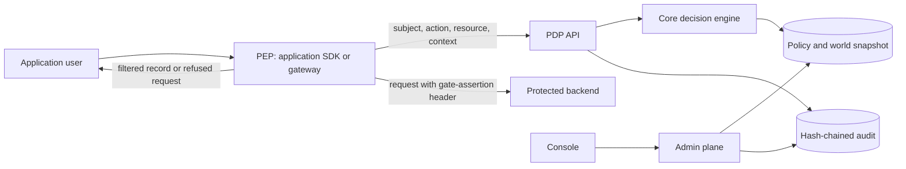

# Understand Qadamar

Qadamar is an access-control decision point with an administration console for applications that handle sensitive records. It combines role, attribute, relationship, content, confidentiality, integrity, and separation-of-duty checks in one deterministic decision, then gives operators evidence for the decision and for every administrative change. This handbook describes the code at commit b09bc44 (after 0.3.0).

## On this page

- [Solve one authorization problem](#solve-one-authorization-problem)
- [Identify the people and components](#identify-the-people-and-components)
- [Apply the design principles](#apply-the-design-principles)
- [Follow a request through the system](#follow-a-request-through-the-system)
- [Choose a deployment shape](#choose-a-deployment-shape)
- [Know the current boundaries](#know-the-current-boundaries)

## Solve one authorization problem

An application must often answer more than “does this user have a role?” It must decide whether this subject may perform this action on this resource, in this context, and what must be hidden or recorded before releasing data. Qadamar answers that question from its own snapshot of subjects, resources, relations, and policy. The caller supplies only identifiers and limited context; it cannot assert roles, clearance, compartments, integrity, or ownership.

Qadamar is for teams building or integrating case-management, document, finance, records, or similar internal applications that need mandatory controls and reviewable administration. It serves several distinct jobs:

- A **policy decision point (PDP)** evaluates one request, a batch, a search, or a list filter, and signs decision tokens and decision assertions.
- The **console** supports policy work, access changes, approvals, emergency access, reviews, audit, and evidence export.
- A **TypeScript SDK and HTTP gateway** help a policy enforcement point (PEP) carry out the decision and its obligations. The SDK also lets a backend verify the decision assertion that the gateway forwards.
- A **SQL compiler** turns a list authorization residual into a parameterized PostgreSQL predicate.

Qadamar does not replace the application's identity provider, business database, content store, or audit archive. It also does not classify documents: the resource snapshot must already carry the content classes found by a scanner. Sources: `packages/core/src/types.ts`, `packages/pdp-http/src/runtime.ts`, `packages/pdp-http/src/pdp.ts`, `packages/sql/src/index.ts`.

## Identify the people and components

The console has separate roles for access administrators, policy authors, approvers, security officers, resource owners, and auditors. These console roles are not the policy roles assigned to application subjects in a policy bundle. Developers and operators work mainly through the SDK, gateway, HTTP API, and deployment configuration rather than through the console.

*Figure: The PDP decides from stored policy and attributes; the PEP releases data only after enforcing the result.*

The core engine is pure: a decision is reproducible from the bundle, request, and relation graph. The HTTP runtime resolves references into that snapshot, derives server-side history, certification records, and the PEP credential's bound subject types, and writes decision metadata to the audit log. The console simulator and access matrix use the same engine but do not append decision audit rows. Sources: `packages/core/src/evaluate.ts`, `packages/pdp-http/src/runtime.ts`, `packages/pdp-http/src/admin/simulator.ts`, `packages/pdp-http/src/admin/matrix.ts`.

## Apply the design principles

**Relations never lift mandatory controls.** Membership, allocation, a parent folder, a reporting line, delegation, and break-glass can supply a reason to know. They cannot raise clearance, add a compartment, make a network trusted, or raise integrity. Eligibility and mandatory checks still run before need-to-know. Source: `packages/core/src/evaluate.ts`.

**Fail closed.** An unknown identifier, malformed request, undeclared action, inactive principal, invalid timestamp, missing content-scan result, or throwing rule denies. Missing or null values in conditions produce UNKNOWN rather than an implicit permit. A PEP must also refuse a decision it cannot understand or an obligation it cannot enforce; the included SDK and gateway do so. Sources: `packages/core/src/request.ts`, `packages/core/src/conditions.ts`, `packages/sdk/src/enforce.ts`, `packages/gateway/src/gateway.ts`.

**Require two people for administrative change.** A maker proposes; a different approver or security officer decides. Every queued change, including one that only narrows access, needs this second person. The server rechecks the stored state and impact at approval, so an old proposal becomes stale instead of applying to a different world. Emergency break-glass is the deliberate exception: it applies immediately, but is short-lived and requires later independent review. Sources: `packages/pdp-http/src/admin/changes.ts`, `packages/pdp-http/src/admin/break-glass.ts`.

**Explain rather than assert.** An allow identifies its eligibility and need-to-know basis. A deny identifies the denying rules and human-readable reasons. Relation success includes the tuple path, and a certified command declares its token obligation. The audit log stores identifiers, rule ids, policy versions, and hashes, not business record bodies. Sources: `packages/core/src/types.ts`, `packages/core/src/relations.ts`, `packages/pdp-http/src/audit.ts`.

**Keep enforcement in the data path.** A single-object decision is not enough. Qadamar also supports searches and residual SQL filters, while the gateway filters each item in a JSON list and applies per-item obligations. The SQL residual does not replace point checks for two-person rules, separation of duty, or obligations. Sources: `packages/core/src/filter.ts`, `packages/pdp-http/src/pdp.ts`, `packages/gateway/src/gateway.ts`.

## Follow a request through the system

1. The PEP authenticates the end user and resolves the subject reference. The gateway does this through its `authenticate` hook. The PDP trusts the reference supplied by the authenticated PEP; where the bundle requires a PEP binding, only for the subject types the PEP credential is bound to.
2. The PEP sends the subject, action, resource, and context to the PDP with its own bearer credential.
3. The PDP loads the stored subject and resource, adds server-derived certification records, action history, and the credential's bound subject types, and evaluates the fixed pipeline.
4. The PDP returns allow or deny, rule ids, obligations, and the policy version. A denied response carries no obligations.
5. The gateway asks for a decision assertion: a 30-second Ed25519 JWS that the PDP signs only on an allow and that binds the decision to the forwarded method, path, and body digest. The gateway forwards it in the `gate-assertion` header. A backend can verify it with the SDK's `AssertionVerifier` or `withGateAssertion`.
6. On a certified command, the PEP consumes the single-use decision token before running the command. The PDP re-decides on current state and checks the proposed post-state when IVPs or input validators require it.
7. The PEP applies field allowlists, redaction, masking, and notifications. It refuses the request if it cannot do so safely.

The default request network is `untrusted` when the HTTP caller omits it. `SOD_HISTORY=server` is the default in every profile, so caller-supplied maker and prior-action claims are ignored for SoD-constrained actions; `caller` is an explicit, warned compatibility opt-in for demos/tests. Sources: `packages/pdp-http/src/runtime.ts`, `packages/pdp-http/src/pdp.ts`, `packages/pdp-http/src/tokens.ts`, `packages/sdk/src/assertion.ts`, `packages/pdp-http/src/profile.ts`.

## Choose a deployment shape

- **File mode** keeps state in local files on one node. Use it for the demo and evaluation only.
- **PostgreSQL mode** keeps state, audit, and shared security material in PostgreSQL. One node is active and the others wait as standbys.
- **Cluster mode** (`GATE_CLUSTER` with `DATABASE_URL`) lets every node decide against the shared PostgreSQL state. One node, the leader, holds the admin plane and SCIM; followers answer those requests with 409 `not_leader`. Each node writes its own audit chain. A node that has not confirmed the shared state within its staleness bound refuses decisions with 503 `unavailable`.
- The **managed offer** runs one dedicated Qadamar per customer on Kubernetes. It is proven end to end only on a local test cluster; see `docs/MANAGED-OFFER.md`.

Configuration variables are listed in `docs/CONFIGURATION.md`. Sources: `packages/pdp-http/src/router.ts`, `packages/pdp-http/src/postgres-chains.ts`, `docs/CONFIGURATION.md`, `docs/MANAGED-OFFER.md`.

## Know the current boundaries

- **External assurance: Not available.** The repository claims no independent penetration test, formal model check, product certification, customer deployment, or WCAG conformance.
- **Database backstop: Not available.** Qadamar compiles SQL predicates, but does not generate or install row-level-security policies. A backend that bypasses every PEP, or that does not verify the decision assertion, is outside Qadamar's enforcement boundary.
- **Content classification and OCR: Not available.** Qadamar consumes closed content-class labels supplied in the resource snapshot.
- **Signed bundle distribution and maximum bundle age: Not available.** The node verifies its stored signed bundle at startup; it does not distribute that bundle to independent PDPs.
- **Console SSO and SDKs:** OIDC and SAML require MFA. SAML supports encrypted signed assertions and POST/Redirect single logout. TypeScript and Python PEP SDKs are implemented.
- **Email and paging integrations: Not available.** Break-glass supports one signed HTTPS webhook; SIEM export is separate.
- **Clark-Wilson coverage: Partial.** E1 does not stop a backend that skips assertion verification or a direct database write, and E3 still trusts which user a bound PEP names. See [Read the Clark-Wilson coverage](integrity-and-separation.md#read-the-clark-wilson-coverage).

Sources: `README.md`, `docs/ARCHITECTURE.md`, `docs/DEPLOY.md`, `docs/ACCESSIBILITY.md`.

## Related pages

- [Follow a decision through the core](decision-model.md)
- [Understand mandatory controls](mandatory-controls.md)
- [Understand integrity and separation of duty](integrity-and-separation.md)
- [Run the local demo](../guides/getting-started.md)
- [Read the limits and quotas](../reference/limits-and-quotas.md)
