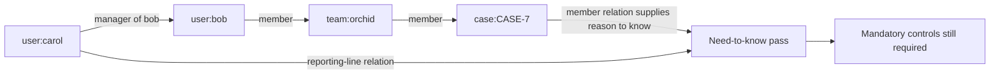
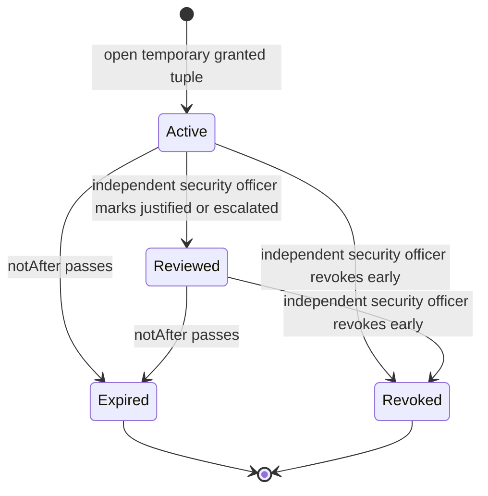

# Use relations and delegation safely

Relations describe why a particular subject has a reason to know a particular object, while delegation makes an agent act for one or more people. Both mechanisms narrow or explain access within the rest of the decision pipeline; neither replaces eligibility, mandatory controls, conditions, content rules, or separation of duty.

## On this page

- [Model relation tuples](#model-relation-tuples)
- [Resolve relation rewrites](#resolve-relation-rewrites)
- [Apply need-to-know modes](#apply-need-to-know-modes)
- [Evaluate every delegation link](#evaluate-every-delegation-link)
- [Open and review break-glass](#open-and-review-break-glass)

## Model relation tuples

A tuple records `object#relation@subject`, such as `case:CASE-14#allocated@user:bob`. With `subjectRelation`, the subject is a userset: `case:CASE-7#member@team:orchid#member` means members of the Orchid team, resolved through the team's own relation definition.

Tuples can carry `notBefore`, `notAfter`, `grantedBy`, and a human reason. This grant duration is a CBAC (context-based) control: a tuple counts only when the decision instant (`context.now`) is inside its window, including both endpoints. Outside it the tuple does not exist for that request; the explain trace shows a `cbac` step with outcome `skip` and `CBAC.GRANT_EXPIRED` or `CBAC.GRANT_NOT_YET` (`policyRule` `NTK.<relation>` for a direct relation grant, requirement `relationTuple`), and the decision is whatever the remaining grants give. The legacy fields `validFrom`/`validTo` are still read as the same window; `notBefore`/`notAfter` win when both are present. An invalid date bound makes the tuple inactive. For an ordinary `granted` or `allocated` proposal through the admin API (`add_tuple`, which accepts either name but refuses both names for one bound with 422, and stores `notBefore`/`notAfter`), an expiry is required within 90 days; future-start grants cannot be proposed before their effective time. Role assignments carry the same window: `roleAssignments: [{ role, notBefore?, notAfter? }]` on a subject (set through `update_subject`) adds a role only inside its window, traced the same way with `policyRule` = the role and requirement `roleAssignment`.

A `breakGlass` tuple must have finite start and end times and a positive duration no greater than `needToKnow.breakGlassMaxHours`. Otherwise it is not live. Sources: `packages/core/src/types.ts`, `packages/core/src/relations.ts`, `packages/pdp-http/src/admin/changes.ts`.

*Figure: Group and reporting-line paths supply reasons to know, not clearance or compartments.*

## Resolve relation rewrites

Each relation definition has a non-empty `union`. Any branch can establish the relation:

| Rewrite | Meaning |
|---|---|
| `{ "this": true }` | Match a direct tuple or a userset tuple. |
| `{ "computed": "other" }` | Resolve another relation on the same object. |
| `{ "fromParent": { "relation": "parent", "then": "member" } }` | Follow a live relation tuple to a parent object, then resolve the named relation there. |
| `{ "viaReports": { "managerRelation": "manager", "then": "direct_knows", "maxDepth": 20 } }` | Walk the reporting line from the candidate manager toward reports, then test the target relation for a report. |

`fromParent` uses relation tuples; it is separate from the resource's `parent` field used for classification inheritance. Reporting depth is validated from 1 through 50, and the general relation walk stops after 32 hops. Cycles do not create an allow. A successful check returns the tuple path for the explanation drawer.

Sources: `packages/core/src/relations.ts`, `packages/core/src/validate.ts`, `packages/core/src/mandatory.ts`.

## Apply need-to-know modes

The bundle protects selected resource types with a relation and an optional `minLevel`. Resources below that level do not need the relation; resources at or above it do. The three modes are:

- `off`: do not evaluate need-to-know.
- `dry_run`: record `wouldDeny` entries without denying access for a missing relation.
- `enforce`: deny a missing relation with `NTK.NO_REASON`.

A successful relation produces an `NTK.<relation>` basis entry. If any tuple in the successful path is break-glass, the engine also adds `NTK.BREAK_GLASS` and the configured notification obligation. All other denials still win. Sources: `packages/core/src/evaluate.ts`, `packages/core/src/relations.ts`.

## Evaluate every delegation link

A delegated agent names a person in `subject.attrs.delegatedBy`; the HTTP runtime hydrates that `user` subject as the agent's `delegator`. An agent without a delegator is malformed in the core. A delegator that cannot be found makes the agent inactive (`CORE.INACTIVE`). A cycle makes the repeated link inactive (`DELEGATION.INACTIVE`).

The engine evaluates the agent and then every delegator. Each must be active and must pass eligibility, mandatory controls, need-to-know, and ABAC (content attributes included). Denials after the first principal receive the `DELEGATION.` prefix. A mask remains unless every link is exempt. For two-person and conflict checks, actions performed for someone also count in that person's chain history. A certifier anywhere in the chain is denied the procedure they certified (`CW.CERTIFIER_EXECUTES`).

A chain may contain at most five principals: the initial subject plus four delegation links. Longer chains deny as malformed. Sources: `packages/core/src/request.ts`, `packages/core/src/evaluate.ts`, `packages/pdp-http/src/runtime.ts`.

## Open and review break-glass

Break-glass creates a temporary `granted` relation immediately; it does not create clearance, eligibility, integrity, or network access. An access administrator or security officer can open it, but cannot open it for themselves. The resource type must declare `granted`, and the admission decision must allow `read` with the temporary tuple in place. Any remaining denial prevents the grant from opening.

The console labels the window **Hours (1–4)**. The API accepts a finite number of hours greater than zero, capped by both 4 and the bundle's lower `breakGlassMaxHours`; the bundle validator itself allows a cap up to 24. The incident justification needs at least 20 characters. Admission defaults to a trusted-network evaluation, but subsequent requests use their own network context.

*Figure: Break-glass access expires by validity time; review records an outcome, and revocation removes the tuple.*

Only a security officer can review or revoke, and never their own emergency or one for which they are the subject. A review outcome is `justified` or `escalated` with a note; early revocation requires a reason of at least 20 characters and removes the tuple immediately. Expiry stops the relation through normal validity checking even before the periodic expiry notice runs.

The engine adds the bundle's break-glass notification recipients to allowed access through the emergency path. A separate optional signed HTTPS webhook reports open, revoke, and expiry events. Email and paging integrations are **Not available**. Sources: `packages/pdp-http/src/admin/break-glass.ts`, `packages/pdp-http/src/notify.ts`, `packages/pdp-http/src/server.ts`.

## Related pages

- [Understand mandatory controls](mandatory-controls.md)
- [Understand integrity and separation of duty](integrity-and-separation.md)
- [Open and review emergency access](../guides/security-officer.md)
- [Model relations in a policy bundle](../guides/policy-authoring.md)
