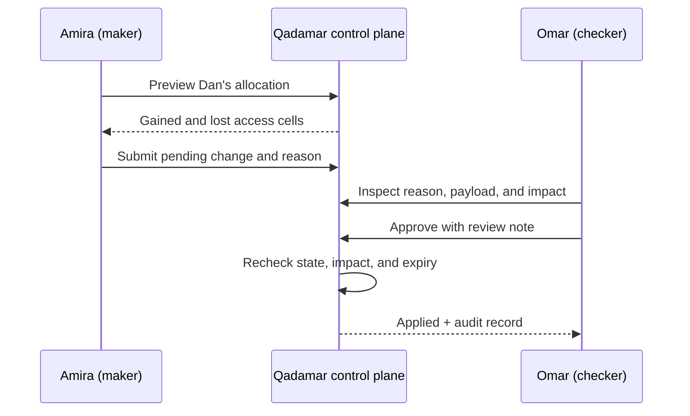

# Run the toy-domain demo

This walkthrough starts Qadamar in file mode on your machine, makes an authorized request with `curl`, and completes a relation-grant change through two-person approval. It uses only fictional demo data and a fresh data directory, so an existing Qadamar demo state is not reused. Every command and expected result on this page was run against the code at commit b09bc44 (after 0.3.0).

## On this page

- [Prepare the local server](#prepare-the-local-server)
- [Make the first decision with curl](#make-the-first-decision-with-curl)
- [Propose the first change](#propose-the-first-change)
- [Approve as a second person](#approve-as-a-second-person)
- [Stop or reset the demo](#stop-or-reset-the-demo)
- [Resolve common demo problems](#resolve-common-demo-problems)

## Prepare the local server

Allow about 10 minutes after the prerequisites are available. You need Node.js 22.18 or later and pnpm. The demo server listens on loopback by default.

1. From the repository root, install the workspace dependencies and build the console:

   ```bash
   pnpm install
   pnpm --filter @product/admin build
   ```

2. Start the PDP and console with the fictional toy domain and its fixed demonstration clock:

   ```bash
   DATA_DIR=data/handbook-demo \
   CLOCK=fixed:2026-11-08T10:00:00Z \
   RESOURCE_OWNERS='{"ruth":["carol"]}' \
   node packages/pdp-http/src/main.ts
   ```

   The fixed clock keeps the seeded relation and break-glass windows meaningful. `DATA_DIR=data/handbook-demo` creates a fresh state instead of reusing the default `data/runtime`.

3. Wait for `PDP listening at http://127.0.0.1:8787`.
4. Before signing in, open `data/handbook-demo/INITIAL-CREDENTIALS.txt` with a local editor and store the generated demo passwords and `pepApiKey` in your local secret store. The file is JSON (`passwords` per account, and `pepApiKey`), has mode 600, and is deleted after the first successful sign-in or one hour after creation, whichever comes first.

The generated accounts are `amira` (access administrator and policy author), `omar` (approver), `lina` (security officer), `ruth` (resource owner), and `sam` (auditor). They are local demonstration identities, not production accounts. Sources: `README.md`, `packages/pdp-http/src/auth.ts`.

After signing in, use **Language** in the sidebar to choose English, Français or العربية. The choice is remembered
for that user in the browser. Arabic places navigation on the right and keeps codes and numbers left-to-right.
A native Arabic review is still required before customer use. Keyboard users can reach the language buttons with
Tab and activate them with Enter or Space; on narrow screens open **Menu** first. Screen-reader validation still
requires a human; see [accessibility verification](../../ACCESSIBILITY.md) for scope and pending browser execution.

## Make the first decision with curl

Bob is an L2 investigator allocated to the L2 case `CASE-14`. On a trusted network, his inherited `viewer` role and live `allocated` relation allow `read`; the response also carries redaction and masking obligations.

1. Open a second terminal at the repository root and set the generated PEP key in it:

   ```bash
   export PEP_API_KEY='<pepApiKey from INITIAL-CREDENTIALS.txt>'
   ```

2. Send the evaluation from the same terminal:

   ```bash
   curl -sS http://127.0.0.1:8787/access/v1/evaluation \
     -H "Authorization: Bearer ${PEP_API_KEY}" \
     -H 'Content-Type: application/json' \
     --data '{
       "subject": { "type": "user", "id": "bob" },
       "action": { "name": "read" },
       "resource": { "type": "case", "id": "CASE-14" },
       "context": { "network": "trusted" }
     }'
   ```

3. Confirm that the response contains:

   ```json
   {
     "decision": true,
     "context": {
       "rules": ["RBAC.viewer", "NTK.knows"],
       "obligations": {
         "redact": ["informant_name"],
         "maskClasses": ["finance.amount"],
         "notify": []
       }
     }
   }
   ```

   The full response also contains `reasons`, `policy_version`, and `would_deny`. Rule order follows the engine's evaluation order. The PDP, not the caller, supplies Bob's role, clearance, integrity, and relations.

4. Optional: remove `context` or set its network to `untrusted` and repeat. The decision stays `true`: `CASE-14` is L2, within the untrusted-network ceiling, has no compartments, and the toy rule `no-export-untrusted` affects only `export`. For a denial, change the resource to `CASE-7`: the decision is `false` with `BLP.NO_READ_UP`, `MAC.COMPARTMENT` and `NTK.NO_REASON`, because Bob lacks its L3 level, the `ORCHID` compartment and a relation to it.

Sources: `examples/toy-domain/world.json`, `examples/toy-domain/bundle.json`, `packages/pdp-http/src/pdp.ts`.

## Propose the first change

Dan has the `security_officer` policy role and L3 clearance, but no live reason to know `CASE-14`. A short allocation gives him that reason without changing his clearance or roles.

1. Open `http://127.0.0.1:8787` and sign in as `amira` with her generated password.
2. Open **Simulator** and select **Impact of a change**.
3. Under **Change type**, select **Grant a relation**.
4. Set the fields as follows:

   | Console field | Value |
   |---|---|
   | **Subject** | **Dan — Security office (L3 Secret · FALCON)** |
   | **Relation** | `allocated` |
   | **Resource** | **Procurement irregularities (CASE-14) · L2 Confidential** |
   | **Subject relation (optional)** | Leave empty |
   | **Valid until (≤ 90 days)** | `2026-11-30` |

5. Select **Preview impact**. In **Gained access**, find Dan's `read` on `CASE-14`; the previous denial is `NTK.NO_REASON`. Other subjects do not gain access merely from Dan's tuple.
6. Open **Explain** on that row to inspect the current-state trace. The impact table is the before/after comparison; the explanation drawer evaluates the current published state, not a separate candidate-state trace.
7. Under **Reason for change (at least 20 characters)**, enter a specific justification such as `DEMO-101 Assign Dan to review procurement controls`.
8. Select **Submit for approval**. The change is now `pending`; it has not applied.

The console requires a preview of the current candidate before enabling submission. Changing any field invalidates that preview. Sources: `apps/admin/src/screens/SimulatorImpactPane.tsx`, `apps/admin/src/utils/useChangePreview.ts`, `packages/pdp-http/src/admin/changes.ts`.

## Approve as a second person

1. Sign out as Amira and sign in as `omar`.
2. Open **Approvals** and keep **Pending** selected.
3. Select the new **Grant access** change. Check the maker, reason, payload, state digest, and **Gained access** table.
4. Under **Review note or rejection reason (required)**, enter `DEMO-101 Verified allocation, expiry, and access impact`.
5. Select **Approve**. The change becomes **Applied**, and Dan's allocation is now live.
6. To verify, repeat the curl evaluation with `"id": "dan"` as the subject. The decision is `true` with an `NTK.knows` basis. Amira could not approve her own proposal; Omar is the independent second person.

Approval revalidates the state digest, impact, and grant expiry. If anything relevant changed after submission, approval returns `stale` and the maker must submit a fresh proposal. Source: `packages/pdp-http/src/admin/changes.ts`.



*Figure: A change applies only after an independent checker approves the exact proposal.*

## Stop or reset the demo

Stop the server with Ctrl+C. The state remains in `data/handbook-demo`, so restarting the same command resumes the demo with its applied change.

For a clean walkthrough, stop the server and choose a new directory, for example `DATA_DIR=data/handbook-demo-2`. Do not delete a state directory unless you are certain that its demo or operational data is disposable.

## Resolve common demo problems

- **The console returns 404 or an empty shell:** run `pnpm --filter @product/admin build` before starting the PDP, then restart it.
- **The initial credential file is gone:** it was deleted after a successful sign-in or its lifetime expired. Use the secrets you stored, or start with a fresh `DATA_DIR` for a disposable demo.
- **The port is already in use:** the server exits if `127.0.0.1:8787` is taken. Set another port, for example `PORT=8811`, and use that port in the browser and curl URL.
- **A grant is denied or has no gained access:** check clearance, compartments, network, integrity, existing relations, and action eligibility. A relation alone does not create an allow.
- **Approval says the proposal is stale:** preview and submit a new change from current state; do not reuse the old proposal.
- **Ruth sees no resources:** keep `RESOURCE_OWNERS='{"ruth":["carol"]}'` in the demo command. Resource-owner scope comes from the authenticated id and this explicit mapping.

Sources: `packages/pdp-http/src/server.ts`, `packages/pdp-http/src/runtime.ts`, `packages/pdp-http/src/static.ts`.

## Related pages

- [Understand the decision model](../concepts/decision-model.md)
- [Propose other access changes](access-administrator.md)
- [Review changes as an approver](approver.md)
- [Integrate the first PEP](integrator.md)
