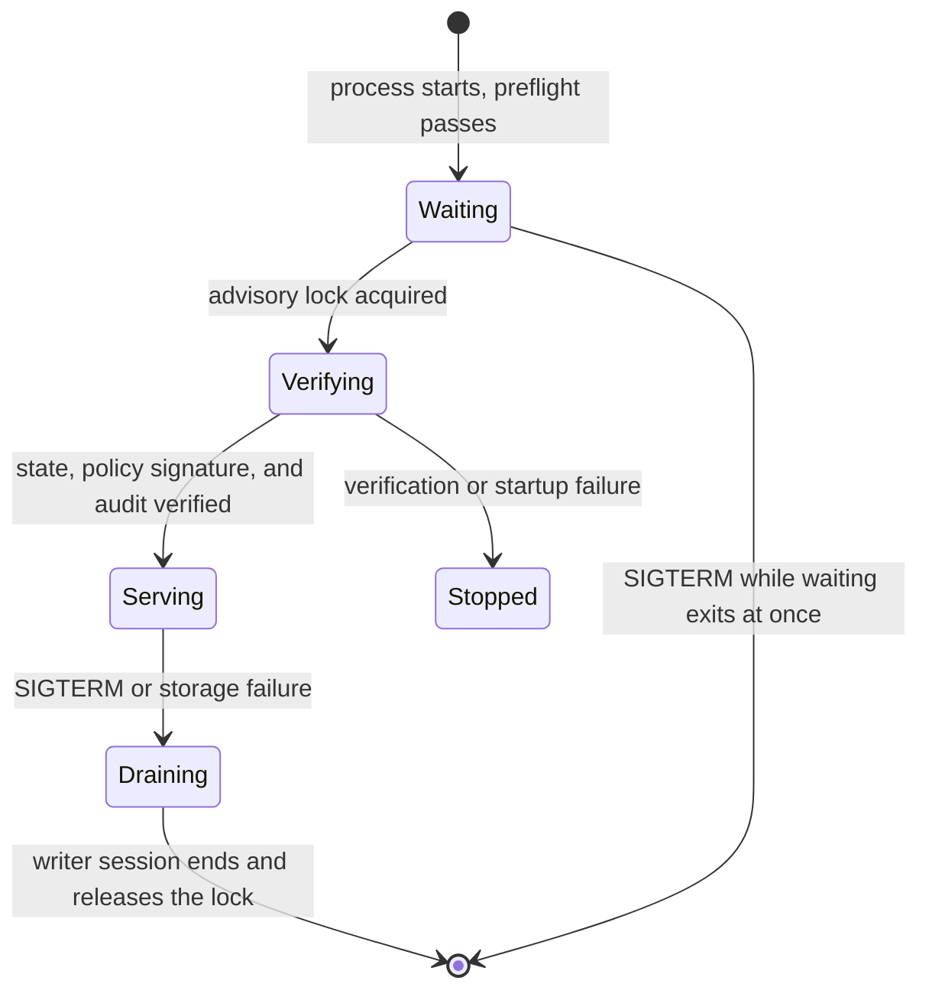

# Fail over the active node

Qadamar has two PostgreSQL topologies, and each has its own failover. In active/standby mode, a waiting process takes the PostgreSQL advisory lock from the active process, reloads shared state, and then opens its HTTP port. In cluster mode, every node keeps deciding and only the leader role, which serves the admin plane, moves. This runbook covers both, for the code at commit b09bc44 (after 0.3.0). It does not provide database failover.

## On this page

- [Understand the failover boundary](#understand-the-failover-boundary)
- [Prepare a planned takeover](#prepare-a-planned-takeover)
- [Perform a planned takeover](#perform-a-planned-takeover)
- [Leader change in cluster mode](#leader-change-in-cluster-mode)
- [Respond to an unplanned failure](#respond-to-an-unplanned-failure)
- [Return the old node as standby](#return-the-old-node-as-standby)
- [Troubleshoot takeover](#troubleshoot-takeover)

## Understand the failover boundary

*Figure 1. Active/standby mode: a waiting process serves only after it holds the lock and has completed startup verification.*

The active process holds the advisory lock on its writer connection. A standby blocks in `PgLedger.open()` before listening, so it has no HTTP port (`packages/pdp-http/src/postgres.ts`). After it acquires the lock, it loads documents, anchors, credentials, and the keyring, verifies the policy signature and the audit, then starts its timers and opens its port (`packages/pdp-http/src/server.ts`).

A waiting standby exits at once on SIGTERM or SIGINT: the handlers are registered before the node waits for the lock (`packages/pdp-http/src/main.ts`). Before this fix, a standby running as PID 1 in a container ignored SIGTERM, could take the lock while it was being stopped, and held it until it was forced to stop. During a Kubernetes rollout that left no active node for 30 seconds (`CHANGELOG.md`).

Every profile, production included since 0.5.0, starts from the authenticated checkpoint and verifies the full chain in the background: `/readyz` reports `audit.fullChain: false` and `gate_audit_full_chain_verified` is 0 until that ends. Pending OIDC logins, rate-limit buckets, and logout replay IDs are process-local and do not transfer. Console sessions do: with PostgreSQL they are rows of `gate_session`, keyed by the hash of the session id.

Database replication and failover are outside this runbook. If the primary is unavailable, or a lagging replica is promoted, Qadamar cannot provide its consistency or tamper-detection guarantees.

## Prepare a planned takeover

1. Confirm every node runs the intended artifact and shares the same `DATABASE_URL` and `SIGNING_KEY_SEAL`.
2. Confirm the active node's `/readyz` returns 200 and its authenticated `/metrics` reports `gate_active_node 1`.
3. Confirm the standby process is running and waiting. Its closed port is expected, not a failed readiness check.
4. Confirm a recent backup and a tested restore. Preserve the current JWKS, latest anchors, and policy publication.
5. Check that no unreviewed database migration or artifact change is pending: takeover runs startup logic under the waiting node's binary.
6. Tell console users they must sign in again. Ask administrators to pause proposals and SCIM writes during the cutover.
7. Make sure the load balancer health-checks each node's listener and does not restart the waiting process because its port refuses connections.
8. Prepare a known authenticated PEP evaluation to run after takeover.

In the supplied Compose file, `gate-active` and `gate-standby` are service names, not fixed roles. Check which one listens (`docker-compose.yml`).

## Perform a planned takeover

1. **Record starting evidence.** Capture the audit head, current policy version, latest anchor, signing key list, and pending changes.
2. **Stop the active node gracefully.** Send SIGTERM through its supervisor. Qadamar stops accepting connections, lets in-flight requests finish, closes idle connections, waits for queued ledger work, and ends its writer session, which releases the lock (`packages/pdp-http/src/server.ts`, `postgres.ts`).
3. **Wait for the standby.** Do not acquire or release the advisory lock by hand. The standby takes it after the old writer session ends.
4. **Watch startup.** In production the full audit scan completes before the port opens. Do not bypass verification to shorten downtime.
5. **Verify storage identity.** Confirm from the logs that the node opened the intended database. A different or empty store is a stop condition.
6. **Check readiness.** `GET /readyz` returns 200 with `"active":true` and `"audit":{"verified":true}`.
7. **Check decision integrity.** Run the known PEP evaluation and compare its decision and policy version. If the application uses certified commands, consume a test decision token.
8. **Check shared security state.** Named PEP credentials, signing keys, SCIM credential source, and SIEM cursor match the pre-takeover records. They are stored in PostgreSQL, so nothing is copied between nodes.
9. **Check audit continuity.** `GET /admin/v1/audit/verify` returns `verified: true`, and a new decision increases `gate_audit_length` without a sequence reset.
10. **Resume traffic.** Re-enable administration and SCIM. Console users sign in again on the new active node.
11. **Check outbound work.** SIEM batches continue from the stored cursor, new anchors are created, and break-glass notices are delivered.

Requests in flight when the old listener closes can fail; clients retry only operations that are safe to retry. After a token-consumption timeout, both the consumption and the upstream outcome are unknown. Reconcile PDP audit and performed-action history with application state before retrying, and do not reuse the token or issue another non-idempotent command blindly.

## Leader change in cluster mode

With `GATE_CLUSTER=true`, every node decides and holds only its own node lock; the leader also holds the leader lock (`packages/pdp-http/src/postgres.ts`).

What happens when the leader stops:

1. Its writer session ends and PostgreSQL releases the leader lock.
2. Followers keep answering PDP requests on the shared state. Each one checks the shared state on every poll (`GATE_MAX_STALENESS_MS / 4`, between 20 and 500 ms; 500 ms by default) and on PostgreSQL `LISTEN/NOTIFY`.
3. On a poll, a follower tries the leader lock. The first to get it reloads the metadata and a full ordered record snapshot plus anchors, writes its `GATE_ADVERTISE_URL` to `gate_sync`, and logs `Node <id> took the leader lock: the admin plane is served here`. If it cannot load and verify them, it releases the lock so that another node can lead. Ordinary follower catch-up before this used the incremental change log; takeover deliberately uses the full snapshot.
4. The new leader answers 200 on `GET /leaderz`. The load balancer moves `/admin/` and `/scim/` to it. Other followers now return the new leader's address in their `409 not_leader` answers.
5. Console users stay signed in: the new leader reads their sessions from `gate_session`. Only a sign-in in progress at the IdP during the failover has to start again.

Rules that hold throughout:

- **Admin plane on the leader only.** A follower answers every `/admin/` and `/scim/` request, read or write, with `409` and `{"error":"not_leader","message":"...","leader":<advertised URL or null>}`. It writes no audit row for it (`packages/pdp-http/src/router.ts`).
- **Staleness bound.** A node that has not confirmed the shared state within `GATE_MAX_STALENESS_MS` (default 2000 ms) answers PDP requests with `503 unavailable` and fails `/readyz` until a sync succeeds. PEPs can retry another node.
- **Leader-only background work.** Anchoring, SIEM export, break-glass expiry notices, and pruning of expired decision tokens run only on the leader (`packages/pdp-http/src/server.ts`, `postgres.ts`).
- **One process per node id.** A second process with an id already in use waits, like a standby, until the first stops.

To change the leader on purpose, send SIGTERM to the leader, confirm that exactly one other node returns 200 on `/leaderz`, run `GET /admin/v1/audit/verify` through it, and then restart the old node; it returns as a follower. Test observations of this transition are in [Capacity and performance](capacity.md#multi-node-scaling-in-cluster-mode).

## Respond to an unplanned failure

1. **Identify the failed boundary.** Qadamar process, host, database writer connection, audit integrity, or the upstream application.
2. **Do not restart-loop the failed node.** After a storage failure the node exits on purpose, because its memory may be ahead of PostgreSQL. The log line is `Storage failure, stopping:` (`packages/pdp-http/src/main.ts`).
3. **Check the standby's logs and listener,** or in cluster mode `/leaderz` on the other nodes. A crash releases the locks when PostgreSQL sees the connection close. When a host disappears without closing its connections, the locks are released only when the database server's TCP keepalive gives up; configure server-side keepalives on the database. Qadamar sets client keepalive on its own connections with a 10-second initial delay (`packages/pdp-http/src/postgres.ts`).
4. **Withhold traffic until verification completes.** A listener without ready status is not a healthy node.
5. **If audit verification fails, stop normal recovery.** Follow [Respond to an audit tamper alert](audit-tamper-response.md). Do not clear checkpoints, remove anchors, or adopt a policy merely to start.
6. **If the database is unavailable, recover the database first.** Starting more Qadamar processes cannot replace primary recovery and adds connection pressure.
7. **After service returns, compare independent evidence.** Check the SIEM's last sequence and the TSA anchors against the recovered heads for gaps or forks.
8. **Review in-flight certified actions.** A token can be consumed before the upstream command failed. Reconcile performed-action history with application logs before relying on later separation-of-duty decisions.

## Return the old node as standby

1. Preserve its logs and diagnose the original failure before reusing the host or process.
2. Confirm it has the same artifact, database endpoint, seal, and production settings as the serving node.
3. Leave `DATA_DIR` alone. In PostgreSQL mode, credentials and keyring come from shared documents; local files are not authoritative after the one-time import.
4. Start it. In active/standby mode, confirm it blocks without opening a port; if it opens a second listener, stop one node at once and check the lock configuration. In cluster mode, confirm it returns 503 on `/leaderz` and 200 on `/readyz`.
5. Run a second planned takeover only if your change policy requires proof of recovery in both directions.
6. Restore monitoring for both nodes. A waiting standby's closed port is not an availability incident by itself.

## Troubleshoot takeover

| Symptom | Likely boundary and action |
| --- | --- |
| Standby never opens a port | Check whether the old writer session is still alive, whether the process is waiting on the advisory lock, and whether the load balancer probes the right port. Do not restart PostgreSQL to force takeover. |
| A waiting standby ignores SIGTERM and takes the lock while stopping | The build predates the SIGTERM fix. Upgrade to the code at commit b09bc44 (after 0.3.0). |
| New node exits on a storage error | Check primary connectivity and service-role privileges. Keep it out of service until writes and rechecks succeed. |
| Policy signature failure | Verify the database and keyring provenance. Follow the reviewed adoption procedure in [Upgrade Qadamar](upgrade.md) only if the bundle is trusted. |
| Audit checkpoint or MAC failure | Treat it as integrity evidence. Preserve the store and follow the tamper runbook. |
| Production takeover takes longer than expected | Full-chain verification grows with audit length. Measure the scan; do not run production with the demo profile to shorten it. |
| Console users receive 401 | Not caused by the failover: the session ended (logout, 15 minutes idle, 8 hours, back-channel logout). Sign in again. If every user gets 401 at once, check that the nodes' clocks agree (limits run on each node's wall clock). |
| OIDC callback fails after takeover | Start a new login. Pending login state is sealed by a per-process key. |
| SIEM resends a batch | Expected after a crash between the receiver's 2xx and cursor persistence. Deduplicate by sequence; do not reset the cursor. |
| Two nodes listen in active/standby mode | Stop traffic to one and check the database endpoint and lock configuration. Only one lock holder per database is possible. |
| Cluster: `409 not_leader` with `"leader":null` | `GATE_ADVERTISE_URL` is not set on the leader. Route admin traffic by `/leaderz` instead. |
| Cluster: no node returns 200 on `/leaderz` | Followers take the lead on their next poll. If none does, check the logs for `Leader takeover failed` and database connectivity. |
| Cluster: a node returns `503 unavailable` on decisions | The node is past its staleness bound. Check its logs for `State sync connection lost` or `State sync failed`; it reconnects on the next poll. |

## Related pages

- [Data and storage](../architecture/data-and-storage.md)
- [Deploy Qadamar](deploy.md)
- [Upgrade Qadamar](upgrade.md)
- [Monitoring and alerts](monitoring.md)
- [Back up and restore](backup-restore.md)
- [Capacity and performance](capacity.md)
- [ADR: PostgreSQL single active node](../architecture/decisions/0003-postgresql-single-active-node.md)
